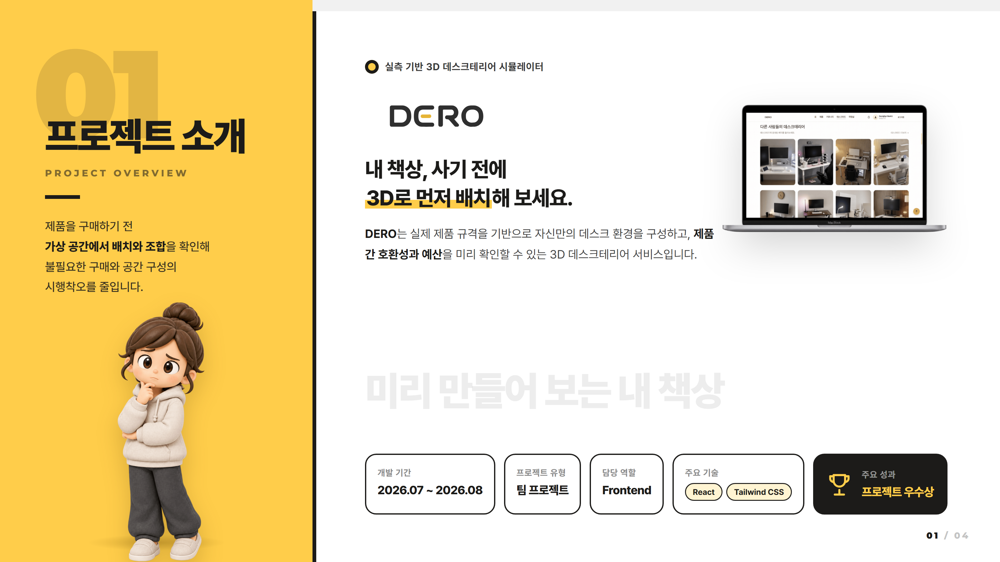
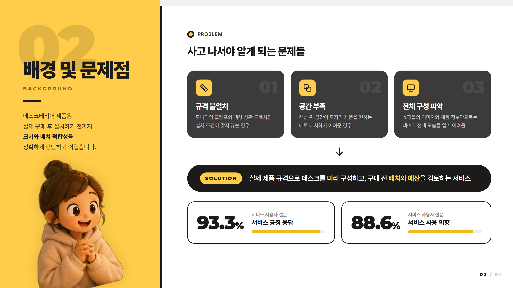
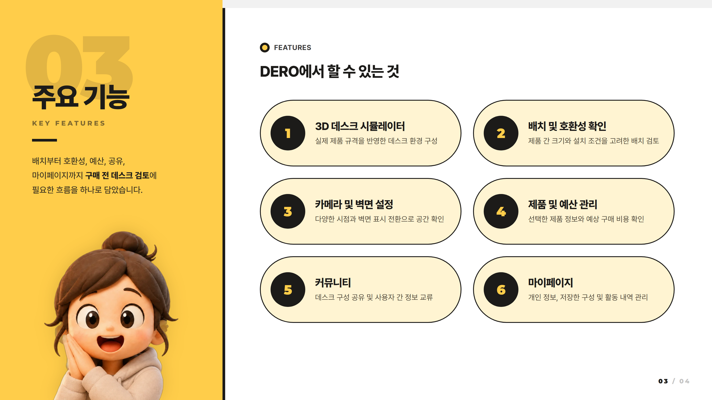
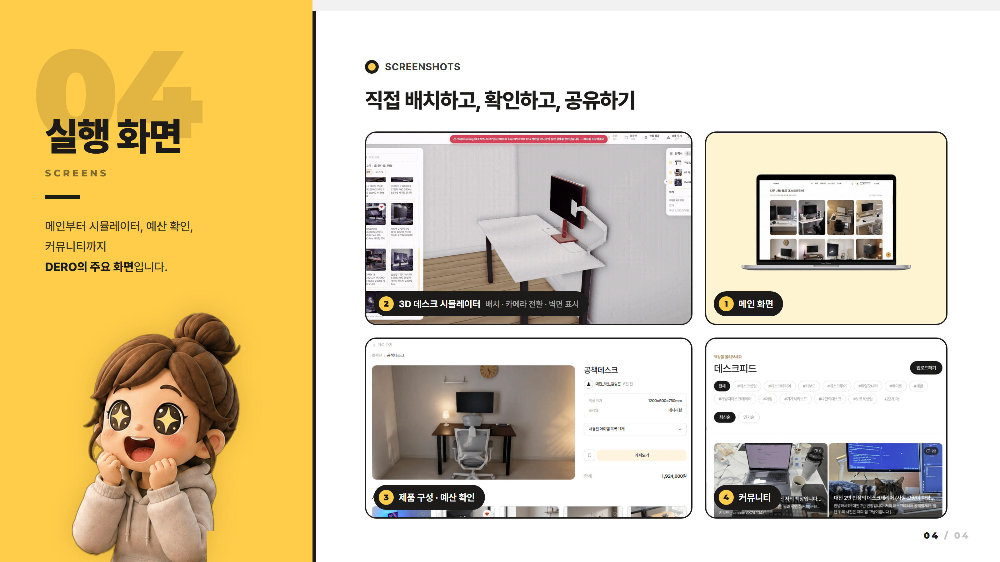

# 🖥️ DERO — 실측 기반 3D 데스크테리어 시뮬레이터

> **내 책상, 사기 전에 3D로 먼저 배치해 보세요.**
> 실제 제품 규격을 기반으로 데스크 환경을 구성하고, 제품 간 호환성과 예산을 미리 확인하는 3D 데스크테리어 서비스입니다.

| 항목 | 내용 |
|---|---|
| 개발 기간 | 2026.07 ~ 2026.08 |
| 프로젝트 유형 | 팀 프로젝트 |
| 담당 역할 | Frontend |
| 주요 기능 | 실측 스펙 기반 3D 배치 · 호환성 검증 · 예산 확인 |
| 주요 기술 | React · Tailwind CSS (서비스: Spring Boot · Next.js · Three.js) |
| 주요 성과 | 🏆 프로젝트 우수상 |

## 01. 프로젝트 소개

## 02. 배경 및 문제점

## 03. 주요 기능

## 04. 실행 화면

## 05. 담당 역할

### Frontend (2026.07 ~ 08)

- React 기반 프론트엔드 개발 및 화면 구성
- 프론트엔드 개발 환경을 React 기반으로 전환하는 작업 참여
- Tailwind CSS 설치 및 UI 개발 환경 구성
- 마이페이지 5개 화면의 구조 및 UI 설계
- 페이지별 UI 요소와 사용자 동선을 고려한 화면 구성
- 프론트엔드 개발 과정에서 발생한 문제 분석 및 개선 방향 검토

## 06. 기술 스택 및 선정 이유

| 기술 | 선정 이유 |
|---|---|
| React | 컴포넌트 기반 구조를 통한 화면 개발 및 UI 재사용 |
| JavaScript | 사용자 이벤트 처리 및 동적 화면 구성 |
| Tailwind CSS | 유틸리티 클래스 기반의 빠른 스타일 적용과 일관된 UI 관리 |
| HTML / CSS | 웹페이지 구조 및 레이아웃 구성 |

## 07. 기술 구현 정보

### 1) React 기반 프론트엔드 구조

React를 활용하여 서비스의 화면을 컴포넌트 단위로 구성하는 개발 환경을 구축했습니다.

페이지별 기능과 UI 요소를 구분하여 개발하고, 공통으로 활용할 수 있는 레이아웃과 구성 요소를 고려했습니다.

**주요 작업**

- React 기반 프로젝트 환경 구성
- 페이지 및 UI 컴포넌트 구조 검토
- 화면별 사용자 인터페이스 구성
- 컴포넌트 재사용을 고려한 화면 설계

### 2) Tailwind CSS 기반 UI 구성

Tailwind CSS를 도입하여 스타일을 효율적으로 적용할 수 있는 프론트엔드 개발 환경을 구성했습니다.

화면별 레이아웃과 간격, UI 요소의 표현 방식을 일관되게 관리하는 데 중점을 두었습니다.

**주요 작업**

- Tailwind CSS 설치 및 설정
- UI 요소별 스타일 적용 구조 검토
- 화면 간 레이아웃 및 디자인 일관성 고려

### 3) 마이페이지 UI 설계

마이페이지를 구성하는 5개 화면의 구조를 설계하며 사용자 정보 및 활동 데이터를 효율적으로 확인할 수 있는 UI를 검토했습니다.

- 화면별 주요 정보와 기능 분류
- 메뉴 및 콘텐츠 영역 구성
- 페이지 간 이동 흐름 검토
- 사용자 관점의 정보 배치와 조작 편의성 고려

### 4) 3D 서비스의 사용자 인터페이스

DERO는 사용자가 3D 공간에서 제품을 선택하고 배치하는 서비스이므로 일반적인 정보 조회 페이지와 달리 다양한 조작 기능을 제공합니다.

제품 선택, 카메라 전환, 벽면 표시 등의 기능을 사용자가 쉽게 이해하고 접근할 수 있도록 하는 인터페이스가 중요했습니다.

이를 통해 3D 기능 자체뿐 아니라 사용자가 기능을 편리하게 사용할 수 있도록 화면을 구성하는 프론트엔드 설계의 중요성을 이해했습니다.

## 08. 트러블슈팅 및 기술적 과제

### 1) 프론트엔드 개발 환경 전환

**과제**

프로젝트 개발 과정에서 프론트엔드 환경을 React 기반으로 변경하면서 기존 화면 구성 방식과 프로젝트 구조를 재검토해야 했습니다.

**대응 과정**

React의 컴포넌트 기반 개발 방식에 맞춰 화면 구조와 UI 구성 방법을 검토하고, 개발 환경 설정 및 실행 과정을 확인했습니다.

**학습 내용**

프레임워크가 변경될 경우 단순한 문법 변경뿐 아니라 컴포넌트 구조와 화면 구성 방식도 함께 고려해야 한다는 점을 배웠습니다.

### 2) UI 스타일 관리 및 일관성 확보

**과제**

여러 화면을 개발하는 과정에서는 페이지별 스타일이 달라지기 쉬워 일관된 UI 구성 방식이 필요했습니다.

**대응 과정**

Tailwind CSS를 적용할 수 있는 개발 환경을 구성하고, 공통 스타일과 레이아웃 기준을 활용하는 방식을 검토했습니다.

**학습 내용**

개별 화면의 스타일 구현뿐 아니라 서비스 전체에서 일관된 사용자 경험을 제공할 수 있도록 UI 구조를 관리하는 것이 중요하다는 점을 학습했습니다.

### 3) 마이페이지 화면 및 정보 구성

**과제**

마이페이지에는 여러 종류의 사용자 정보와 활동 내역이 포함되어 있어, 기능별로 화면을 구분하고 직관적인 이동 흐름을 설계할 필요가 있었습니다.

**대응 과정**

마이페이지를 5개 화면으로 구분하여 각 화면의 정보와 기능을 정리하고, 메뉴 구조와 화면 이동 흐름을 검토했습니다.

**학습 내용**

프론트엔드 개발에서는 기능 구현뿐 아니라 사용자가 원하는 정보에 쉽게 접근할 수 있도록 화면 구조를 설계하는 과정도 중요하다는 점을 배웠습니다.

## 09. 학습 내용 및 회고

### 학습한 내용

- React 기반 컴포넌트 개발 및 화면 구성
- 프론트엔드 프로젝트 환경 설정과 구조 이해
- Tailwind CSS를 활용한 UI 스타일 관리
- 마이페이지 등 다중 화면의 구조 및 사용자 동선 설계
- 3D 시뮬레이터를 포함한 웹 서비스의 사용자 인터페이스 구성

### 회고

이번 프로젝트에서는 React 기반 프론트엔드 개발에 참여하면서 컴포넌트 구조와 UI 설계에 대한 이해를 높일 수 있었습니다.

특히 기존 개발 환경을 변경하고 Tailwind CSS를 도입하는 과정을 통해 프로젝트 설정과 화면 개발 구조의 중요성을 배웠습니다.

또한 마이페이지의 여러 화면을 설계하며 **기능을 구현하는 것뿐 아니라 사용자가 정보를 쉽게 확인하고 서비스를 직관적으로 이용할 수 있도록 구성하는 과정**이 중요하다는 점을 느꼈습니다.

향후에는 컴포넌트 재사용성과 코드 유지보수성을 높이고, 다양한 화면 크기에서도 일관된 사용자 경험을 제공할 수 있는 프론트엔드 개발 역량을 강화하고자 합니다.

## 10. 출처 및 라이선스

### 참고 자료 및 외부 리소스

- [React](https://react.dev/) — 프론트엔드 개발
- [Tailwind CSS](https://tailwindcss.com/) — UI 스타일링
- 3D 제품 모델 및 텍스처 — 실제 사용한 에셋의 제작자 및 라이선스 표기
- 제품 이미지 및 규격 정보 — 실제 활용한 데이터 제공처 표기

### 라이선스

본 프로젝트는 교육 및 포트폴리오 목적으로 제작되었습니다.

소스 코드의 공개 및 오픈소스 라이선스 적용 여부는 팀의 공개 정책에 따릅니다.
