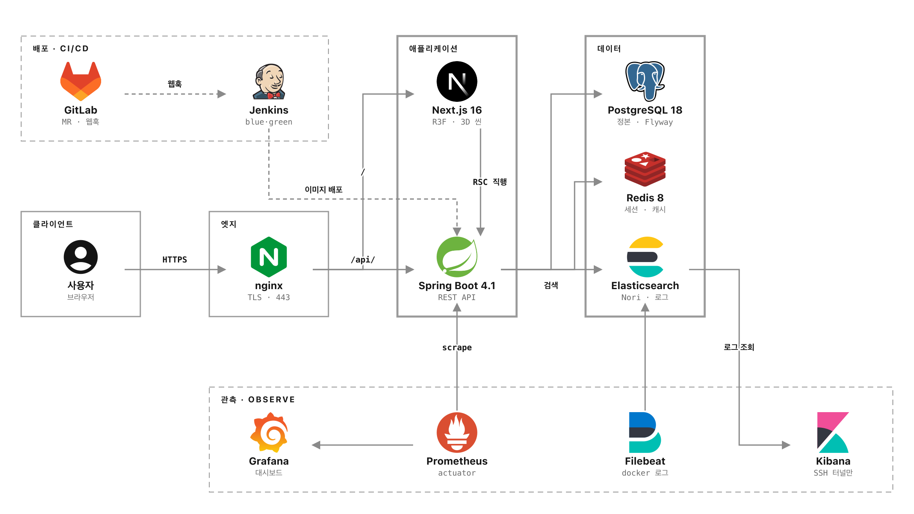

# 🖥️ DERO — 실측 기반 3D 데스크테리어 시뮬레이터

<p align="center">
  
  
  
  
</p>

<details>
<summary>01~04 슬라이드 텍스트 보기</summary>

### 01. 프로젝트 소개

**DERO는 실제 제품 규격을 기반으로 자신만의 데스크 환경을 미리 구성하고, 제품 간 호환성과 예산을 확인할 수 있는 3D 데스크테리어 시뮬레이션 서비스입니다.**
실제 제품을 구매하기 전에 3D 공간에서 배치와 조합을 확인하여 불필요한 구매와 공간 구성의 시행착오를 줄이는 것을 목표로 개발했습니다.

| 항목 | 내용 |
|---|---|
| 프로젝트명 | DERO (데로) |
| 개발 기간 | 2026.07 ~ 2026.08 |
| 프로젝트 유형 | 팀 프로젝트 |
| 주요 기술 | React, TypeScript, Tailwind CSS, 3D GLB 에셋 |
| 주요 성과 | 프로젝트 최우수상 |

### 02. 배경 및 문제점

데스크테리어 제품은 실제로 구매하고 설치하기 전까지 크기와 색상, 제품 간 호환성을 정확하게 파악하기 어렵습니다. 특히 모니터암의 규격 불일치, 제품 간 공간 간섭, 예상 예산 초과 등의 문제로 추가적인 비용이 발생할 수 있습니다.
이를 해결하기 위해 실제 제품의 규격과 가격을 기반으로 구매 전 데스크 환경을 검토할 수 있는 3D 시뮬레이터를 기획했습니다. 사전 사용자 설문에서는 배치 미리보기 기능에 대한 긍정 응답이 **93.3%**, 서비스 사용 의향이 **88.6%** 로 나타났습니다.

### 03. 주요 기능

| 기능 | 설명 |
|---|---|
| 3D 데스크 시뮬레이터 | 실제 제품 크기를 반영한 데스크 환경 구성 |
| 제품 배치 및 호환성 검토 | 제품 간 크기와 설치 조건을 고려한 배치 확인 |
| 다중 카메라 시점 | 1인칭, 3인칭, 탑뷰, 후면뷰 제공 |
| 벽면 표시 전환 | 좌·우·앞 3면의 벽을 개별적으로 표시 및 숨김 |
| 예산 관리 | 선택한 제품의 가격을 바탕으로 예상 비용 확인 |
| 커뮤니티 | 데스크 구성 공유 및 사용자 간 정보 교류 |

### 04. 실행 화면

메인 화면 · 3D 데스크 시뮬레이터 · 제품 구성 및 예산 확인 · 커뮤니티

</details>

## 05. 담당 역할

**조규홍 — Frontend 개발**

- React 기반 프론트엔드 개발 작업 참여
- TypeScript 및 Tailwind CSS를 활용한 UI 개발 환경 구성
- 마이페이지의 주요 메뉴 및 화면 구조 설계 검토
- 프론트엔드 실행 환경 구성 및 UI 컴포넌트 관련 문제 분석

## 06. 기술 스택 및 선정 이유

| 기술 | 선정 이유 |
|---|---|
| React | 컴포넌트 재사용과 사용자 상호작용이 많은 UI 구현 |
| TypeScript | 타입 검사를 통한 데이터 구조 관리 및 코드 안정성 향상 |
| Tailwind CSS | 공통 스타일 적용과 UI 개발 효율성 확보 |
| GLB | 3D 제품 모델의 형상과 재질 정보를 효율적으로 관리 |
| Spring Boot | REST API 및 서버 측 비즈니스 로직 구성 |
| PostgreSQL | 사용자·상품·커뮤니티 등 관계형 데이터 관리 |
| Flyway | 데이터베이스 스키마 변경 이력 관리 |

## 07. 기술 구현 정보

### 1) 실측 기반 3D 데스크 시뮬레이터

제품의 실제 크기 정보를 활용하여 3D 공간에서 배치 상태를 확인할 수 있도록 구성했습니다.
사용자가 제품의 위치와 조합을 변경하면서 책상 공간에 적합한 구성을 미리 검토하는 방식입니다.

### 2) 카메라 프리셋 및 벽면 전환

3D 공간에서 다양한 시점으로 데스크를 확인할 수 있도록 네 가지 카메라 프리셋을 구성했습니다.

- **1인칭 뷰:** 실제 사용자의 시선에서 배치 확인
- **3인칭 뷰:** 전체 데스크 구성 확인
- **탑뷰:** 제품 간 간격과 공간 활용 확인
- **후면뷰:** 모니터암 및 케이블 정리 공간 확인

또한 좌·우·앞 벽면을 개별적으로 표시하거나 숨길 수 있도록 하여 시야를 확보하고 배치 상태를 쉽게 확인할 수 있도록 했습니다.

### 3) 제품 규격 및 예산 정보 활용

제품별 크기, 가격, 설치 조건 등의 정보를 활용하여 데스크 구성에 필요한 정보를 제공하도록 설계했습니다.
이를 통해 단순한 3D 배치를 넘어 실제 구매 과정에서 발생할 수 있는 호환성 문제와 예산 초과를 사전에 검토하는 것을 목표로 했습니다.

### 4) 웹 서비스 구조

React 기반 프론트엔드와 Spring Boot 기반 백엔드를 분리하고, 제품·사용자·커뮤니티 정보를 관리하는 구조로 개발했습니다.
데이터베이스는 PostgreSQL을 활용하고, Flyway를 통해 스키마 변경을 관리하는 방식으로 구성했습니다.

<p align="center">
  
</p>

## 08. 트러블슈팅

### 1) 3D 환경에서의 시야 확보 문제

- **문제** — 실제 공간과 유사하게 벽을 구성하면 일부 시점에서 제품이 가려져 배치 상태를 확인하기 어려웠습니다.
- **해결 과정** — 네 가지 카메라 프리셋과 벽면별 표시 전환 기능을 적용하여 사용자가 상황에 맞게 시점을 변경할 수 있도록 구성했습니다.
- **결과 및 학습** — 실제 공간의 구조를 유지하면서도 제품 배치를 쉽게 확인할 수 있는 UI의 중요성을 이해했습니다.

### 2) 대용량 3D 에셋 처리

- **문제** — 3D 제품 모델의 용량이 커질수록 로딩 시간과 렌더링 성능에 영향을 줄 수 있어 최적화가 필요했습니다.
- **검토 과정** — GLB 모델의 크기와 전송 방식을 확인하고, 모델 압축 및 텍스처 최적화와 같은 개선 방법을 검토했습니다.
- **학습 내용** — 3D 웹 서비스에서는 모델의 시각적 품질뿐 아니라 파일 크기, 네트워크 전송량, 렌더링 성능을 함께 고려해야 한다는 점을 학습했습니다.

## 09. 학습 내용 및 회고

### 학습한 내용

- React와 TypeScript 기반 프론트엔드 개발
- Tailwind CSS를 활용한 컴포넌트 스타일 관리
- 3D 모델 파일 구조 및 웹 환경에서의 에셋 처리 방식
- 사용자 관점의 카메라 및 3D 인터페이스 설계
- 프론트엔드와 백엔드가 분리된 서비스 구조 이해

### 회고

이번 프로젝트에서는 기존의 일반적인 웹 UI와 달리, 사용자가 3D 공간에서 직접 제품을 배치하고 확인하는 서비스의 개발 과정을 경험했습니다.
특히 **사용자의 조작 편의성과 3D 모델의 시각적 완성도, 웹 환경에서의 성능을 함께 고려해야 한다는 점**을 배웠습니다.
향후에는 3D 에셋 최적화와 제품 호환성 검증 기능을 더욱 고도화하여 실제 구매 의사결정에 도움이 되는 서비스로 발전시키고자 합니다.

## 10. 출처 및 라이선스

### 참고 자료 및 외부 리소스

- 3D 모델·썸네일·샘플 사진·캐릭터 일러스트는 팀이 직접 제작하거나 AI 생성 도구로 만든 자산이며, 외부 저작물을 포함하지 않습니다.
- 환경 HDRI `frontend/public/assets/env/studio_small_09_1k.hdr`: [Poly Haven](https://polyhaven.com/a/studio_small_09) (CC0)
- 의존 라이브러리: `frontend/package.json`, `backend/dero-api/build.gradle`에 명시되어 있으며 각 패키지의 라이선스를 따릅니다.
- `.claude/skills/`의 외부 스킬 복제본: [mattpocock/skills](https://github.com/mattpocock/skills) (MIT) · [emilkowalski/skills](https://github.com/emilkowalski/skills) (MIT) · [Leonxlnx/taste-skill](https://github.com/Leonxlnx/taste-skill) (MIT) · [JuliusBrussee/caveman](https://github.com/JuliusBrussee/caveman) (Apache-2.0) · [D4Vinci/Scrapling](https://github.com/D4Vinci/Scrapling) (BSD-3). 출처 목록은 `skills-lock.json`.

### 라이선스

본 프로젝트는 교육 및 포트폴리오 목적으로 제작되었습니다.
별도의 오픈소스 라이선스 적용 여부는 팀의 최종 공개 정책에 따릅니다.

---

<details>
<summary>저장소 구조 · 로컬 실행</summary>

```
backend/dero-api/   Spring Boot API 서버
frontend/           Next.js + Three.js 웹 앱
docs/               기획·설계 정본 (SPEC, REQUIREMENTS, ERD, ADR, 배포 토폴로지 등)
infra/              nginx 설정
observability/      ES·Kibana·Prometheus·Grafana·Filebeat 설정
scripts/            배포 스위치·에셋 파이프라인 스크립트
compose*.yaml       앱 / 데이터 / 관측 3계층 Docker Compose
Jenkinsfile         CI/CD 파이프라인 (main 푸시 = blue-green 배포)
```

```bash
docker compose -f compose.data.yaml up -d        # postgres + redis

cd backend/dero-api
./gradlew bootRun --args='--spring.profiles.active=local --spring.datasource.url=jdbc:postgresql://localhost:5432/dero_db'

cd frontend
npm ci && npm run dev                            # http://localhost:3000
```

전체 빌드·배포 절차, 환경변수, DB 덤프 복원: [docs/context/deployment.md](docs/context/deployment.md)

</details>
