# 유저 플로우 — 데스크테리어 시뮬레이터 MVP

> **살아있는 문서** — 갱신은 이 파일을 직접 수정한다(날짜 스냅샷 신규 생성 금지). 주요 변경 근거는 docs/CONTEXT.md 결정 기록(D번호)으로 남긴다. 최종 갱신: 2026-07-30.
> 상위 문서: `docs/CONTEXT.md`(기획 SSOT, D1~D26) · `docs/REQUIREMENTS.md`(REQ 표·수용 기준) · `docs/PERSONAS.md`(P1 김준서 / P2 박현우, 페인 ID)
> 목적: 화면정의서·요구사항 명세의 기반. 사용자 여정을 "공통 줄기 + 가지 + 잎(종착지)" 트리로 표현한다.

> **[가정 박스]**
> - ~~소셜 로그인 제공자 미정~~ **해소(2026-07-28)** — **카카오·구글 2종**으로 확정(ADR-0005 결정 6). 네이버 등은 추후 같은 방식으로 추가한다(`user.provider` 값 추가 + 프로바이더 설정. `VARCHAR(10)`이라 스키마 변경은 필요 없다). G1 인증 가지는 확정 순서로 다시 그렸다 — **이메일/비밀번호가 아니라 OAuth 순서다.**
> - **서비스명 미정**: 본문에서 "서비스"로 통칭한다. 확정 시 해당 표기만 교체.

---

## 1층 — 전체 화면 맵 (IA)

### 화면 목록 · 소속 영역

| 영역 | 화면 | 담당 REQ | 로그인 |
|------|------|----------|--------|
| 랜딩 | 랜딩(진입) | — | 불필요 |
| 커뮤니티 | 커뮤니티 목록 — 템플릿·공개 배치 (`/desk-feed`) | REQ-COM-01·04·05 | 열람 불필요 |
| 커뮤니티 | 템플릿/배치 상세 (`/desk-feed/[feedId]`) | REQ-COM-01·03·05·06 | 열람 불필요 / 상호작용 필요 |
| 커뮤니티 | 게시글 목록 (`/community`) — 해시태그 필터 | REQ-COM-12 | 열람 불필요 |
| 커뮤니티 | 게시글 상세 (`/community/[postId]`) — 본문 배치 카드·사진·좋아요·댓글 | REQ-COM-12 | 열람 불필요 / 상호작용 필요 |
| 커뮤니티 | 게시글 작성 (`/community/new`) — 제목·마크다운 본문·배치 삽입·사진·해시태그 | REQ-COM-12 | 필요 |
| 인증 | 로그인·가입 | REQ-USR-01 | — |
| 시뮬레이터 | 환경설정 패널(책상·예산·벽·목적) | REQ-ENV-01·02·03·04 | 필요 |
| 시뮬레이터 | 제품 라이브러리(탐색·검색) | REQ-SIM-01, REQ-CMP-06 | 필요 |
| 시뮬레이터 | 3D 캔버스(배치·스냅·카메라·충돌) | REQ-SIM-01·02·03·04·05·08 | 필요 |
| 시뮬레이터 | 견적 패널 | REQ-REC-01·02·03 | 필요 |
| 시뮬레이터 | 판정 패널(호환성 결과·대안) | REQ-CMP-01~06 | 필요 |
| 시뮬레이터 | 측정 도구 모드 | REQ-SIM-09, REQ-REC-04 | 필요 |
| 시뮬레이터 | AI 상상도 모달 | REQ-IMG-01·02·03 | 필요 |
| 작업실 | 내 저장 배치 목록·관리 (`/craft`) | REQ-USR-02, REQ-SIM-06·07 | 필요 |
| 마이페이지 | 개인 프로필·사용자 활동 허브 (`/mypage`) — 내 정보·북마크·찜하기·팔로우·설정·로그아웃 | REQ-USR-01, REQ-COM-05·07 | 필요 |
| 관리자 | 에셋 등록 / 규격 CRUD / 템플릿 시딩 | REQ-ADM-01·02·03 | 관리자 |

### 진입점 3개

- **직접 URL**: 랜딩 → A/B/C 분기.
- **템플릿 공유 딥링크**: 커뮤니티 상세로 직행. 비로그인이면 열람만, 복사 시도 시 로그인 관문(딥링크 보존).
- **세팅 추천 질문 시작 [Should]**: C 가지(REQ-REC-02) 진입점. 랜딩의 "추천으로 시작" CTA.

### 화면 전이도

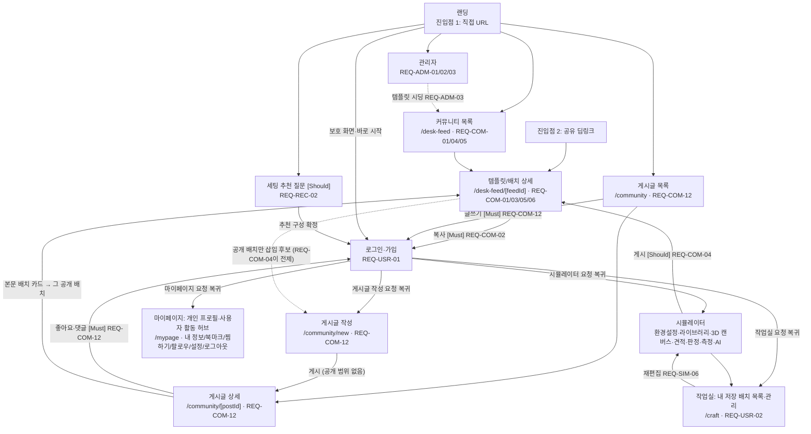

- **커뮤니티 화면은 두 축이다.** `/desk-feed`는 3D 작업물(공개 배치·템플릿)을, `/community`는 그것에 대해 쓴 글(게시글)을 다룬다 — 게시글은 배치를 참조하지 않아도 성립한다(D25).
- **점선 `CD -.-> PN`은 화면 이동이 아니라 데이터 전제다.** 게시글 작성 화면의 배치 삽입 후보에는 **이미 공개된 본인 배치만** 뜨므로, `REQ-COM-04`(배치 게시)로 공개 전환을 해 둔 적이 없으면 후보가 비어 있다.

---

## 2층 — 마스터 트리 + 가지별 상세 플로우

### 마스터 트리 (전체 조망)

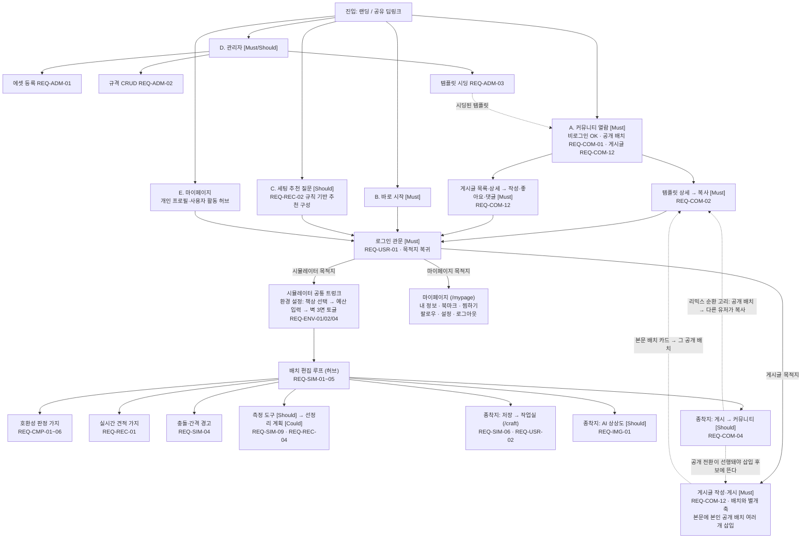

**리믹스 순환 고리**(점선): 템플릿 복사 → 편집 → 게시 → 다른 유저가 다시 복사. `ACOPY → HUB → PUB → ACOPY`가 닫힌 고리를 이룬다. 원본 출처는 자동 표기(REQ-COM-03).

**게시글 축**(REQ-COM-12, G9-A): `A → APOST → GATE → POST`. 시뮬레이터 트렁크(G2)를 지나지 않는다 — **배치를 하나도 만들지 않은 사용자도 글만 써서 게시할 수 있다**(D25). `PUB -.-> POST` 점선은 화면 이동이 아니라 전제다: 본문에 넣을 수 있는 배치는 **이미 공개된 본인 배치**뿐이라, 공개 전환(REQ-COM-04)을 한 적이 없으면 삽입 후보가 비어 있다.

---

### G1 — 진입·인증 (REQ-USR-01)

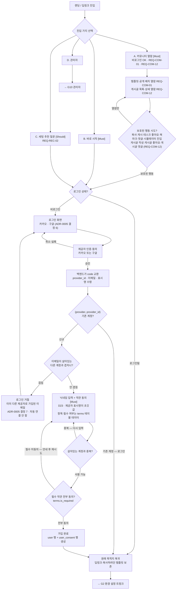

- 비로그인은 커뮤니티 열람만 — **공개 배치와 게시글 둘 다 열람은 관문이 없다**(REQ-COM-01·REQ-COM-12). **시뮬레이터 진입(템플릿 복사 포함)과 게시글 작성부터 로그인 필수.**
- 로그인 성공 시 원래 목적지(복사하려던 템플릿, 쓰려던 게시글 작성 화면 등)로 복귀 — 딥링크 보존.
- **가입/로그인이 갈리는 시점은 제공자 검증 뒤다.** `(provider, provider_id)`를 받기 전에는 신규인지 알 수 없으므로 "가입 화면"이 로그인보다 먼저 오지 않는다 — 사용자가 누르는 버튼은 카카오·구글 둘뿐이고, 가입이냐 로그인이냐는 백엔드가 결정한다.
- **닉네임 입력은 신규 가입에만 있다**(D23). 제공자가 준 표시명을 그대로 쓰지 않는 이유는 닉네임이 **살아있는 계정 기준 유니크**(`uq_user_nickname`)라서다 — 실명 기반 표시명은 흔한 이름에서 충돌하고, 자동으로 접미사를 붙이면 사용자가 원치 않은 이름을 받는다.
- **약관 동의도 신규 가입에만 있고 닉네임과 같은 화면에서 받는다.** 화면에 뜨는 항목과 필수/선택 구분은 코드가 아니라 `terms` 테이블 데이터(`terms.is_required`)다 — 항목을 늘리거나 필수 여부를 바꾸는 데 배포가 필요 없다.
- 항목은 4종이다 — 서비스 이용약관·개인정보 처리·만 14세 이상은 필수라 하나라도 빠지면 가입이 진행되지 않고, **마케팅 수신은 선택**이라 동의하지 않아도 그대로 가입된다.
- **철회는 기존 행을 고치는 게 아니라 `is_agreed = false` 새 행이다**(`user_consent`는 append-only). 언제 동의했고 언제 철회했는지가 이력으로 남고, 현재 상태는 항목별 최신 행이 정한다.
- **이메일이 겹치면 계정을 자동 연결하지 않고 거절한다**(ADR-0005 결정 7). 제공자가 준 이메일에 소유 검증 보장이 없어 자동 연결이 계정 탈취 경로가 되고, `provider` 컬럼이 하나뿐이라 연결된 상태를 스키마가 표현하지도 못한다.
- 제공자가 이메일을 안 주면 백엔드가 `kakao_{provider_id}@dero.invalid`로 합성한다(`NOT NULL`이라 비울 수 없다). 화면에는 드러나지 않는다.

---

### G2 — 환경 설정 트렁크 (공통 트렁크)

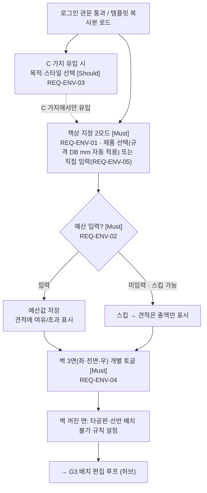

- 책상은 배타적 2모드(D18, 2026-07-21) — ① 제품 선택: 규격은 DB 메타데이터 자동 적용, 조절 UI 미노출 ② 직접 입력: 사용자가 W·D·H·상판두께+재질·프레임을 입력하고 그 값이 판정 정본(REQ-ENV-05). 이전 "수치 직접 입력 없음(D4)"은 철회됨.
- 목적·스타일 선택(REQ-ENV-03, Should)은 C 가지(세팅 추천)에서 유입될 때만 트렁크에 결합.

---

### G3 — 배치 편집 루프 (허브)

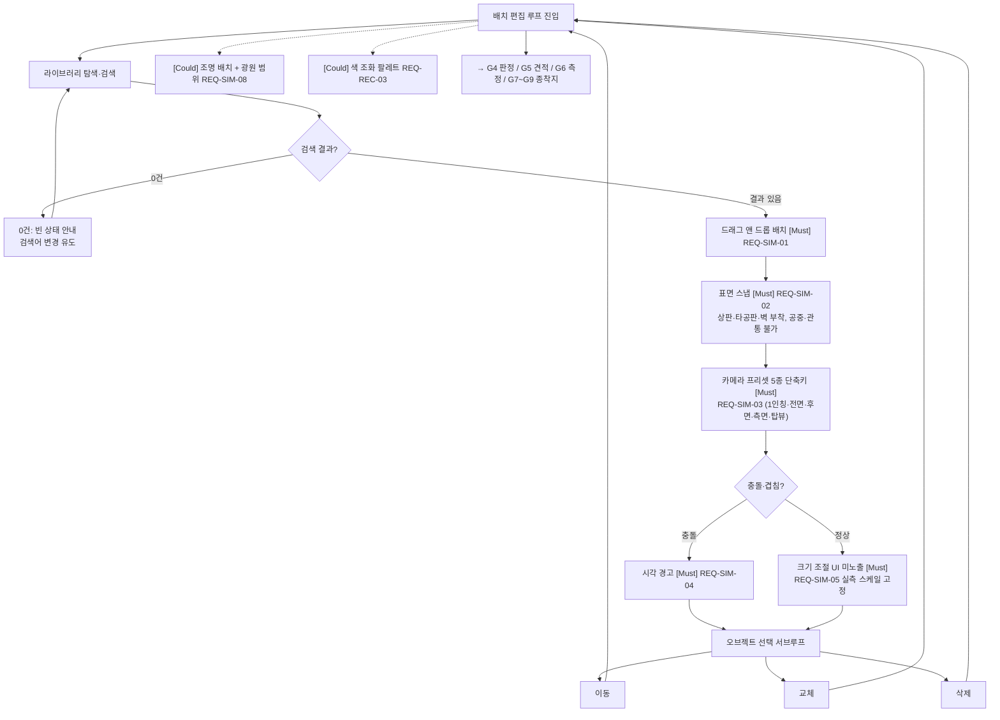

- 배치 트리거마다 G4 호환성 판정·G5 견적이 실시간 동반된다(허브 특성).
- 크기 조절은 UI 자체를 노출하지 않는다(REQ-SIM-05) — 시도 자체가 불가.

---

### G4 — 호환성 판정 (REQ-CMP-01~06)

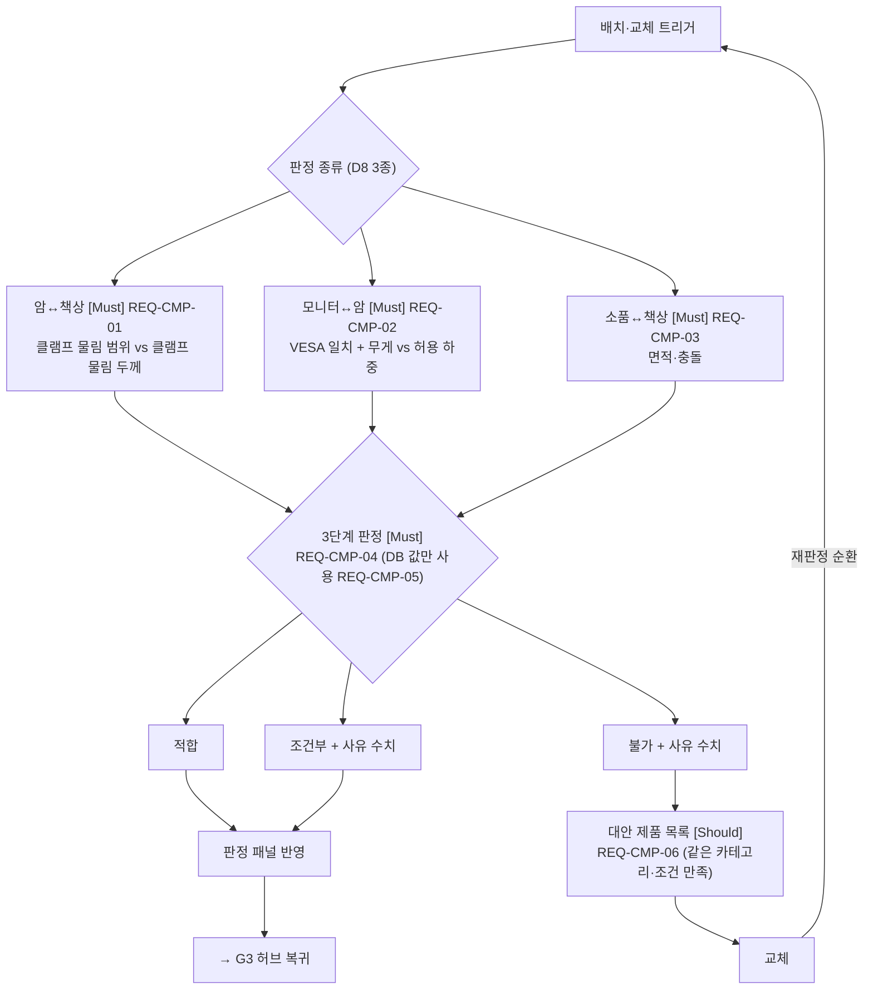

- 판정은 **규격 메타데이터 DB 값(mm)만** 사용(REQ-CMP-05, NFR-01) — 3D 메쉬 치수 참조 금지.
- 불가 → 대안 → 교체 → 재판정 순환이 P2(박현우)의 핵심 여정(H2 검증).

---

### G5 — 실시간 견적 (REQ-REC-01)

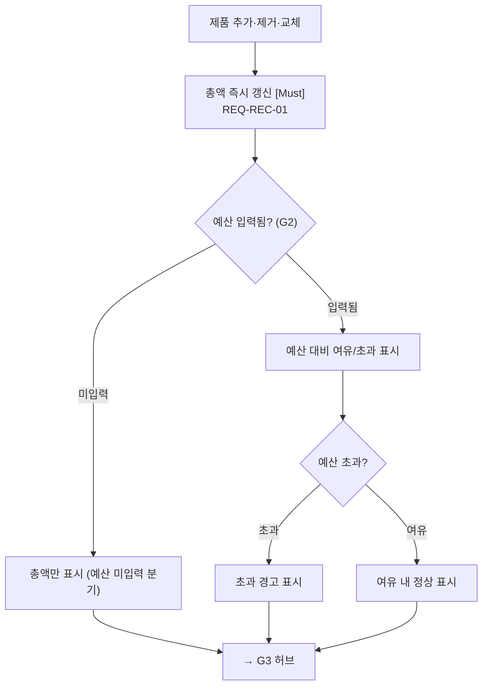

---

### G6 — 측정·선정리 [Should / Could] (REQ-SIM-09, REQ-REC-04)

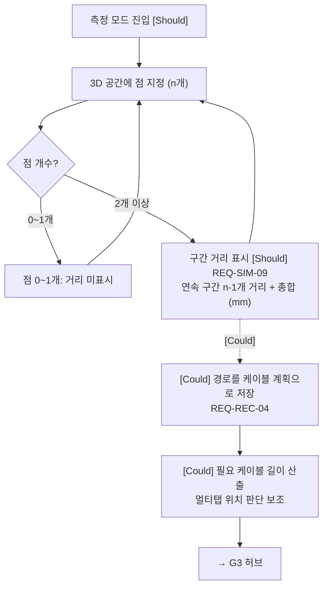

- 점 n개 → 연속 구간 n−1개의 거리와 총합을 mm로 표시. 점이 1개 이하면 거리 미표시.
- 선정리 계획 보조[Could]는 측정 기반 케이블 경로 길이 산출 → 필요 케이블 길이·멀티탭 위치 판단 보조(P2-PN3 대응).

---

### G7 — 종착지: 저장·작업실 (REQ-SIM-06, REQ-USR-02)

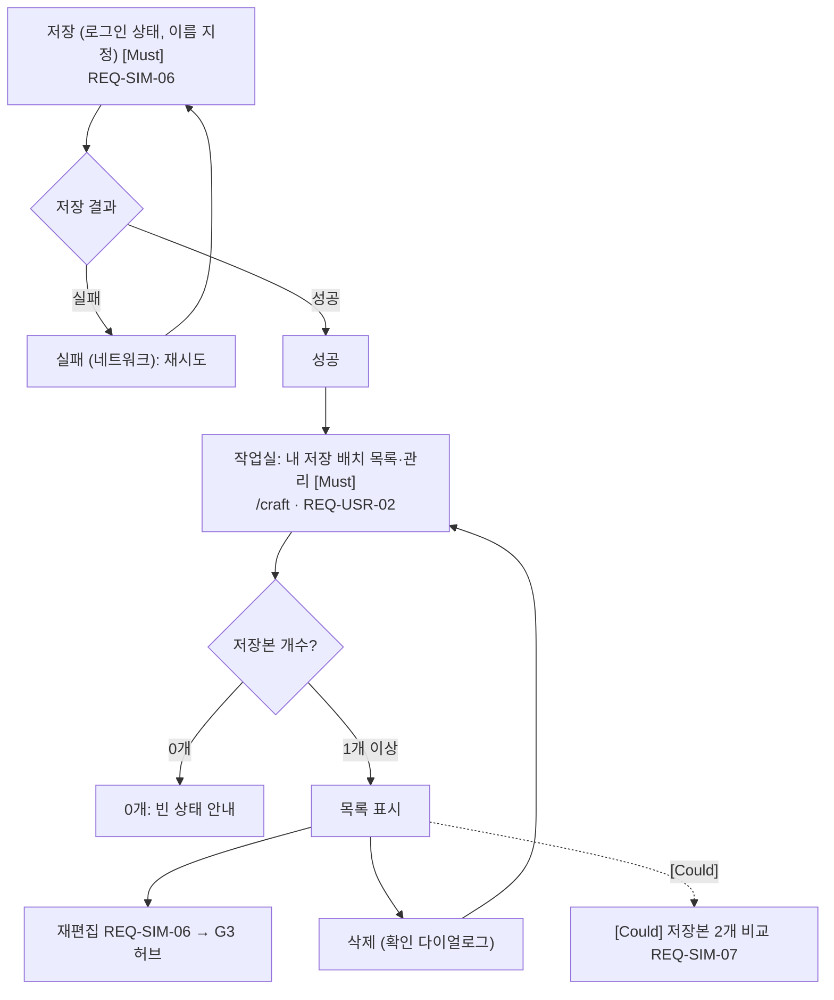

---

### G7-A — 마이페이지: 프로필·활동 허브 (REQ-USR-01, REQ-COM-05·07)

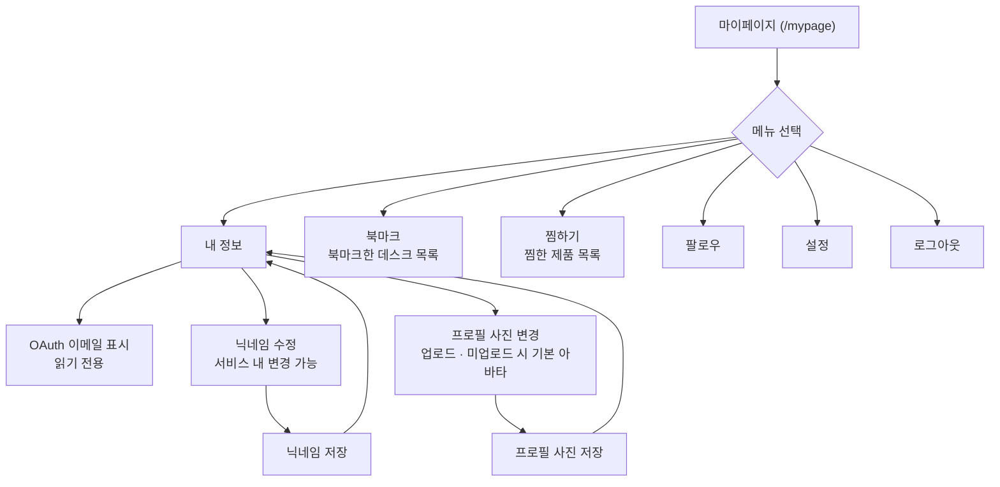

- 데스크 좋아요는 마이페이지 목록으로 노출하지 않는다. 데스크 활동의 북마크와 제품 활동의 찜하기만 각각 조회한다.
- 프로필 사진은 **소셜 제공자에게서 받지 않는다**(D24). 가입 직후에는 값이 없어 기본 아바타가 뜨고, 사용자가 여기서 올려야 우리 저장소에 저장된다.

---

### G8 — 종착지: AI 상상도 [Should] (REQ-IMG-01~03)

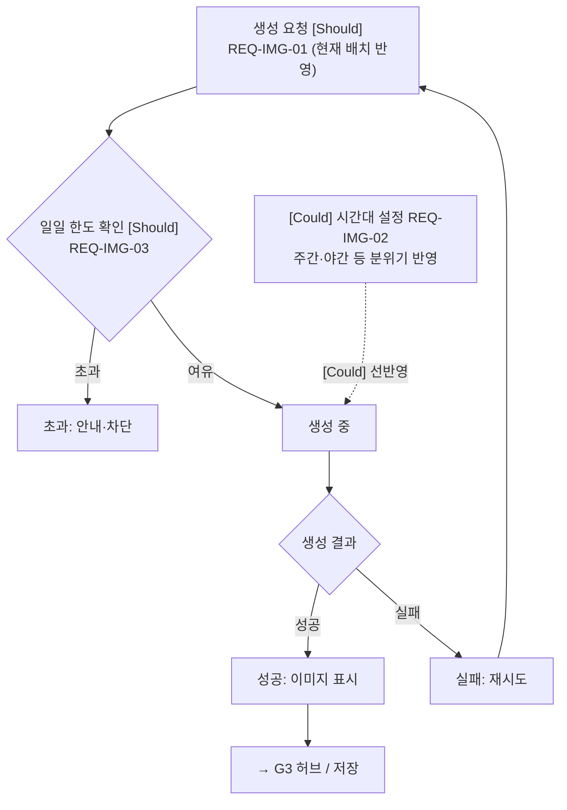

- AI는 상상도만 생성(NFR-04) — 배치·호환성 검증에 관여하지 않는다.

---

### G9 — 종착지: 게시·개인 활동 [Should] (REQ-COM-03~06)

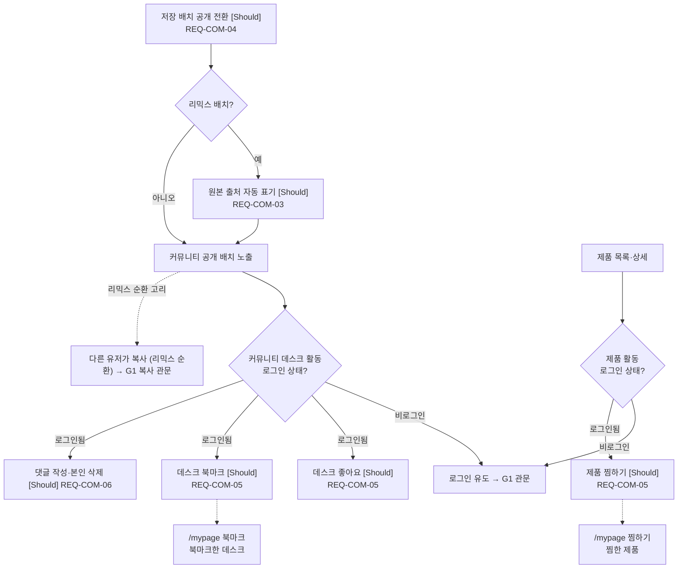

---

### G9-A — 게시글 작성·열람 [Must] (REQ-COM-12)

> **전제**: 게시글은 **배치와 별개 축**이다(D25) — G9의 하위 단계도, 시뮬레이터 허브의 종착지도 아니다. 배치를 하나도 만들지 않은 사용자가 글만 써도 그대로 게시된다. 번호의 `-A`는 커뮤니티 도메인에서 G9 옆자리라는 배치 표시일 뿐이고(G7-A와 같은 관례) 종속을 뜻하지 않는다.

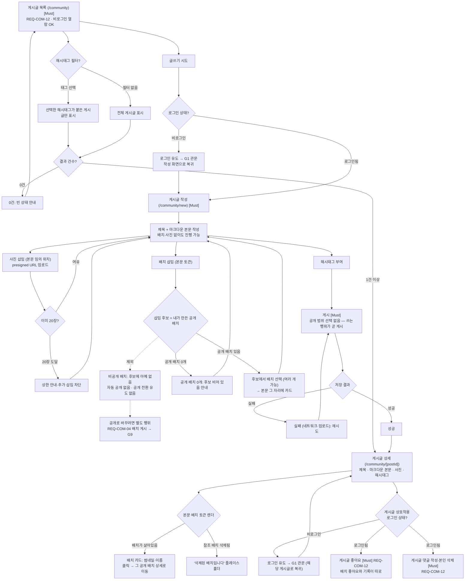

- **배치 참조는 선택이다.** 배치를 하나도 넣지 않은 글도 그대로 게시된다 — 스토리에는 배치가 완성되기 전 이야기(고민·실패·중간 과정)가 들어가는데, 배치를 강제하면 그 글을 아예 못 쓴다(D25).
- **본문에 넣는 것은 배치뿐이다.** 배치 토큰(`[[placement:ID]]`)을 본문 임의 위치에 **여러 개** 넣을 수 있고, 그 자리에 썸네일·이름 등이 카드로 렌더되며 카드에서 그 배치로 이동한다. ~~상품 토큰(`[[product:ID]]`)~~은 폐기됐다(D26) — 배치가 `placed_item`으로 제품 구성·견적을 통째로 품는다.
- **삽입 후보에는 내가 만든 공개 배치만 뜬다. 비공개 배치는 목록에 아예 나타나지 않는다** — 프론트가 후보를 거르고, WAS가 저장 시점에 작성자 본인 소유와 `visibility = PUBLIC`을 다시 검증한다(ADR-0013 결정 3). **자동 공개도, "공개로 바꿀까요" 유도도 없다 — 차단 하나뿐이다.** 되돌릴 수 없는 노출을 글 쓰는 도중에 일으키지 않는 것이 가장 확실하기 때문이다.
- **그래서 공개 배치가 하나도 없는 사용자는 삽입할 배치 자체가 없다.** 배치를 공개로 바꾸는 것은 `REQ-COM-04`(배치 게시 — 커뮤니티 공개, G9)의 **독립된 행위**이고, 게시글 플로우는 이미 공개된 것만 참조한다 — 이 의존 때문에 `REQ-COM-04`가 존치된다(D26).
- **참조한 배치가 삭제되면 카드가 사라지는 게 아니라 그 자리에 "삭제된 배치입니다" 플레이스홀더가 남는다**(ADR-0013 결정 4). 카드가 통째로 없어지면 "이 배치는 …" 다음이 비어 앞뒤 문장이 무엇을 가리키는지 알 수 없다.
- **사진은 본문 임의 위치에 최대 20장.** presigned URL로 브라우저가 직접 올린다. **순서를 따로 저장하지 않는다** — 본문 안 위치가 곧 순서다. 목록 카드에 쓸 대표 이미지 1장만 따로 지정한다(저장 시 본문 첫 이미지가 기본값, 사용자가 바꿀 수 있다).
- **게시글에는 공개 범위가 없다 — 쓰는 행위 자체가 게시다.** 삭제는 소프트 삭제다(D25).
- **게시글에 붙는 상호작용은 좋아요·댓글뿐이다 — 북마크는 없다**(D25 최종 확정). 좋아요·댓글은 배치의 것과 기록이 따로다(`post_like`/`post_comment` vs `placement_like`/`comment`).
- **게시글 좋아요는 `/mypage` 활동 목록에 노출하지 않는다**(D24 2026-07-30 추가) — 마이페이지 목록은 북마크한 데스크·찜한 제품 둘 그대로다(G7-A).

---

### G10 — 관리자 (REQ-ADM-01~03)

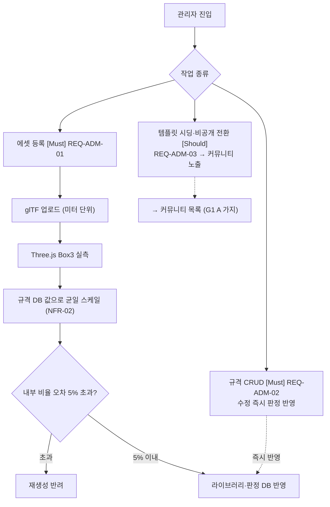

- 비균일 스케일 금지(NFR-02), 균일 스케일만. 규격 DB가 정본 — Meshy auto_size 미신뢰(D7).
- [Could] 조명 배치+광원 범위(REQ-SIM-08), 색 조화 팔레트(REQ-REC-03)는 G3 루프의 부가 가지(위 G3 참조).

---

## 3층 — 경우의 수 매트릭스

각 행은 2층 가지(G1~G10, G7-A·G9-A 포함)·REQ ID로 역추적 가능하다.

### 3-1. 인증 게이트 (G1)

| 상황 | 조건 | 시스템 동작 | REQ | 우선순위 |
|------|------|-------------|-----|----------|
| 시뮬레이터 진입 | 비로그인 | 로그인 유도 → 성공 시 시뮬레이터 복귀 | REQ-USR-01 | Must |
| 템플릿 복사 | 비로그인 | 로그인 유도 → 복사하려던 템플릿으로 복귀(딥링크 보존) | REQ-COM-02, REQ-USR-01 | Must |
| 배치 게시 | 비로그인 | 로그인 유도 → 게시 대상 배치로 복귀 | REQ-COM-04, REQ-USR-01 | Should |
| 데스크 좋아요 | 비로그인 | 로그인 유도 → 해당 공개 배치 복귀 | REQ-COM-05, REQ-USR-01 | Should |
| 데스크 북마크 | 비로그인 | 로그인 유도 → 해당 공개 배치 복귀 | REQ-COM-05, REQ-USR-01 | Should |
| 제품 찜하기 | 비로그인 | 로그인 유도 → 해당 제품 복귀 | REQ-COM-05, REQ-USR-01 | Should |
| 댓글 작성 | 비로그인 | 로그인 유도 → 해당 공개 배치 복귀 | REQ-COM-06, REQ-USR-01 | Should |
| AI 상상도 생성 | 비로그인 | 로그인 유도 → 시뮬레이터 복귀 | REQ-IMG-01, REQ-USR-01 | Should |
| 커뮤니티 열람 | 비로그인 | 열람 허용(관문 없음) | REQ-COM-01 | Must |
| 게시글 목록·상세 열람 | 비로그인 | 열람 허용(관문 없음) | REQ-COM-12 | Must |
| 게시글 작성 | 비로그인 | 로그인 유도 → 작성 화면(`/community/new`) 복귀 | REQ-COM-12, REQ-USR-01 | Must |
| 게시글 좋아요 | 비로그인 | 로그인 유도 → 해당 게시글 복귀 | REQ-COM-12, REQ-USR-01 | Must |
| 게시글 댓글 작성 | 비로그인 | 로그인 유도 → 해당 게시글 복귀 | REQ-COM-12, REQ-USR-01 | Must |

### 3-2. 판정 결과 (G4)

| 상황 | 조건 | 시스템 동작 | REQ | 우선순위 |
|------|------|-------------|-----|----------|
| 암↔책상 | 물림 두께가 범위 내 | 적합 | REQ-CMP-01, REQ-CMP-04 | Must |
| 암↔책상 | 경계값 | 조건부 + 수치 사유 | REQ-CMP-01, REQ-CMP-04 | Must |
| 암↔책상 | 물림 두께가 범위 초과 | 불가 + 수치 사유 → 대안 제시 | REQ-CMP-01, REQ-CMP-06 | Must / Should |
| 모니터↔암 VESA | 규격 일치 | 적합 | REQ-CMP-02, REQ-CMP-04 | Must |
| 모니터↔암 VESA | 규격 불일치 | 불가 + 사유 → 대안 제시 | REQ-CMP-02, REQ-CMP-06 | Must / Should |
| 모니터↔암 하중 | 허용 하중 여유 | 적합 | REQ-CMP-02, REQ-CMP-04 | Must |
| 모니터↔암 하중 | 근접(예: 90% 이상) | 조건부 + 수치 사유 | REQ-CMP-02, REQ-CMP-04 | Must |
| 모니터↔암 하중 | 허용 하중 초과 | 불가 + 수치 사유 → 대안 제시 | REQ-CMP-02, REQ-CMP-06 | Must / Should |
| 소품↔책상 면적 | 잔여 면적 충분 | 적합 | REQ-CMP-03, REQ-CMP-04 | Must |
| 소품↔책상 면적 | 잔여 면적 부족 | 불가 + 사유 | REQ-CMP-03, REQ-CMP-04 | Must |

### 3-3. 제약 규칙 (G2·G3·G6·G9-A)

| 상황 | 조건 | 시스템 동작 | REQ | 우선순위 |
|------|------|-------------|-----|----------|
| 타공판·선반 배치 | 해당 벽 면 토글 꺼짐 | 배치 불가 안내 | REQ-ENV-04 | Must |
| 크기 조절 시도 | 배치된 오브젝트 임의 리사이즈 | 크기 조절 UI 미노출 (책상 규격 입력 폼은 대상 아님, D18) | REQ-SIM-05 | Must |
| 공중 배치·관통 | 표면 밖 드롭 | 표면 스냅으로 부착 강제, 관통 방지 | REQ-SIM-02 | Must |
| 예산 | 미입력 | 견적 총액만 표시(초과 판정 없음) | REQ-ENV-02, REQ-REC-01 | Must |
| 예산 | 0원 | 총액이 있으면 즉시 초과 경고 | REQ-ENV-02, REQ-REC-01 | Must |
| 예산 | 초과 | 초과 경고 표시 | REQ-REC-01 | Must |
| 측정 점 | 0~1개 | 거리 미표시(구간 없음) | REQ-SIM-09 | Should |
| 배치 삽입 후보 | 내 배치가 비공개 | 후보 목록에 표시하지 않음 — 자동 공개도 공개 전환 유도도 없음(공개 전환은 REQ-COM-04 경로) | REQ-COM-12, REQ-COM-04 | Must |
| 배치 삽입 | 남이 만든 배치 | 후보에 없음, 토큰을 직접 넣어도 저장 거부(소유자·공개 여부 서버 검증) | REQ-COM-12 | Must |
| 게시글 작성 | 배치를 하나도 넣지 않음 | 그대로 게시 가능(배치 참조는 선택) | REQ-COM-12 | Must |
| 게시글 게시 | 게시 시점 | 공개 범위 선택 없음 — 쓰는 행위가 곧 게시 | REQ-COM-12 | Must |

### 3-4. 한도·빈 상태 (G1·G3·G7~G9·G9-A)

| 상황 | 조건 | 시스템 동작 | REQ | 우선순위 |
|------|------|-------------|-----|----------|
| AI 생성 | 일일 한도 초과 | 안내·차단 | REQ-IMG-03 | Should |
| 내 저장 배치 | 0개 | `/craft` 빈 상태 안내 | REQ-USR-02 | Must |
| 북마크한 데스크 | 0개 | `/mypage` 북마크 빈 상태 안내 | REQ-COM-05 | Should |
| 찜한 제품 | 0개 | `/mypage` 찜하기 빈 상태 안내 | REQ-COM-05 | Should |
| 라이브러리 검색 | 0건 | 빈 상태 안내, 검색어 변경 유도 | REQ-SIM-01 | Must |
| 템플릿 목록 | 0개(시딩 전) | 커뮤니티 빈 상태 안내 | REQ-COM-01, REQ-ADM-03 | Must / Should |
| 게시글 목록 | 0개 | `/community` 빈 상태 안내 | REQ-COM-12 | Must |
| 해시태그 필터 | 결과 0건 | 빈 상태 안내, 태그 해제 유도 | REQ-COM-12 | Must |
| 배치 삽입 후보 | 내 공개 배치 0개 | 후보 비어 있음 안내 — 공개 전환은 REQ-COM-04 경로 | REQ-COM-12, REQ-COM-04 | Must |
| 게시글 사진 | 20장 도달 | 상한 안내, 추가 삽입 차단 | REQ-COM-12 | Must |

### 3-5. 에러·복구 (G3·G7·G8·G9-A·G1·G10)

| 상황 | 조건 | 시스템 동작 | REQ | 우선순위 |
|------|------|-------------|-----|----------|
| glTF 로드 | 로드 실패 | 에셋 로드 실패 안내, 재시도 | REQ-SIM-01, REQ-ADM-01 | Must |
| 배치 저장 | 네트워크 실패 | 저장 실패 안내, 재시도 | REQ-SIM-06 | Must |
| AI 생성 | 생성 실패 | 실패 안내, 재시도 | REQ-IMG-01 | Should |
| 편집 중 세션 만료 | 로그인 세션 만료 | 작업 보존 후 재로그인 유도 → 편집 복귀 | REQ-USR-01, REQ-SIM-06 | Must |
| 게시글 사진 업로드 | presigned 업로드 실패 | 업로드 실패 안내, 재시도 | REQ-COM-12 | Must |
| 게시글 저장 | 네트워크 실패 | 게시 실패 안내, 재시도 | REQ-COM-12 | Must |
| 게시글 열람 | 본문이 참조한 배치가 삭제됨 | 그 자리에 "삭제된 배치입니다" 플레이스홀더(카드를 지우지 않음) | REQ-COM-12 | Must |

### 3-6. 템플릿·리믹스 (G1·G9)

| 상황 | 조건 | 시스템 동작 | REQ | 우선순위 |
|------|------|-------------|-----|----------|
| 템플릿 복사 | 복사 후 | 복사본 편집 가능, 원본 불변 | REQ-COM-02 | Must |
| 리믹스 게시 | 원본 존재 | 원본 출처 자동 표기 | REQ-COM-03 | Should |
| 리믹스 게시 | 원본 삭제됨 | 출처 "원본 없음" 표기 | REQ-COM-03 | Should |

---

> **미결 연동**(requirements.md §6·CONTEXT.md 미결): 소셜 로그인 제공자 선택, 서비스명, 초기 에셋 목록은 확정 시 해당 노드만 교체한다. 선정리 구현 수준은 G6에 [Could]로 반영(REQ-REC-04) — 배포 후 P2-PN3 인터뷰로 재확인.
