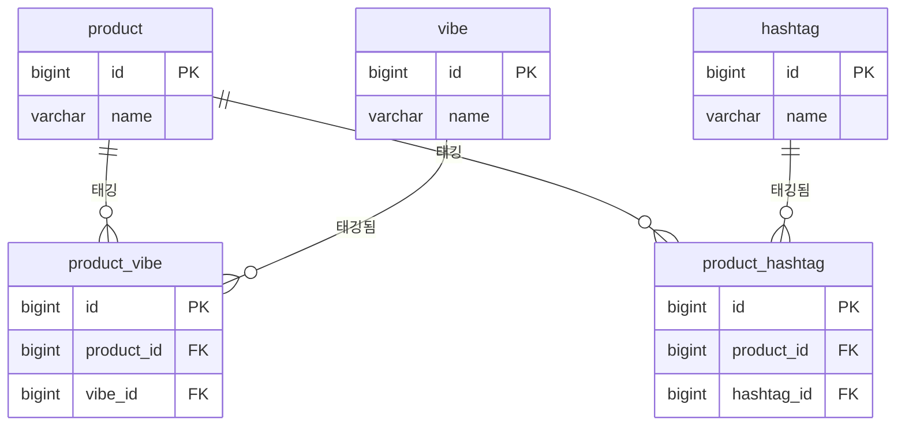
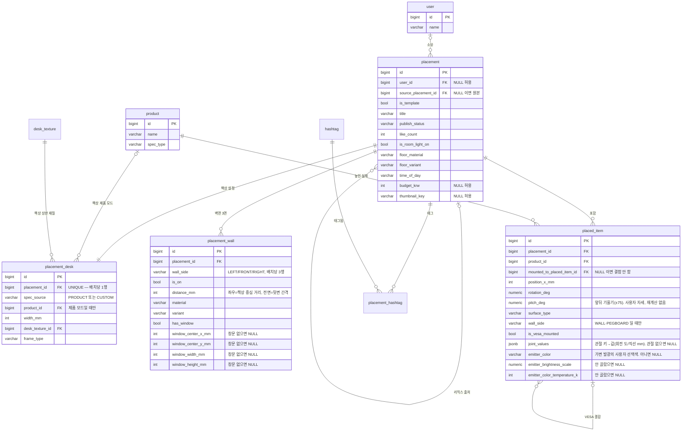

# DB 스키마·ERD 정본

> 읽는 시점: 테이블·컬럼 추가·변경, JPA 엔티티·리포지토리·마이그레이션 작성 시 (루트 CLAUDE.md 라우팅 표에서 진입).
> 관련 문서: 이름은 `docs/GLOSSARY.md` 2부(용어 SSOT)가 정본, 기획 결정(D1~D19)은 `docs/CONTEXT.md`.

## 이 문서의 지위

- **이 문서가 DB 스키마의 정본이다.** 여기 적힌 테이블·컬럼·타입·NULL 여부·기본값·제약·인덱스가 실제 스키마다. erdcloud 같은 그림 도구는 사람이 보기 위한 사본이고, 그림과 이 문서가 어긋나면 이 문서가 맞다(그림은 MR에서 diff가 되지 않아 정본이 될 수 없다).
- **GLOSSARY와의 분담**: 테이블·컬럼을 **뭐라고 부를지**는 `docs/GLOSSARY.md` 2부가 정본이다. 여기서는 그 이름들이 실제로 **어떤 타입·제약으로 존재하는지**를 정한다. 새 컬럼은 GLOSSARY §2-3 표준 단어로 이름을 조립한 뒤 이 문서에 등록한다. 새 도메인 용어·엔티티가 생기면 GLOSSARY 갱신이 세트다.
- **변경 절차**: 스키마를 바꾸려면 **이 문서를 먼저 고치고 MR 리뷰를 받는다.** 엔티티 코드나 마이그레이션이 문서보다 앞서면 안 된다.
- **이 문서는 동결돼 있다 (2026-07-23, 박동규 지시).** 에이전트는 이 파일을 직접 편집할 수 없다 — `.claude/hooks/erd-freeze.sh`가 `Edit`·`Write`·`Bash` 쓰기를 차단한다. 바꿔야 하면 **먼저 박동규에게 ①무엇을 ②왜 지금 ③안 바꾸면 무슨 일이 ④파급 범위를 설명하고 동의를 받는다.** 동의 후 박동규가 `!.claude/hooks/erd-freeze.sh --unlock "<사유>"`를 실행하면 30분간 편집이 열린다. 수정 뒤에는 아래 "확정 후 개정" 표에 한 줄을 남기고 `--rebaseline`로 기준선을 갱신한다. 동결 목적은 스키마가 **조용히** 바뀌는 것을 막는 것이다 — 승인된 변경을 막는 게 아니다. 훅 동작 상세: `docs/HARNESS-RULES.md` §4.
- **Flyway**: V1 마이그레이션은 이 문서에서 파생한다. 마이그레이션이 생긴 뒤에도 정본은 이 문서다 — 둘이 어긋나면 이 문서 기준으로 마이그레이션을 정정한다.

## 전역 규칙

**엔진·타입**

- PostgreSQL. PK는 **테이블별 명시 시퀀스**에서 받는다 — `CREATE SEQUENCE <테이블>_id_seq INCREMENT BY 50;` + `id BIGINT NOT NULL DEFAULT nextval('<테이블>_id_seq')`. 아래 표에서 `BIGINT seq`로 축약한다. `INCREMENT BY 50`은 JPA `@SequenceGenerator(allocationSize = 50)`과 짝이고 **둘이 어긋나면 PK가 조용히 충돌한다**(ADR-0006 결정 8).
  - **`GENERATED BY DEFAULT AS IDENTITY`를 쓰지 않는다**(2026-07-28 개정). identity가 자동 생성한 시퀀스는 `information_schema.sequences`에 나타나지 않고, Hibernate `PostgreSQLDialect`가 시퀀스 검증에 바로 그 뷰를 조회한다 → `ddl-auto: validate`가 `missing sequence [<테이블>_id_seq]`로 부팅을 죽인다. 시퀀스는 `pg_class`에 이름·증분까지 정확히 실재하는데도 그렇다.
- 시각은 전부 `TIMESTAMPTZ`, **UTC 저장**. 표시 시점의 타임존 변환은 WAS·클라이언트 소관.
- 치수는 `_mm` 정수(`INT`) 고정. 각도는 `_deg`, 금액은 `_krw`, 색온도는 `_k` — 전부 `INT`.
- **각도 예외 — 사용자가 연속으로 조작하는 인스턴스 각도는 `NUMERIC(6,2)`다**(`placed_item.rotation_deg`·`placed_item.pitch_deg`. 관절 값은 `placed_item.joint_values` JSONB 안의 JSON number라 이 규칙 밖이다 — 소수 정밀도는 같게 유지한다). REQ-SIM-18이 "스텝 단위 없이 임의 실수각"을 요구한다. 정수로 자르면 경계선상 배치가 저장 전 "적합"이었다가 재로드 후 "위반"으로 뒤집힌다 — 경계·스태킹 판정이 회전 footprint 기준이기 때문이다. 제품 **규격**의 각도(`arm.tilt_min_deg` 등)는 카탈로그 표기값이라 그대로 `INT`.
- **대각 화면 크기 `_inch`는 `NUMERIC(4,1)`.** 27·34인치는 정수지만 23.8·31.5인치처럼 소수 표기가 실제로 쓰인다.
- **무게·하중 `_g`는 `INT`.** 그램 정수로 저장하고 표시할 때 kg로 환산한다(`4500` → "4.5kg") — 그램에서 소수점은 제품 카탈로그에 존재하지 않는 정밀도다. `_mm` 정수 고정과 같은 결이고, 판정 비교가 정수끼리라 부동소수 오차가 없다. `_g` 컬럼은 예외 없이 같은 타입을 쓴다.
- enum 값은 `VARCHAR` + UPPER_SNAKE 문자열로 저장한다. **Postgres ENUM 타입은 쓰지 않는다** — 값 하나 추가하는 데 마이그레이션이 필요해진다.
- `user`는 SQL 예약어다. DDL·네이티브 쿼리에서 `"user"`로 인용한다.

**명명**

- PK는 항상 `id`(테이블명 반복 금지). FK는 `<참조 테이블 단수>_id`. 자기참조·역할 FK는 `parent_id` / `source_<테이블>_id` / `follower_id`·`following_id`.
- 제약·인덱스 이름: `pk_<테이블>` / `fk_<테이블>_<참조테이블>` / `uq_<테이블>_<컬럼들>` / `idx_<테이블>_<컬럼들>`.
  - 한 테이블이 같은 테이블을 두 번 참조하거나 역할 FK를 쓰면 참조 테이블명으로는 구분이 안 된다 → 그 경우만 `fk_<테이블>_<컬럼명>`으로 적는다(`fk_follow_follower_id`, `fk_category_parent_id`).

**제약**

- **`CHECK` 제약을 쓰지 않는다.** 값의 범위·조합처럼 규칙이 바뀔 수 있는 검증은 전부 WAS가 한다. DB에 비즈니스 로직을 넣지 않는다.
- `NOT NULL`·FK·`UNIQUE`는 유지한다. 특히 `UNIQUE`는 비즈니스 규칙이 아니라 **동시 요청 경쟁 조건 방어 수단**이라 남긴다 — 같은 좋아요 요청이 동시에 두 번 들어와도 행이 하나만 생겨야 한다.
- 서브타입 정합성(모니터 제품이 `desk`에 행을 갖지 않는 것)도 DB가 아니라 WAS가 보장한다.
- **boolean은 전부 `NOT NULL` + 기본값을 둔다. nullable boolean 금지.** nullable이면 true/false/unknown 3상태가 되어 WAS가 컬럼마다 null 분기를 해야 한다. "모름"을 진짜로 표현해야 하는 날이 오면 그때 별도 컬럼으로 뺀다.
  - 기본값 예외는 **규격 서브타입의 boolean 전부와 `product_emitter.recolorable`**이다(`desk.is_rounded`, `monitor.is_stand_detachable`·`is_pivot_supported`, `arm.is_clamp_mountable`·`is_grommet_mountable`·`is_wall_mountable`·`is_vesa_plate_detachable`·`has_cable_management`, `light.is_color_temperature_adjustable`·`is_brightness_adjustable`, `prop.is_stackable`, `product_emitter.recolorable`). 제품 등록 시 실측해서 반드시 채워야 하는 값이라 `false` 기본값을 두면 **미입력이 조용히 "아니오"로 둔갑한다** — 스탠드가 분리되는 모니터가 "분리 불가"로 기록되면 모니터↔암 판정이 틀린 답을 낸다. `NOT NULL`은 그대로 지키므로 3상태 문제는 생기지 않는다.
  - 반대로 **규격이 아닌 boolean은 기본값을 둔다** — `placement.is_template`처럼 "아직 아님"이 곧 `false`인 값은 미입력이 곧 정답이라 둔갑 문제가 없다.
- **soft delete 테이블의 자연키 유니크는 부분 유니크 인덱스(`WHERE deleted_at IS NULL`)로 만든다.** 일반 `UNIQUE`를 걸면 삭제 표시만 된 행이 자리를 계속 차지해 **같은 이메일로 재가입, 같은 이름으로 재등록이 막힌다.** 살아있는 행이 하나도 없는데 제약에 걸리는 셈이다 — 토글·정션에서 soft delete를 쓰지 않는 이유와 같은 함정이 마스터 테이블에도 있다.

  ```sql
  CREATE UNIQUE INDEX uq_user_email ON "user"(email) WHERE deleted_at IS NULL;
  ```

  - `CHECK` 제약이 아니라 인덱스라서 "DB에 비즈니스 로직 금지" 방침에 걸리지 않는다. 경쟁 조건 방어라는 `UNIQUE`의 목적도 그대로 지킨다.
  - 적용 대상은 감사 3종(soft delete) 테이블의 자연키 유니크 전부: `user.email` · `user(provider, provider_id)` · **`user.nickname`** · `brand.name` · `vibe.name` · `hashtag.name` · `vesa_spec(width_mm, height_mm)`.
  - **hard delete 테이블은 적용하지 않는다** — `follow`·`placement_like`·`product_like`·`cart_item`·`placement_bookmark`·`product_vibe`·`product_hashtag`·`placement_hashtag`·`product_vesa`는 행을 물리 삭제하므로 일반 `UNIQUE` 제약 그대로 둔다.

**ON DELETE**

- 표에 ON DELETE를 적지 않은 FK는 PostgreSQL 기본 동작(`NO ACTION`)이다. soft delete 대상 테이블은 평소 물리 삭제가 없으므로 실제로 발동할 일이 드물다.
- `CASCADE`·`SET NULL`을 쓰는 곳은 각 테이블의 제약 항목에 명시했다.
- `product`와 운명을 공유하는 테이블(규격 서브타입 5종·`asset`·`product_emitter`)은 `ON DELETE CASCADE`다. 평시 삭제는 `product.deleted_at`이므로 실제 발동은 데이터 정리 등으로 행을 물리 삭제할 때뿐이지만, 그때 규격만 고아로 남으면 안 된다.
- **위 hard delete 목록의 토글·정션 14종은 부모 FK 전부가 `ON DELETE CASCADE`다** — `follow`·`placement_like`·`product_like`·`post_like`·`cart_item`·`placement_bookmark`·`product_vibe`·`product_hashtag`·`post_hashtag`·`product_vesa`(뒤 2종은 2026-07-30 편입)·`placement_hashtag`(2026-08-07 편입)·`desk_feed_like`·`desk_feed_hashtag`(2026-08-10 편입)·`desk_feed_product`(2026-08-11 편입)·`desk_feed_image_product`(2026-08-12 편입). 이 15종은 정의상 부모와 운명을 같이하는데 참조 컬럼이 전부 `NOT NULL`이라 `SET NULL`을 쓸 수 없다. `NO ACTION`으로 두면 **부모의 물리 삭제 자체가 거부되어** hard delete 정의와 정면으로 어긋난다(2026-07-28 실측: `DELETE FROM placement`이 `fk_placement_bookmark_placement`에 막혔다).

**인덱스**

- **Postgres는 FK에 인덱스를 자동으로 만들지 않는다.** 참조 방향 조회(부모 → 자식)와 부모 삭제 시 자식 스캔이 전부 풀스캔이 된다 → **모든 FK 컬럼에 인덱스를 명시한다.**
- 예외 하나: 복합 `UNIQUE`의 **선두 컬럼**은 그 유니크 인덱스가 이미 커버하므로 별도 인덱스를 만들지 않는다(`uq_placement_like_user_id_placement_id`가 있으면 `user_id` 단독 인덱스는 불필요, `placement_id`는 필요).

**감사 컬럼** — 아래 표에서는 축약해 부른다.

| 축약 | 실제 컬럼 |
|---|---|
| 감사 3종 | 감사 2종 + `deleted_at TIMESTAMPTZ NULL` |
| 감사 2종 | `created_at TIMESTAMPTZ NOT NULL DEFAULT now()` + `created_by BIGINT NULL` + `updated_at TIMESTAMPTZ NULL` + `updated_by BIGINT NULL` |

- `deleted_at`에는 **기본값을 두지 않는다**(NULL = 살아있음).
- **감사 2종은 전 테이블 공통이다 — `updated_at` 유무로 테이블을 가르지 않는다**(2026-07-28 개정, 승인 박동규, DERO-210). 그전엔 "행이 수정될 수 있는 테이블에만 `updated_at`을 둔다"였고 축약도 1·2·3종 3단이었다. 그 결과 **JPA `@MappedSuperclass`가 3단으로 쌓여**(ADR-0006 결정 5는 2단으로 정했다) 새 엔티티마다 이 문서에서 감사 종류를 찾아 상속을 골라야 했고, 틀리면 컴파일은 통과하고 `ddl-auto: validate`가 **부팅에서** 죽었다.
  - **정션·토글·이력 테이블의 `updated_at`은 영원히 NULL이다.** 그 행들은 생성 후 변하지 않고 hard delete된다 — 컬럼이 있다는 것이 "이 행은 수정될 수 있다"는 뜻이 아니다. 전역 규칙 "영원히 NULL인 컬럼이 읽는 사람을 속인다"에 대한 **명시적 예외**이고, 그 대가로 상속 선택이라는 반복 실수 경로를 없앴다.
  - **`deleted_at`은 통일하지 않았다.** soft delete와 `UNIQUE`는 충돌해서(아래 "hard delete" 절) 토글·정션에 컬럼을 두면 언젠가 누가 soft delete를 걸고 재팔로우·재좋아요가 막힌다. 통일의 이득이 그 위험을 못 넘는다.
- **`created_by`·`updated_by`는 `user.id` 값을 담되 FK 제약을 걸지 않는다**(2026-07-28 신설). 세 가지 이유다 — ① 감사 기록은 주체가 사라져도 남아야 하는데 FK가 있으면 hard delete 경로가 막히거나 `SET NULL`로 증거가 지워진다, ② 시드·마이그레이션·배치 잡처럼 사람이 아닌 삽입이 실재하는 `user` 행을 요구하게 된다, ③ 감사 계층 전체에 붙는 컬럼이라 FK면 전 테이블 인덱스 30여 개가 따라온다. **인덱스도 만들지 않는다** — 조회 축이 아니라 사후 추적용이다(전역 규칙 "모든 FK 컬럼에 인덱스"의 대상이 아니다. FK가 아니므로).
- 둘 다 **nullable**이다. 인증이 배선되기 전 구간과 시스템 삽입에는 주체가 없다. NULL = "사람이 아닌 경로로 들어온 행".

**soft delete 대상 (`deleted_at` 있음 = 감사 3종)**

`user` · `brand` · `category` · `product` · `vesa_spec` · `desk_texture` · `vibe` · `hashtag` · `placement` · `comment` · `placement_bookmark_group` · `post` · `post_comment` · `desk_feed` · `desk_feed_comment`

**hard delete (행을 그냥 지운다)**

- 규격 서브타입 5종 · `asset` · `product_emitter` · `product_image` — `product.deleted_at`이 정본이라 자체 플래그가 없다.
- `placed_item` · `placement_desk` — 배치와 함께 사라진다.
- `post_image` — 게시글과 함께 사라진다.
- `desk_feed_image` — 데스크피드 글과 함께 사라진다.
- 토글·정션 전부: `follow` · `placement_like` · `product_like` · `post_like` · `cart_item` · `placement_bookmark` · `product_vibe` · `product_hashtag` · `post_hashtag` · `placement_hashtag` · `product_vesa` · `desk_feed_like` · `desk_feed_hashtag` · `desk_feed_product` · `desk_feed_image_product`
  → **이유: soft delete와 `UNIQUE`는 충돌한다.** 언팔로우한 행을 남겨두면 재팔로우가 유니크 제약에 막히고, 피하려면 유니크 키에 `deleted_at`을 섞는 편법이 필요해진다. 껐다 켰다 하는 관계는 행을 지운다.
- `generated_image` — 일일 생성 한도 카운트의 근거라 행을 지우지 않는다(그래서 삭제 개념 자체가 없다).
- `terms` · `user_consent` — 동의를 받은 사실과 시점이 증빙이라 행을 지우지 않는다(`generated_image`와 같은 자리). 철회도 삭제가 아니라 `is_agreed = false` 새 행이다.

---

## ERD

37개 테이블을 한 장에 넣으면 읽을 수 없어 4개 영역으로 나눈다. 영역 간 연결은 필요한 테이블(`product`·`placement`·`user`)을 여러 다이어그램에 중복 등장시켜 표현한다. 컬럼은 PK·FK와 핵심 몇 개만 실었다 — **전체 컬럼은 아래 "테이블 상세"가 정본**이다.

### 1. 카탈로그·규격

```mermaid
erDiagram
    brand |o--o{ product : "제조"
    category ||--o{ product : "분류"
    category |o--o{ category : "상위-하위"
    user |o--o{ product : "업로드"
    product ||--o| asset : "GLB"
    product ||--o| desk : "규격"
    product ||--o| monitor : "규격"
    product ||--o| arm : "규격"
    product ||--o| light : "규격"
    product ||--o| product_emitter : "발광"
    product ||--o| prop : "규격"
    product ||--o{ product_vesa : "지원"
    vesa_spec ||--o{ product_vesa : "지원됨"
    product ||--o{ product_image : "실사"
    desk_texture ||--o{ desk : "상판 재질"

    user {
        bigint id PK
        varchar name
    }
    brand {
        bigint id PK
        varchar name
    }
    category {
        bigint id PK
        bigint parent_id FK "NULL 이면 루트"
        varchar name
        int display_order
    }
    product {
        bigint id PK
        varchar source "CATALOG 또는 USER"
        bigint owner_user_id FK "USER 일 때만"
        bigint brand_id FK "CATALOG 일 때만"
        bigint category_id FK
        varchar spec_type "어느 규격 테이블에 있는지"
        varchar name
        int price_krw "USER 면 NULL"
        varchar status
    }
    asset {
        bigint product_id PK "FK 겸 PK"
        varchar asset_key
        varchar review_status "PENDING·APPROVED·REJECTED"
        varchar review_note "반려 사유"
        varchar glb_export_mode
        varchar finish "PART_SEGMENTATION 일 때만"
        jsonb rig_manifest "관절 없으면 NULL"
    }
    desk {
        bigint product_id PK "FK 겸 PK"
        bigint desk_texture_id FK
        int width_mm
        int top_thickness_mm
        int edge_thickness_mm
        int allowed_load_g
    }
    desk_texture {
        bigint id PK
        varchar name
        varchar albedo_key "단색이면 NULL"
        int tile_size_mm "텍스처 1장이 덮는 실제 폭"
    }
    monitor {
        bigint product_id PK "FK 겸 PK"
        numeric diagonal_inch
        int aspect_width
        int bezel_mm
        varchar panel_shape
        int weight_g
    }
    arm {
        bigint product_id PK "FK 겸 PK"
        varchar arm_kind "MONITOR 또는 MIC"
        varchar arm_type
        int device_capacity
        bool is_clamp_mountable
        bool is_grommet_mountable
        bool is_wall_mountable
        int clamp_min_mm
        int allowed_load_g
    }
    light {
        bigint product_id PK "FK 겸 PK"
        int color_temperature_min_k "NULL 허용 — 카탈로그 마커"
        varchar distribution "NULL 허용 — 카탈로그 마커"
    }
    product_emitter {
        bigint product_id PK "FK 겸 PK"
        varchar shape "POINT 또는 SPOT"
        varchar distribution "shape 가 SPOT 이면 필수"
        int lumens "저작 기준 광속"
        int radius_mm
        bool recolorable
        varchar default_color
        int point_x_mm "셋 다 있거나 셋 다 없거나"
    }
    prop {
        bigint product_id PK "FK 겸 PK"
        int width_mm
        bool is_stackable
    }
    vesa_spec {
        bigint id PK
        int width_mm
        int height_mm
    }
    product_vesa {
        bigint id PK
        bigint product_id FK
        bigint vesa_spec_id FK
    }
```



### 2. 분류 태그



### 3. 배치



### 4. 커뮤니티·상거래

```mermaid
erDiagram
    user ||--o{ follow : "팔로우 하는 쪽"
    user ||--o{ follow : "팔로우 받는 쪽"
    user ||--o{ user_consent : "동의"
    terms ||--o{ user_consent : "대상 회차"
    user |o--o{ comment : "작성"
    placement ||--o{ comment : "달림"
    user ||--o{ placement_like : "누름"
    placement ||--o{ placement_like : "받음"
    user ||--o{ product_like : "찜"
    product ||--o{ product_like : "찜받음"
    user ||--o{ placement_bookmark_group : "만듦"
    placement_bookmark_group |o--o{ placement_bookmark : "묶음"
    user ||--o{ placement_bookmark : "저장"
    placement ||--o{ placement_bookmark : "저장됨"
    user |o--o{ post : "작성"
    post ||--o{ post_image : "사진"
    user ||--o{ post_like : "누름"
    post ||--o{ post_like : "받음"
    user |o--o{ post_comment : "작성"
    post ||--o{ post_comment : "달림"
    post ||--o{ post_hashtag : "태그"
    hashtag ||--o{ post_hashtag : "태그됨"
    user |o--o{ desk_feed : "작성"
    placement |o--o{ desk_feed : "첨부"
    desk_feed ||--o{ desk_feed_image : "사진"
    user ||--o{ desk_feed_like : "누름"
    desk_feed ||--o{ desk_feed_like : "받음"
    user |o--o{ desk_feed_comment : "작성"
    desk_feed ||--o{ desk_feed_comment : "달림"
    desk_feed ||--o{ desk_feed_hashtag : "태그"
    hashtag ||--o{ desk_feed_hashtag : "태그됨"
    desk_feed ||--o{ desk_feed_product : "사용 제품"
    product ||--o{ desk_feed_product : "쓰임"
    desk_feed_image ||--o{ desk_feed_image_product : "사진 태그"
    product ||--o{ desk_feed_image_product : "찍힘"
    user ||--o{ cart_item : "담음"
    product ||--o{ cart_item : "담김"
    user ||--o{ generated_image : "생성"
    placement |o--o{ generated_image : "출처"

    user {
        bigint id PK
        varchar email
        varchar provider
        varchar role
    }
    placement {
        bigint id PK
        varchar title
        varchar publish_status
    }
    post {
        bigint id PK
        bigint user_id FK "NULL 허용"
        varchar title
        text content "[[placement:ID]] 토큰"
        int like_count
    }
    desk_feed {
        bigint id PK
        bigint user_id FK "NULL 허용"
        bigint placement_id FK "NULL 허용"
        varchar title
        text content "마크다운 본문"
        int like_count
    }
    product {
        bigint id PK
        varchar name
    }
    follow {
        bigint id PK
        bigint follower_id FK
        bigint following_id FK
    }
    terms {
        bigint id PK
        varchar code
        int revision
        boolean is_required
        timestamptz effective_at
    }
    user_consent {
        bigint id PK
        bigint user_id FK
        bigint terms_id FK
        boolean is_agreed
    }
    comment {
        bigint id PK
        bigint placement_id FK
        bigint user_id FK "탈퇴 시 NULL"
        text content
    }
    placement_like {
        bigint id PK
        bigint user_id FK
        bigint placement_id FK
    }
    product_like {
        bigint id PK
        bigint user_id FK
        bigint product_id FK
    }
    placement_bookmark_group {
        bigint id PK
        bigint user_id FK
        varchar title
    }
    placement_bookmark {
        bigint id PK
        bigint user_id FK
        bigint placement_id FK
        bigint placement_bookmark_group_id FK "NULL 허용"
    }
    cart_item {
        bigint id PK
        bigint user_id FK
        bigint product_id FK
        int quantity
    }
    generated_image {
        bigint id PK
        bigint user_id FK
        bigint placement_id FK "NULL 허용"
        varchar image_key
        varchar time_of_day
    }
```



---

## 테이블 상세

각 표의 `NULL` 열은 `불가` = `NOT NULL`, `허용` = nullable. 감사 컬럼은 위 축약 정의를 따르고 표에서는 생략한다.

### 1. 사용자·소셜

#### `user`

SQL 예약어라 DDL·네이티브 쿼리에서 `"user"`로 인용한다. 감사 3종.

| 컬럼 | 타입 | NULL | 기본값 | 비고 |
|---|---|---|---|---|
| id | BIGINT seq | 불가 | — | PK |
| email | VARCHAR(320) | 불가 | — | 살아있는 계정 기준으로 1개 |
| provider | VARCHAR(10) | 불가 | — | KAKAO / GOOGLE. 값이 늘어난다(네이버 등) — `VARCHAR(10)`은 확장분을 이미 담는다 |
| provider_id | VARCHAR(255) | 불가 | — | 소셜 제공자가 준 식별자 |
| nickname | VARCHAR(50) | 불가 | — | 표시용 닉네임. **실명이 아니다** — `name`으로 되돌리지 않는다. 살아있는 계정 기준으로 1개 |
| profile_image_key | VARCHAR(1024) | 허용 | — | 사용자가 올린 프로필 사진 object key. 안 올렸으면 NULL — 프론트가 기본 아바타를 쓴다 |
| status | VARCHAR(10) | 불가 | `'ACTIVE'` | ACTIVE / INACTIVE |
| role | VARCHAR(10) | 불가 | `'USER'` | USER / ADMIN |

- 제약: `pk_user`(id)
- **부분 유니크 인덱스** (soft delete 테이블이라 일반 UNIQUE 금지 — 탈퇴한 사람이 같은 카카오 계정으로 재가입하는 것을 막아버린다):
  - `uq_user_email`(email) `WHERE deleted_at IS NULL`
  - `uq_user_provider_provider_id`(provider, provider_id) `WHERE deleted_at IS NULL`
  - `uq_user_nickname`(nickname) `WHERE deleted_at IS NULL`
- 인덱스: FK 없음
- **닉네임은 가입 플로우에서 사용자가 직접 입력한다**(D23 2026-07-28 확정, 승인 박동규). 제공자가 준 표시명을 그대로 채우면 실명 기반이라 흔한 이름에서 충돌하고, **두 번째 가입자의 가입이 유니크 위반으로 실패한다.** 제공자 표시명은 초깃값으로만 주고, 중복이면 그 자리에서 거절해 다시 받는다 — 접미사 자동 부여는 채택하지 않았다. 문자 제약·금칙어는 인증 티켓에서 정한다(상한 50자는 위 표가 정본).
- **프로필 사진은 우리가 자체 저장한다 — 소셜 제공자가 주는 사진은 받지 않는다**(D24 2026-07-29 개정, 승인 박동규). 제공자 URL은 우리 버킷에 없어 presigned 발급 대상이 아니고 만료·차단을 우리가 통제하지 못한다. 그래서 가입 직후 `profile_image_key`는 항상 NULL이고, 사용자가 업로드해야 값이 생긴다. 닉네임과 **다른 선택**이다 — 닉네임은 제공자 표시명을 초깃값으로 받는다(D23).

#### `follow`

감사 2종(`updated_at`은 영원히 NULL). hard delete — 언팔로우는 행 삭제다.

| 컬럼 | 타입 | NULL | 기본값 | 비고 |
|---|---|---|---|---|
| id | BIGINT seq | 불가 | — | PK |
| follower_id | BIGINT | 불가 | — | FK → `user`.id — 팔로우 하는 쪽 |
| following_id | BIGINT | 불가 | — | FK → `user`.id — 팔로우 받는 쪽 |

- 제약: `pk_follow` · `fk_follow_follower_id` · `fk_follow_following_id` (FK 2개 **ON DELETE CASCADE**) · `uq_follow_follower_id_following_id`(follower_id, following_id)
- 인덱스: `idx_follow_following_id` (follower_id는 UNIQUE 선두라 커버됨)
- 자기 자신 팔로우 방지는 WAS가 한다(CHECK 미사용).

#### `terms`

약관·동의 항목 마스터. **개정 회차마다 한 행**이다. 감사 2종 — 행을 지우지 않는다(동의 증빙).

| 컬럼 | 타입 | NULL | 기본값 | 비고 |
|---|---|---|---|---|
| id | BIGINT seq | 불가 | — | PK |
| code | VARCHAR(30) | 불가 | — | 동의 항목 식별자. `TERMS_OF_SERVICE` / `PRIVACY_POLICY` / `MARKETING` / `AGE_OVER_14` — **값은 데이터다**(아래) |
| revision | INT | 불가 | — | 같은 `code`의 개정 회차. 1부터. **`version`이 아니다** — 그 이름은 낙관적 락 전용이고 `placement`에만 있다 |
| title | VARCHAR(200) | 불가 | — | 동의 화면에 뜨는 제목 |
| content_key | VARCHAR(1024) | 허용 | — | 약관 문서 object key. 회차마다 불변. 문서 본문을 DB에 담지 않는다 |
| is_required | BOOLEAN | 불가 | `false` | 필수 동의 여부. 미입력이 곧 "선택"이라 기본값을 둔다(규격 서브타입 boolean 예외에 해당하지 않는다) |
| effective_at | TIMESTAMPTZ | 불가 | — | 시행 시각. `code`별로 `effective_at <= now()` 중 최신 회차가 현행 |

- 제약: `pk_terms`(id) · `uq_terms_code_revision`(code, revision) — **일반 `UNIQUE`다.** soft delete 테이블이 아니라 부분 유니크 인덱스 대상이 아니다
- 인덱스: `idx_terms_code_effective_at`(code, effective_at) — 현행 회차 조회 축. FK 없음
- **동의 항목을 늘리는 데 마이그레이션도 배포도 필요 없다 — 행 INSERT 하나다.** `code`를 Java enum으로 만들지 않는 이유가 이것이다(enum이면 값 하나 추가에 배포가 붙는다 — Postgres ENUM 타입을 금지한 것과 같은 결). 서비스 이용 중 새로 받는 동의(위치정보·푸시 알림)도 같은 자리에 들어간다.
- **약관 개정 = `revision + 1` 행 INSERT.** 기존 행을 고치지 않는다 — 사용자가 동의한 그 시점의 문서가 남아야 증빙이 된다.
- 필수/선택은 `is_required` **데이터**다. WAS가 필수 항목 목록을 하드코딩하지 않는다.

#### `user_consent`

사용자별 동의 이력. 감사 2종(`updated_at`은 영원히 NULL) — **append-only**, 행을 지우지 않는다.

| 컬럼 | 타입 | NULL | 기본값 | 비고 |
|---|---|---|---|---|
| id | BIGINT seq | 불가 | — | PK |
| user_id | BIGINT | 불가 | — | FK → `"user"`.id |
| terms_id | BIGINT | 불가 | — | FK → `terms`.id — 어느 **회차**에 동의했는지가 여기 담긴다 |
| is_agreed | BOOLEAN | 불가 | `false` | true = 동의, false = 거부·철회 |

- 제약: `pk_user_consent` · `fk_user_consent_user` · `fk_user_consent_terms` — **둘 다 ON DELETE를 두지 않는다(`NO ACTION`).** 토글·정션의 `CASCADE`를 따라 하지 말 것: 동의 이력은 부모와 운명을 같이하지 않는다(증빙이라 남아야 한다).
- 인덱스: `idx_user_consent_user_id` · `idx_user_consent_terms_id`
- **`UNIQUE`가 없다.** 동의 → 철회 → 재동의가 각각 새 행이라 `(user_id, terms_id)`가 여러 번 나온다. 경쟁 조건으로 같은 동의가 두 행이 되어도 "최신 행이 정답"이라 답이 바뀌지 않는다 — `UNIQUE`를 경쟁 조건 방어로 쓰는 다른 테이블과 여기가 갈리는 지점이다.
- **철회는 UPDATE가 아니라 `is_agreed = false` 새 행이다.** 마케팅 수신 동의는 철회 시점까지 증명해야 하는데 UPDATE면 그 증거가 지워진다.
- **동의 시각은 `created_at`이다** — 별도 `agreed_at`을 두지 않는다(영원히 같은 값인 중복 컬럼).
- 현재 동의 상태 = `code`별 최신 행의 `is_agreed`. 재동의 대상 = 현행 `revision` ≠ 마지막으로 동의한 `revision`. 둘 다 판정은 WAS다.

  ```sql
  SELECT DISTINCT ON (t.code) t.code, uc.is_agreed
  FROM user_consent uc JOIN terms t ON t.id = uc.terms_id
  WHERE uc.user_id = ?
  ORDER BY t.code, uc.created_at DESC, uc.id DESC;
  ```

### 2. 카탈로그

#### `brand`

감사 3종.

| 컬럼 | 타입 | NULL | 기본값 | 비고 |
|---|---|---|---|---|
| id | BIGINT seq | 불가 | — | PK |
| name | VARCHAR(100) | 불가 | — | 브랜드명 |
| description | TEXT | 허용 | — | |
| brand_url | VARCHAR(2048) | 허용 | — | 공식 사이트 |
| logo_image_key | VARCHAR(1024) | 허용 | — | 로고 이미지 object key. 이미지 동의어 정본이 `image` |

- 제약: `pk_brand`(id)
- 부분 유니크 인덱스: `uq_brand_name`(name) `WHERE deleted_at IS NULL`
- 인덱스: FK 없음

#### `category`

탐색·분류 트리. 값이 자유롭게 늘어난다("게이밍 모니터", "27인치" 같은 하위 갈래). 감사 3종.

| 컬럼 | 타입 | NULL | 기본값 | 비고 |
|---|---|---|---|---|
| id | BIGINT seq | 불가 | — | PK |
| parent_id | BIGINT | **허용** | — | FK → `category`.id. **루트 카테고리는 상위가 없으므로 NULL이어야 한다** |
| name | VARCHAR(50) | 불가 | — | 책상 · 모니터 · 모니터암 … |
| description | VARCHAR(255) | 허용 | — | |
| display_order | INT | 불가 | `0` | 정렬 순서 |

- 제약: `pk_category`(id) · `fk_category_parent_id` → `category`(id)
- 인덱스: `idx_category_parent_id`
- **`name`에 유니크를 걸지 않는다** — 계층 트리라 부모가 다르면 같은 이름이 정당하게 나온다("모니터 > 27인치", "책상 > 1200mm"). 다른 마스터 테이블(`brand`·`vibe`·`hashtag`)과 갈리는 지점이다.

#### `product`

카탈로그 제품 마스터. 감사 3종.

| 컬럼 | 타입 | NULL | 기본값 | 비고 |
|---|---|---|---|---|
| id | BIGINT seq | 불가 | — | PK |
| source | VARCHAR(10) | 불가 | `'CATALOG'` | CATALOG / USER. **운영진이 등록한 카탈로그 제품인지, 사용자가 올린 자작 제품인지**(D20) |
| owner_user_id | BIGINT | 허용 | — | FK → `"user"`.id. `source = USER`일 때만 채운다 |
| brand_id | BIGINT | 허용 | — | FK → `brand`.id. `source = CATALOG`면 필수(WAS 강제) |
| category_id | BIGINT | 불가 | — | FK → `category`.id. 탐색·분류 트리 |
| spec_type | VARCHAR(20) | 불가 | — | DESK / MONITOR / ARM / LIGHT / PROP. **이 제품의 규격이 어느 서브타입 테이블에 있는지** |
| name | VARCHAR(200) | 불가 | — | 제품명 |
| description | TEXT | 허용 | — | |
| price_krw | INT | 허용 | — | 원화 정가. `source = CATALOG`면 필수. 자작 제품은 NULL이고 견적 합산에서 빠진다 |
| product_url | VARCHAR(2048) | 허용 | — | 구매처 링크. `source = CATALOG`면 필수 |
| status | VARCHAR(10) | 불가 | `'ACTIVE'` | ACTIVE / HIDDEN |

- 제약: `pk_product`(id) · `fk_product_brand` · `fk_product_category` · `fk_product_owner_user_id` → `"user"`(id) **ON DELETE SET NULL**
- 인덱스: `idx_product_brand_id` · `idx_product_category_id` · `idx_product_owner_user_id`
- **`spec_type`과 `category_id`를 분리하는 이유**: `category`는 탐색용이라 자유롭게 늘어나고, `spec_type`은 규격 서브타입 테이블 개수만큼 고정이다. 둘을 한 컬럼으로 묶으면 카테고리를 추가할 때마다 규격 매핑이 깨진다.
- **사용자 업로드도 `product` 행이다 — 별도 테이블을 만들지 않는다**(2026-07-23 확정, 승인 박동규. D20). 사용자가 카테고리별 규격을 입력하므로 판정 대상이 되고, 판정 대상이라는 것이 곧 제품이라는 뜻이다. 서브타입 5종·`asset`·`placed_item.product_id`가 그대로 재사용되어 호환성 판정 코드가 갈라지지 않는다. 병렬 테이블을 세웠다면 규격 서브타입 5종을 복제해야 했다.
- **카탈로그 전용 3컬럼을 nullable로 완화했다**(`brand_id`·`price_krw`·`product_url`). 자작 제품에는 브랜드도 가격도 구매처도 없다. **`source`별 필수 여부는 WAS가 강제한다** — `CHECK`를 쓰지 않으므로 DB는 판단하지 않는다(`asset.finish`의 필수 여부를 `glb_export_mode`가 가르는 것과 같은 형태).

  | 컬럼 | `source = CATALOG` | `source = USER` |
  |---|---|---|
  | `brand_id` · `price_krw` · `product_url` | **필수** | NULL 허용 |
  | `owner_user_id` | NULL | **필수** |

- **대표 이미지 컬럼을 두지 않는다**(2026-07-30 개정 — 종전 `image_key VARCHAR(1024)` 1컬럼. D25·DERO-268). 제품 실사 이미지가 여러 장이 되면서 `product_image` 테이블로 흡수됐고, 대표 1장은 `product_image.is_primary`가 정본이다. **`product_image` 행이 하나도 없으면 프론트가 폴백 아이콘을 쓴다** — 업로드 시 GLB 썸네일을 서버에서 렌더하지 않는다(MVP에 렌더 파이프라인을 하나 더 세울 값어치가 없다). `source = CATALOG`의 "이미지 최소 1장" 필수도 WAS가 행 개수로 강제한다.
- **`owner_user_id`는 `ON DELETE SET NULL`이다.** 탈퇴해도 승인된 자작 제품은 남는다 — 남의 배치가 `placed_item.product_id`로 참조 중이면 지우는 순간 그 배치가 깨진다. `comment.user_id`와 같은 처리다.
- **업로드 대상은 `ARM`·`LIGHT`·`PROP` 3종이다**(2026-08-02 개정 — 그전엔 모니터를 포함한 4종) — `DESK`·`MONITOR`는 제외(D20). 둘 다 절차 생성이라 `asset` 행이 없고(D18, 모니터는 2026-08-02 재개정), 사용자 책상 니즈는 REQ-ENV-05 직접 입력 규격이 덮는다.
- **`status`와 `asset.review_status`는 다른 축이다.** `status`는 카탈로그 노출 여부(운영진이 제품을 내림), `review_status`는 GLB·규격 검수 단계다. 자작 제품이 남에게 보이려면 `status = ACTIVE` **그리고** `review_status = APPROVED` 둘 다여야 한다.

#### `product_image`

제품 실사 이미지. `product` 1:N. **대표 이미지의 정본**(2026-07-30 신설, 승인 박동규 — `product.image_key` 1컬럼을 흡수. D25·REQ-REC-06). 감사 2종.

| 컬럼 | 타입 | NULL | 기본값 | 비고 |
|---|---|---|---|---|
| id | BIGINT seq | 불가 | — | PK |
| product_id | BIGINT | 불가 | — | FK → `product`.id |
| image_key | VARCHAR(1024) | 불가 | — | 실사 이미지 object key |
| display_order | INT | 불가 | `0` | 노출 순서 |
| is_primary | BOOLEAN | 불가 | `false` | 대표 이미지 여부. 목록·카드에 쓰이는 한 장 |

- 제약: `pk_product_image`(id) · `fk_product_image_product` → `product`(id) **ON DELETE CASCADE**
- 부분 유니크 인덱스: `uq_product_image_product_id`(product_id) `WHERE is_primary` — **제품당 대표 1장을 DB가 강제한다.** 둘이면 목록 카드가 어느 것을 쓸지 갈린다. `CHECK`가 아니라 인덱스라 "DB에 비즈니스 로직 금지" 방침에 걸리지 않고, 동시 요청으로 대표가 둘이 되는 경쟁 조건도 막는다(`UNIQUE`를 남기는 목적 그대로다).
- 인덱스: `idx_product_image_product_id`
- **`product.image_key`를 흡수했다.** 대표 이미지 정본이 컬럼과 테이블 두 곳에 있으면 "대표가 뭐냐"를 볼 때마다 어디를 보는지 갈린다 — `material_skin` 테이블 폐기, `asset` 재질 4컬럼 → `finish`, `emitter_manifest` → `product_emitter`와 같은 판단이다. 흡수 시점이 지금 가장 싸다(Flyway V1 baseline이 프로덕션 미배포).
- **`source = CATALOG`면 최소 1장이 필수다**(WAS 강제. `CHECK`를 쓰지 않는다). 자작 제품(`source = USER`)은 0장이 정상이다 — 종전 `image_key` nullable이 하던 일을 행 개수가 대신한다.
- 제품당 상한 8장은 WAS가 강제한다. **3D 형상이 단순화된 제품의 실제 모습을 보완하는 것이 목적**이다(REQ-REC-06).
- hard delete다 — `product.deleted_at`이 정본이라 자체 플래그가 없다(규격 서브타입 5종·`asset`·`product_emitter`와 같은 자리).

#### `asset`

`product` 1:1이되 **관계가 nullable** — 책상과 모니터는 규격값으로 절차 생성하므로(D18) `asset` 행이 아예 없다. 나머지 제품은 전부 행을 갖는다(D19 소품 전량 GLB화). 모니터가 여기 들어온 것은 2026-08-02 재개정이다 — 2026-07-23의 하이브리드("스탠드·베젤 파츠만 GLB")는 폐기됐다. 감사 2종.

| 컬럼 | 타입 | NULL | 기본값 | 비고 |
|---|---|---|---|---|
| product_id | BIGINT | 불가 | — | **PK 겸 FK** → `product`.id |
| asset_key | VARCHAR(1024) | 불가 | — | glTF/GLB object key |
| polygon_count | INT | 허용 | — | 경량화 검수용 |
| review_status | VARCHAR(20) | 불가 | `'PENDING'` | PENDING / APPROVED / REJECTED (D20으로 값 확정, 2026-07-23) |
| review_note | VARCHAR(500) | 허용 | — | 반려 사유. `REJECTED`일 때만 채운다(REQ-ADM-04) |
| verified_at | TIMESTAMPTZ | 허용 | — | 검수 통과 시각 |
| glb_export_mode | VARCHAR(20) | 불가 | — | `PART_SEGMENTATION`(파트별 분리 메쉬, 텍스처 없음) / `TEXTURE`(융합 메쉬 + PBR 텍스처). 한 GLB가 관절과 텍스처를 동시에 가질 수 없다 |
| finish | VARCHAR(20) | 허용 | — | 코드 재질 프리셋 선택. `PART_SEGMENTATION`일 때만 채운다 |
| rig_manifest | JSONB | 허용 | — | D16 리그 매니페스트 — 파트→세그먼트 매핑·관절 축/점·한계각·supportPart. **관절 정의의 정본은 규격 DB지 메쉬가 아니다**. 관절 종류(회전/직선)·표시명 label·커플링(coupledTo)을 담는다(ADR-0002). 매니페스트 검증 규칙은 asset-pipeline.md. 관절 없는 에셋은 NULL |

- 제약: `pk_asset`(product_id) · `fk_asset_product` → `product`(id) **ON DELETE CASCADE**
- 인덱스: PK가 곧 FK 컬럼이라 추가 인덱스 불필요
- **`product`와 식별관계다** — `product_id`가 PK이자 FK라 부모 없는 에셋은 존재할 수 없다. 사용자 업로드(D20)가 들어와도 이 관계는 그대로다: 업로드는 `product` 행을 먼저 만들고 그 아래 `asset`을 붙인다. "규격 없는 떠 있는 에셋"은 이 스키마에 없다.
- **검수 상태 3값의 뜻**(D20, 2026-07-23 확정 — 그전엔 값 목록이 미결이었다):

  | 값 | 뜻 | 누가 볼 수 있나 |
  |---|---|---|
  | `PENDING` | 업로드 직후 기본값 | **업로더 본인만** — 자기 배치에는 바로 쓸 수 있다 |
  | `APPROVED` | 운영진 승인 | 전체 라이브러리 노출, 누구나 자기 배치에 사용 |
  | `REJECTED` | 반려 | 본인만, `review_note`에 사유 표시 |

  - 운영진이 등록한 카탈로그 에셋도 같은 컬럼을 쓴다 — 등록 흐름상 곧바로 `APPROVED`가 된다.
  - **승인은 "봤다"지 "실측을 보증한다"가 아니다.** 자작 제품 규격은 자기신고라 `product.source = USER`인 제품에는 승인 후에도 미인증 경고를 띄운다(D6 품질 안전장치).
- 한 GLB가 관절과 텍스처를 동시에 가질 수 없다(asset-pipeline.md, 2026-07-18 승인). `PART_SEGMENTATION`이면 로더가 이 행의 `finish`가 가리키는 코드 재질 프리셋을 전 메쉬에 입힌다. `TEXTURE`인데 덮으면 KTX2 텍스처가 죽고, `PART_SEGMENTATION`인데 안 덮으면 무재질 회색이 된다 — 등록자가 이 구분을 입력할 자리가 필요하다(REQ-ADM-01 Must).
- **`finish`의 필수 여부는 `glb_export_mode`가 결정한다**(WAS가 강제. `CHECK`를 쓰지 않으므로 DB는 판단하지 않는다):

  | `glb_export_mode` | `finish` |
  |---|---|
  | `PART_SEGMENTATION` | **필수** — part-seg export는 텍스처를 아예 주지 않아(asset-pipeline.md) 재질을 고를 곳이 여기밖에 없다 |
  | `TEXTURE` | **NULL** — 재질 정본이 GLB 안의 PBR 텍스처다. 값을 넣으면 어느 쪽이 정본인지 갈린다 |

- **PBR 수치가 아니라 프리셋 이름 하나만 받는다**(2026-07-23 확정, 승인 박동규 — 그전엔 `material_class`·`base_color`·`roughness`·`metalness` 4컬럼이었다). 값은 `CLEAR_ACRYLIC`(투명 아크릴) · `METALLIC`(메탈릭) · `WHITE`(화이트) · `BLACK`(블랙) 4종이다. **색·거칠기·금속성의 정본은 코드다** — `frontend/src/three/render/materials.ts`의 `materialForSkin()`이 이미 재질 분류별로 clearcoat·transmission·ior를 코드에서 강제하고 있다. DB에 같은 수치를 또 받으면 정본이 둘이 되어 어긋나고, 어긋난 쪽이 렌더를 지배한다 — `monitor`의 mm 3종, `arm`의 `height_adjust_range_mm`에서 이 문서가 계속 제거해 온 드리프트와 같은 형태다. 등록자 입력도 숫자 3개에서 드롭다운 1개로 줄어든다(REQ-ADM-01 부담 감소). 아트 디렉션 일관성(D17)도 등록자가 수치를 흔들 수 없는 쪽이 보장한다.
- **재질 정본은 3갈래로 갈린다.** 한 곳에 모으려 하면 성격이 다른 것이 섞인다:

  | 부류 | 재질 정본 |
  |---|---|
  | `asset.glb_export_mode = TEXTURE` | GLB 안의 PBR 텍스처 |
  | `spec_type = DESK` | `desk_texture` — 책상은 절차 생성이라 `asset` 행 자체가 없다(D18) |
  | `spec_type = MONITOR` | 코드 상수 — 모니터도 절차 생성이라 `asset` 행 자체가 없다(D18 2026-08-02 재개정) |
  | `asset.glb_export_mode = PART_SEGMENTATION` | `finish`가 고른 코드 재질 프리셋(수치 자체는 `frontend/src/three/render/materials.ts`) |

- **`texture_url`을 두지 않는다**(폐기, 2026-07-23). `finish`가 붙는 대상은 `PART_SEGMENTATION` 하나인데 part-segmentation export는 텍스처를 아예 받을 수 없고, 텍스처가 필요해 `TEXTURE`로 재export하는 순간 관절을 잃는다 — 채울 값이 존재하지 않던 컬럼이다.
- **별도 `material_skin` 테이블을 폐기하고 여기로 흡수했다**(2026-07-23 확정, 승인 박동규. 흡수 당시엔 재질 4컬럼이었고 같은 날 `finish` 1컬럼으로 줄었다). 초판은 "행 존재 자체가 재질 정본이 여기 있다는 원자적 사실"이라며 별도 테이블을 정당화했으나, D19(소품 전량 GLB화)로 대상이 `glb_export_mode = PART_SEGMENTATION` 하나로 줄면서 **그 존재 조건이 `asset`의 컬럼으로 완전히 판정된다.** product—asset—material_skin 1:1:1 사슬의 두 번째 1:1이 앞 테이블 컬럼에 종속된 형태였다 — 과정규화다.
- **에셋 하나에 `finish` 하나다** — 로더가 전 메쉬에 같은 재질을 입힌다. 몸통은 블랙이고 관절만 메탈인 투톤은 지금 표현할 수 없다. 그런 수요가 생기면 그건 `asset_part_material`(1:N) 신규 테이블이지, `asset`에 컬럼을 늘리거나 `material_skin`을 되살리는 게 아니다.
- 프론트엔드 타입 `MaterialSkin`(`frontend/src/three/scene/product.ts`)은 **런타임 타입으로 그대로 유지된다** — 테이블 미러가 아니라 렌더러에 넘기는 값 묶음이다. `finish` 4종을 이 타입으로 펼치는 일이 코드 소관이라는 것이 곧 "수치의 정본은 코드"라는 뜻이다.
- **`glb_export_mode`를 `rig_manifest` 유무로 대체하지 않는다.** 지금은 둘이 사실상 일치한다(관절을 쓰려고 part-seg를 뽑으므로) — 그래도 로더가 묻는 질문이 다르다. "재질을 덮을 것인가"와 "관절이 있는가"는 별개다. 겹친다고 한쪽을 지우면 텍스처를 가진 관절 GLB가 들어오는 날 그 텍스처를 잘못 덮는다.
- **`rig_manifest`는 `arm`이 아니라 여기 있다**(2026-07-23 확정, 승인 박동규 — `arm`에서 이동). 매니페스트는 GLB 파트 이름에 묶여 있다: `frontend/src/three/scene/product.ts`의 리그가 `mesh_1`을 `clamp-base` 세그먼트로 매핑한다. GLB를 다시 export하면 매니페스트도 같이 바뀐다 — **제품 규격이 아니라 에셋 파일에 종속된 값**이다. 그리고 관절이 필요한 제품군이 모니터암·마이크암·노트북 거치대·휴대폰 거치대 4종으로 늘었는데 거치대 2종은 `spec_type = PROP`이라 `arm` 테이블에 자리가 없었다. `asset`에 두면 `spec_type`과 무관하게 4종을 전부 덮는다(모니터암·마이크암은 `ARM`, 거치대 2종은 `PROP`).
- **이동은 D7·D16과 충돌하지 않는다.** "관절 정의의 정본은 규격 DB지 메쉬가 아니다"는 그대로다 — 메쉬에서 읽지 말라는 뜻이었지 `arm` 테이블을 지정한 것이 아니었고, `asset`도 규격 DB 안의 테이블이다. 런타임 클램프의 정본은 여전히 이 매니페스트고 `arm`의 각도 컬럼이 아니다(`arm` 절).
- 책상 상판 재질은 여기가 아니라 `desk_texture`가 맡는다 — **제품에 딸린 재질이 아니라 사용자가 고르는 선택지**라 생명주기가 다르다(아래 절 참고).
- **`emitter_manifest`를 두지 않는다**(폐기, 2026-07-29 — `product_emitter` 테이블로 대체. DERO-222). 발광 저작값의 부모는 `asset`이 아니라 `product`다: ADR-0003 결정 7이 벽 RGB 스트립·선반 언더라이트를 **절차 생성**으로 정했는데, 절차 생성 제품은 GLB가 없어 `asset` 행 자체를 만들 수 없다(`asset_key`가 `NOT NULL`이다) — `asset`에 두면 **그 제품군은 빛을 낼 자리가 아예 없다.** `rig_manifest`가 여기 있는 근거(GLB 파트 이름 종속)도 발광에는 성립하지 않는다: mm 좌표와 lm은 파일이 아니라 제품의 성질이라 재export해도 안 바뀐다. 상세는 아래 `product_emitter` 절, 개정 경위는 "확정 후 개정" 표.

#### `product_emitter`

**발광 저작값의 정본** (2026-07-29 신설, 승인 박동규 — D5 개정·ADR-0003·DERO-222). `product` 1:1이되 **관계가 nullable** — 빛을 내지 않는 제품은 행이 없다. **발광은 `spec_type`과 직교**하므로 조명 제품(`LIGHT`)이든 PC 본체 RGB(`PROP`)든 같은 행 구조를 쓴다. 감사 2종.

| 컬럼 | 타입 | NULL | 기본값 | 비고 |
|---|---|---|---|---|
| product_id | BIGINT | 불가 | — | **PK 겸 FK** → `product`.id |
| shape | VARCHAR(20) | 불가 | — | POINT / SPOT. **빛을 어떻게 뿌리는가** — 런타임 광원 종류가 여기서 갈린다 |
| distribution | VARCHAR(20) | 허용 | — | SPOT / FLOOD / AMBIENT. 배광 프리셋. `shape = SPOT`이면 필수, `POINT`면 NULL(WAS 강제) |
| lumens | INT | 불가 | — | **저작 기준 광속**(lm). 사용자 배율이 곱해지기 전의 값 |
| radius_mm | INT | 불가 | — | 빛의 도달 반경. `PointLight.distance`·`SpotLight.distance` 컷오프 |
| recolorable | BOOLEAN | 불가 | — | 사용자가 색을 고를 수 있는가. **기본값 없음**(전역 규칙 "제약" 항) |
| default_color | VARCHAR(7) | 불가 | — | `'#RRGGBB'`. 고정 발광의 최종색이자 가변 발광의 초기값 |
| point_x_mm | INT | 허용 | — | **제품 로컬 좌표계**의 발광 지점. 셋 다 있거나 셋 다 없거나(WAS 강제) — 없으면 bbox 중심 |
| point_y_mm | INT | 허용 | — | |
| point_z_mm | INT | 허용 | — | |

- 제약: `pk_product_emitter`(product_id) · `fk_product_emitter_product` → `product`(id) **ON DELETE CASCADE**
- 인덱스: PK가 곧 FK 컬럼이라 추가 인덱스 불필요
- 감사 2종. `deleted_at` 없음 — `product.deleted_at`이 정본이다(`asset`·규격 서브타입 5종과 같은 자리).
- **부모가 `asset`이 아니라 `product`다.** ADR-0003 결정 7이 벽 RGB 스트립·선반 언더라이트를 **절차 생성**으로 정했는데, 절차 생성 제품은 GLB가 없어 `asset` 행을 만들 수 없다(`asset.asset_key`가 `NOT NULL`이다). `asset`에 매달았다면 **그 제품군은 빛을 낼 자리가 아예 없다.** 부수 효과로 절차 생성 램프(`lamp-warm`·`lamp-task`)와 자작 업로드 제품(D20)도 같은 경로를 쓴다 — 나중에 GLB로 넘어가도 데이터 경로가 안 바뀐다.
- **`rig_manifest`가 `asset`에 있는 근거는 여기 성립하지 않는다.** 매니페스트는 GLB 파트 이름(`mesh_1` → `clamp-base`)에 묶여 재export하면 같이 바뀌지만, 발광값은 mm 좌표와 lm이라 **파일이 아니라 제품의 성질**이다. 옛 `emitter_manifest` 절도 이미 "`point`는 GLB 노드 이름에 묶이지 않는다"고 적고 있었다 — 그 관찰이 테이블 위치를 뒤집은 근거다.
- **JSONB가 아니라 정규 컬럼 9개다**(옛 `asset.emitter_manifest` JSONB에서 전환). JSONB를 골랐던 원래 근거는 "발광 없는 에셋이 대부분이라 컬럼을 파면 거의 항상 NULL"이었는데, **테이블을 따로 파면 그 문제가 사라진다** — 행이 없으면 컬럼도 없다. 대신 얻는 것이 셋이다: ① `lumens`·`radius_mm`·`recolorable`·`default_color`의 필수 여부를 DB가 `NOT NULL`로 지킨다(JSONB는 키 누락을 못 막아 WAS 검증에만 의존했다) ② 값이 5개에서 9개로 늘어 JSON 키 오타의 사정거리가 커졌다 ③ 관리자 검수 화면이 발광 미저작 제품을 `WHERE product_id IS NULL` 조인 한 줄로 찾는다.
- **제품당 발광체 1개다**(ADR-0003 결정 4·6). `product_id`가 PK라 이제 **DB가 그걸 강제한다** — 옛 JSONB는 "객체 하나만 넣는다"를 문서 약속으로만 지켰다. 여러 개가 필요해지면 PK를 `(product_id, seq)` 복합으로 넓힌다.
- **`shape`와 `distribution`은 축이 다르다.** `shape`는 광원 종류(런타임이 `PointLight`를 만드느냐 `SpotLight`를 만드느냐), `distribution`은 그 원뿔을 얼마나 좁게 조이느냐다 — POINT에는 조일 원뿔이 없어 NULL이다. `arm_kind`(제품군)와 `arm_type`(구조)이 직교한 것과 같은 형태다.
- **각·penumbra 수치는 DB에 두지 않는다.** `distribution` 프리셋 **이름 하나만** 받고 실제 cone 각·penumbra의 정본은 프론트 `frontend/src/three/scene/lighting.ts`다 — `asset.finish`가 프리셋 이름만 받고 PBR 수치를 코드에 둔 것과 같은 판단이자 같은 선례다. DB에 수치를 또 받으면 정본이 둘이 되고, 어긋난 쪽이 렌더를 지배한다.
- **`recolorable`에 기본값을 두지 않는다** — 전역 규칙의 "규격 서브타입 boolean 기본값 금지"와 같은 사유다. `false` 기본값이면 미저작이 조용히 "색 고정"으로 둔갑해 **리컬러 가능한 제품에서 색 선택 UI가 아예 안 뜬다.** 사용자는 왜 안 뜨는지 알 방법이 없고 등록자도 자기가 뭘 빠뜨렸는지 모른다. `NOT NULL`은 지키므로 3상태 문제는 생기지 않는다.
- **`point_*_mm`는 mm 정수 3컬럼이다**(옛 JSONB `point: [x, y, z]` m 단위 배열에서 전환). 전역 규칙의 좌표 축 규칙(`_x`·`_y`·`_z` + 단위)을 그대로 따르고 단위는 m에서 mm로 바뀐다 — 이 스키마의 치수는 예외 없이 mm 정수다. 배열이었을 땐 "원소가 3개인가"를 WAS가 봐야 했는데 컬럼이면 **셋 다 있거나 셋 다 없거나**만 보면 된다. 셋 다 NULL이면 bbox 중심이다 — 대부분의 제품이 이걸로 충분해서 저작 부담이 늘지 않는다.
- **`lumens`는 기준값이지 최종값이 아니다.** 렌더가 쓰는 값은 `lumens × placed_item.emitter_brightness_scale`이고 배율이 NULL이면 1배다. 단위를 lm으로 고정하는 이유는 `CAMERA_EXPOSURE` 한 번의 캘리브레이션을 그대로 재사용해 신규 등록 제품이 씬 전용 보정 없이 균형 잡히게 하기 위함이다 — 무단위 상대값으로 저장하면 이 성질이 깨져 제품마다 씬 전용 보정이 붙는다.
- **`lumens`는 휘도 정규화 값이다.** Rec.709 휘도가 시안 0.79 vs 마젠타 0.29로 2.7배 차이라, 정규화하지 않으면 같은 값을 줘도 마젠타만 블룸 문턱을 넘지 못한다(2026-07-25 실측).
- **`light`와 겹치지 않는다.** `light`의 광학 컬럼은 제조사 정격의 **카탈로그 표기**이고 여기는 **렌더 정본**이다. 둘이 어긋나도 화면은 안 바뀐다 — 어긋나는 것은 표기뿐이다(`light` 절).
- **`shape` 열거값**:

  | 값 | 런타임 | 비고 |
  |---|---|---|
  | `POINT` | `PointLight` | 사방으로 뿌린다. **그림자 배정 모집단에서 빠진다** — 큐브맵이라 씬 6패스다(DERO-223) |
  | `SPOT` | `SpotLight` | 원뿔로 쏜다. 그림자 배정 대상이고 `distribution`이 원뿔 각을 고른다 |

  - **`AREA`는 DERO-227이 부결했다 — 이 표는 POINT/SPOT으로 확정이다** (2026-07-30). 사각 하이라이트는 실측으로 진짜였지만(aspect 12.0 대 SPOT 0.98) 프로덕션 카메라 프리셋 6개 중 어느 것도 보여주지 못하고, 그림자가 영구 불가하며(three 업스트림 `TypeError`), 600 lm에서 소실된다. 부결로 "죽은 열거값과 죽은 렌더 분기를 미리 사지 않는다"는 원래 판단이 확정됐다 — **백엔드 열거를 AREA 대비로 열어두지 말 것.** 판정 전문은 227 티켓 코멘트, 정본 `docs/context/lighting-map.md`.
  - **`PROJECTOR`는 아예 적지 않는다** — three.js 업스트림 API가 미확정이다(mrdoob 스레드 미결, `ProjectorLightHelper`도 없다).
- 값 검증은 전부 **WAS**가 한다(이 스키마는 `CHECK`를 쓰지 않는다 — 전역 규칙 "제약" 항):

  | 조건 | 강제되는 것 |
  |---|---|
  | `shape = SPOT` | `distribution` 필수 |
  | `shape = POINT` | `distribution`은 NULL |
  | `point_*_mm` | 셋 다 채우거나 셋 다 NULL. **부분 입력은 거부** — 두 축만 들어오면 나머지 하나가 조용히 0이 되어 발광점이 제품 밖으로 나간다 |
  | 항상 | `default_color`는 `'#RRGGBB'` 표기 · `lumens`·`radius_mm`는 양수 |

- **없으면**: 발광체 위치·색·세기를 코드 상수로 박아야 해 제품을 새로 등록할 때마다 코드를 고쳐야 하고(REQ-ADM-02 Must), 절차 생성 발광 제품(ADR-0003 결정 7)은 저작값을 담을 자리가 아예 없어 **기능 자체가 성립하지 않는다.** `light.reach_mm`을 규격 DB로 올린 것과 같은 사례다.

#### `desk_texture`

책상 상판 재질 선택지 마스터. 감사 3종 — 재질을 내려도 그걸 쓰던 기존 배치가 참조를 잃으면 안 된다.

| 컬럼 | 타입 | NULL | 기본값 | 비고 |
|---|---|---|---|---|
| id | BIGINT seq | 불가 | — | PK |
| name | VARCHAR(50) | 불가 | — | 표시명("월넛") |
| base_color | VARCHAR(7) | 불가 | — | `#RRGGBB`. 단색 재질의 정본이자 **텍스처 도착 전 렌더할 폴백색** |
| albedo_key | VARCHAR(1024) | 허용 | — | KTX2 object key. 단색 재질은 NULL |
| roughness_key | VARCHAR(1024) | 허용 | — | |
| normal_key | VARCHAR(1024) | 허용 | — | |
| roughness | NUMERIC(3,2) | 불가 | — | 맵이 없을 때 쓰는 스칼라 |
| metalness | NUMERIC(3,2) | 불가 | — | |
| tile_size_mm | INT | 허용 | — | **텍스처 1장이 덮는 실제 폭.** 단색 재질은 NULL |
| display_order | INT | 불가 | `0` | 선택 UI 정렬 |

- 제약: `pk_desk_texture`(id)
- 부분 유니크 인덱스: `uq_desk_texture_name`(name) `WHERE deleted_at IS NULL`
- 인덱스: FK 없음
- **텍스처가 클라이언트 번들이 아니라 서버 제공이라 테이블이 필요하다**(2026-07-23 확정, 승인 박동규). 결정적인 건 `tile_size_mm`이다 — 텍스처 1장이 몇 mm를 덮는지는 **파일마다 다르고**, 그건 코드가 아니라 그 파일의 속성이다. 코드 상수로 박으면 텍스처를 교체할 때 코드를 같이 안 고치는 순간 나뭇결 굵기가 조용히 틀어진다(`light.reach_mm`을 규격 DB로 올린 것과 같은 사례, REQ-ADM-02 Must).
- **밀도(px/cm)가 아니라 실측 폭(mm)으로 저장한다.** 서빙 전에 albedo 2K·normal 1K로 리사이즈하면 px/cm은 맵마다 갈리지만 덮는 실제 폭은 그대로다. 밀도로 저장하면 리사이즈할 때마다 이 값을 고쳐야 한다. 환산은 `tile_size_mm = 해상도(px) ÷ 밀도(px/cm) × 10` — 2048px·37.2px/cm이면 551mm.
- **key를 3개 컬럼으로 쪼갠다.** 기준 경로 하나 + 파일명 규약으로 하면 그 규약이 코드에만 있는 숨은 계약이 된다. 맵이 없는 재질은 그냥 NULL이다.
- 상판은 치수 가변이라 **triplanar(월드 좌표) 매핑이 강제된다** — 고정 UV면 1400mm 책상과 2400mm 책상의 나뭇결 굵기가 달라진다(asset-pipeline.md). `tile_size_mm`이 그 매핑의 스케일 입력이다.
- 시딩 4종(D18): 월넛·오크는 맵 3장 + `tile_size_mm`, 블랙·화이트는 key 전부 NULL + `base_color`만 — 도장 상판은 결이 없다.

### 3. 규격 — 슈퍼/서브 테이블

다섯 규격 테이블은 전부 `product_id BIGINT`를 **PK 겸 FK**로 갖는 `product` 1:1 서브타입이다. 공통 사항:

- 제약: `pk_<테이블>`(product_id) · `fk_<테이블>_product` → `product`(id) **ON DELETE CASCADE**
- 인덱스: PK가 곧 FK 컬럼이라 추가 인덱스 불필요
- 감사 2종. `deleted_at` 없음 — `product.deleted_at`이 정본이다.
- 예외: `desk`는 `desk_texture`를 참조하므로 FK·인덱스가 하나 더 붙는다 — `fk_desk_desk_texture` · `idx_desk_desk_texture_id`.

#### `desk`

| 컬럼 | 타입 | NULL | 기본값 | 비고 |
|---|---|---|---|---|
| product_id | BIGINT | 불가 | — | PK 겸 FK |
| width_mm | INT | 불가 | — | 상판 가로 |
| depth_mm | INT | 불가 | — | 상판 깊이 |
| height_mm | INT | 불가 | — | 바닥~상판 윗면 |
| top_thickness_mm | INT | 불가 | — | 상판 두께. 판정 ① 입력의 한쪽 |
| edge_thickness_mm | INT | 불가 | — | 엣지 마감(밴딩·몰딩 포함) 최대 두께. 판정 ① 입력의 다른 쪽 |
| is_rounded | BOOLEAN | 불가 | — | 모서리 라운드 여부 |
| desk_texture_id | BIGINT | 불가 | — | FK → `desk_texture`.id. 이 제품이 실제로 파는 상판 재질 |
| frame_type | VARCHAR(20) | 불가 | — | T_FRAME / FOUR_LEG / TOP_ONLY |
| allowed_load_g | INT | 허용 | — | 상판 허용 하중. 호환성 판정 3종에는 쓰이지 않는다(모니터↔암 하중은 `arm` 쪽) — 있으면 참고값 |

- **판정 ①이 보는 값은 두 컬럼 중 하나가 아니라 `max(top_thickness_mm, edge_thickness_mm)`다**(2026-07-23 확정, 승인 박동규, D21). 클램프 조가 지나가는 구간의 최대 두께가 물림 조건이라, 두꺼운 엣지 몰딩(상판 18/엣지 40)은 상판만 보면 거짓 "적합", 베벨 엣지(상판 25/엣지 15)는 엣지만 보면 거짓 "적합"이 된다. **파생값은 저장하지 않는다** — 두 컬럼이 정본이고 WAS가 매번 계산한다(`monitor`의 인치→mm 파생과 같은 이유. 굳혀 두면 원본을 고친 날 조용히 어긋난다). 판정 규칙 정본은 `docs/context/compatibility.md`.
- **`edge_thickness_mm`가 `NOT NULL`인 이유**(2026-07-23, 종전 nullable에서 승격): 판정 입력이 된 이상 미등록이 상판 값으로 조용히 폴백하면 위 두꺼운 엣지 케이스가 그대로 거짓 "적합"이 된다 — 전역 규칙의 "규격 서브타입 boolean에 기본값 금지"와 같은 사유다(미입력이 조용히 다른 값으로 둔갑). 엣지 마감이 평범하면 `top_thickness_mm`과 같은 값을 넣는다. 등록자 부담은 "엣지가 상판과 같은가" 한 번의 판단이다.

#### `monitor`

| 컬럼 | 타입 | NULL | 기본값 | 비고 |
|---|---|---|---|---|
| product_id | BIGINT | 불가 | — | PK 겸 FK |
| diagonal_inch | NUMERIC(4,1) | 불가 | — | 대각 화면 크기. **형상 생성의 정본 입력** |
| aspect_width | INT | 불가 | — | 화면비 가로 항 |
| aspect_height | INT | 불가 | — | 화면비 세로 항 |
| bezel_mm | INT | 불가 | — | 화면 둘레 베젤 폭(한쪽). 패널 외형 = 화면 + 이 값×2 |
| panel_thickness_mm | INT | 허용 | — | 제품별 실측 두께. NULL이면 제네릭 28mm를 쓴다 |
| panel_shape | VARCHAR(10) | 불가 | — | FLAT / CURVED |
| curvature_radius_mm | INT | **허용** | — | 곡률 반경(1800R 등). **평면 모니터는 곡률이 존재하지 않으므로 NULL이어야 한다** |
| stand_depth_mm | INT | 불가 | — | 기본 스탠드 발판 깊이. 27" 평면 130 / 34" 곡면 230 (CONTEXT.md D18, 2026-07-21 승인) |
| is_stand_detachable | BOOLEAN | 불가 | — | 기본 스탠드 분리 가능 여부 |
| is_pivot_supported | BOOLEAN | 불가 | — | 피벗(세로 회전) 지원 |
| swivel_max_deg | INT | 허용 | — | |
| height_adjust_range_mm | INT | 허용 | — | 기본 스탠드 높이 조절 폭 |
| tilt_min_deg | INT | 허용 | — | |
| tilt_max_deg | INT | 허용 | — | |
| weight_g | INT | 불가 | — | **암 허용 하중 판정(REQ-CMP-02)의 필수 입력** |
| ports | JSONB | 허용 | — | 표시 전용 포트 목록(`["HDMI 2.0","DP 1.4"]`). 판정에 쓰이지 않는다 |

- **인치·화면비·베젤이 정본이고 mm 외형은 파생값이다**(REQ-SIM-15 Must, 2026-07-21 승인 박동규). 화면 mm = `diagonal_inch` × 25.4를 화면비로 분해 → 패널 외형 = 화면 + `bezel_mm`×2 → 제품 깊이 = max(`stand_depth_mm`, 패널 두께 + 곡면 처짐) → 제품 높이 = 스탠드 높이 + 패널 높이. **mm를 저장하면 인치와 어긋난 mm가 들어가도 DB가 모른다** — 파생은 WAS가 매번 한다(프론트 `frontend/src/three/scene/monitor.ts`의 `monitorDims()`와 같은 식).
- **VESA는 이 테이블에 인라인 컬럼으로 두지 않는다.** 한 모니터가 75×75와 100×100을 동시에 지원할 수 있어 단일 컬럼 쌍은 거짓말이 된다 → `product_vesa` 정션이 정본.
- 화면비를 `'21:9'` 같은 문자열이 아니라 정수 두 컬럼으로 쪼갠 이유: **마케팅 라벨과 실제 패널 비율이 다르다.** 34" 울트라와이드는 21:9가 아니라 43:18(3440×1440)이라 라벨을 그대로 믿으면 화면 mm 치수가 어긋난다.
- 해상도(`resolution`)는 프론트 규격에 있으나 판정·요구사항이 없어 컬럼을 두지 않는다.

#### `arm`

| 컬럼 | 타입 | NULL | 기본값 | 비고 |
|---|---|---|---|---|
| product_id | BIGINT | 불가 | — | PK 겸 FK |
| arm_kind | VARCHAR(20) | 불가 | — | MONITOR / MIC. 거치 대상 구분 |
| arm_type | VARCHAR(30) | 불가 | — | POLE / ARTICULATED / STAND. **구조 분류지 마운트 방식이 아니다** |
| device_capacity | INT | 불가 | — | 거치 가능 대수 |
| segment_count | INT | 허용 | — | 관절 세그먼트 개수 |
| pole_height_mm | INT | 허용 | — | 폴 타입일 때 |
| reach_min_mm | INT | 허용 | — | 전후 도달 범위 |
| reach_max_mm | INT | 허용 | — | |
| height_min_mm | INT | 허용 | — | 거치 높이 범위 |
| height_max_mm | INT | 허용 | — | |
| is_clamp_mountable | BOOLEAN | 불가 | — | 클램프(상판 물림) 지원. **판정 ①의 게이트** |
| is_grommet_mountable | BOOLEAN | 불가 | — | 그로밋(타공 관통) 지원 |
| is_wall_mountable | BOOLEAN | 불가 | — | 벽 부착 지원 |
| clamp_min_mm | INT | 허용 | — | 클램프 물림 최소 두께. 암↔책상 판정 근거 |
| clamp_max_mm | INT | 허용 | — | 클램프 물림 최대 두께 |
| tilt_min_deg | INT | 허용 | — | |
| tilt_max_deg | INT | 허용 | — | |
| swivel_range_deg | INT | 허용 | — | 좌우 스위블 **총 가동 범위** |
| pivot_range_deg | INT | 허용 | — | 화면 피벗(세로 회전) **총 가동 범위** |
| is_vesa_plate_detachable | BOOLEAN | 불가 | — | |
| has_cable_management | BOOLEAN | 불가 | — | |
| allowed_load_g | INT | 불가 | — | **모니터 무게 판정(REQ-CMP-02)의 나머지 절반** |

- **마운트 방식을 enum 하나가 아니라 boolean 3종으로 둔다**(2026-07-23 확정, 승인 박동규. `mount_type` CLAMP/GROMMET/WALL 폐기). 클램프와 그로밋을 **동시에** 지원하는 암이 흔해 단일 enum은 둘 중 하나를 버려야 한다 — 버린 쪽이 판정에서 사라진다. `product_vesa`를 정션으로 둔 것과 같은 이유다(한 제품이 여러 값을 갖는다).
- **판정 게이트는 `is_clamp_mountable` 하나이고, 마운트별 결과를 OR로 합치지 않는다**(`docs/context/compatibility.md` 판정 ①과 일치). 합치면 클램프 물림 범위를 넘은 암이 "그로밋도 되니까"로 통과한다. `is_clamp_mountable = false`인 암은 판정 ① 자체를 수행하지 않는다("불가"도 아니다). 그로밋·벽이 V1 판정 입력이 아닌 이유는 책상 쪽에 대응 규격(홀 지름)이 없어서다.
- **`arm_type`과 역할이 겹치지 않는다.** `arm_type`은 구조 분류(폴형·다관절·자립형)고 마운트 boolean은 고정 방식이다 — 다관절 암이 클램프일 수도 그로밋일 수도 있다. `arm_kind`(거치 대상)와도 직교한다: 마이크암에도 폴형·다관절·자립형이 전부 있다. 이 셋을 엮는 검증은 아래 "WAS 검증 규칙"에 모아 뒀다.
- **각도 컬럼(`tilt_min_deg`·`tilt_max_deg`·`swivel_range_deg`·`pivot_range_deg`)은 카탈로그 표기·필터용이다.** 런타임 클램프의 정본은 `asset.rig_manifest`의 관절별 한계각이다(전역 규칙의 각도 항·`placed_item.joint_values` 절의 연장. 매니페스트는 2026-07-23에 `arm`에서 `asset`으로 옮겼다 — 사유는 `asset` 절). 두 곳이 어긋나면 표기값이 아니라 매니페스트가 씬을 지배한다 — 각도 컬럼을 조작 한계로 읽어 클램프에 쓰면 매니페스트를 고친 날 조용히 다른 포즈가 나온다.
- **`swivel_range_deg`·`pivot_range_deg`로 이름에 "범위"를 박는다**(옛 `swivel_deg`·`rotation_deg`). tilt만 min/max 쌍이고 이 둘은 단일값이라 "총 가동 범위"임이 이름에 없으면 한쪽 끝값으로 읽힌다. `rotation_deg`는 특히 `placed_item.rotation_deg`(인스턴스 yaw, `NUMERIC(6,2)`)와 표기가 겹치는데 의미가 달라 GLOSSARY 1용어 1표기 규칙에 걸렸다.
- **`height_adjust_range_mm`를 두지 않는다**(폐기) — `height_max_mm - height_min_mm`인 파생값이다. 저장하면 세 값이 어긋난 행이 만들어져도 DB가 모른다(`monitor`의 mm 3종을 뺀 것과 같은 판단).
- **VESA는 이 테이블에 인라인 컬럼으로 두지 않는다.** 암 1개가 75×75와 100×100을 동시에 지원할 수 있어 `product_vesa` 정션이 암·모니터 양쪽을 덮는다(`monitor` 절과 같은 이유).
- **`device_capacity`에 기본값을 두지 않는다.** 규격 서브타입 boolean에 기본값을 금지한 것(전역 규칙 "제약" 항)과 같은 이유 — 듀얼 암을 실측하지 않으면 조용히 1대로 기록된다.
- **`allowed_load_g`는 `NOT NULL`이다.** REQ-CMP-02 하중 판정의 나머지 절반이라 결측이면 판정이 성립하지 않는다.

**마이크암 편입 (2026-07-23 확정, 승인 박동규)**

- **마이크암은 별도 테이블이 아니라 `arm`에 들어가고 `arm_kind`로 갈린다.** `spec_type` 열거값도 `MONITOR_ARM` → `ARM`으로 개명해 두 종류 공용이 됐다. 관절이 필요한 제품군 4종 중 모니터암·마이크암이 여기고, 노트북 거치대·휴대폰 거치대는 `spec_type = PROP`이다(관절 정의는 넷 다 `asset.rig_manifest`).
- **서브테이블(`monitor_arm` / `mic_arm`)을 만들지 않은 이유.** `arm` 22컬럼 중 19개가 두 종류 공통이다 — 구조·마운트·도달 범위·하중은 대상이 모니터든 마이크든 같은 값이다. 남는 3개도 모니터 쪽 의미가 강할 뿐이고, 마이크암이 **채울 수 없는** 건 `pivot_range_deg` 하나뿐이다(`device_capacity`는 1, `is_vesa_plate_detachable`은 `false`가 마이크암에도 정답이다). 마이크 전용 컬럼은 지금 0개다. 서브테이블 하나가 컬럼 한두 개를 담게 되어 **조인 한 단을 더 파는 값이 안 난다.**
- **더 큰 비용은 조인이 아니라 디스크리미네이터가 2개가 되는 것이다.** 이 스키마는 `CHECK`를 쓰지 않아 서브타입 정합성을 전부 WAS가 보장한다(전역 규칙 "제약" 항). 판별자를 하나 더 늘리면 `spec_type = 'ARM'` + `arm_kind = 'MIC'`인데 모니터암 서브테이블에 행이 붙은 상태를 DB가 막지 못하고, WAS가 등록·수정·삭제마다 `spec_type`↔서브타입 행↔`arm_kind` 3중 정합을 봐야 한다. 컬럼 두세 개를 정규화하려고 정합성 검증 지점을 늘리는 거래다.
- **서브테이블로 갈아탈 트리거는 둘이다.** ① 한 kind 전용 컬럼이 5개를 넘을 때 ② kind별로 다른 판정이 생길 때. ②는 아직 멀다 — 지금 호환성 판정 3종(`docs/context/compatibility.md`)에 마이크 관련 판정이 하나도 없다.
- **`monitor_capacity` → `device_capacity` 개명.** 마이크암도 거치 대수는 1이 정답이지 0이 아닌데, 컬럼 이름이 `monitor_`면 마이크암 행에 들어간 1이 "모니터 1대"라는 **거짓이 된다.** 이름이 담는 대상을 넓혀 거짓을 저장하지 않게 한 것이다 — 값·타입·NULL 여부는 `INT NOT NULL` 그대로다.
- **`is_vesa_plate_detachable`은 `BOOLEAN` `NOT NULL` 그대로 둔다.** 마이크암엔 VESA 플레이트가 없으니 nullable로 완화하자는 안이 나왔다가 철회됐다. 전역 규칙이 nullable boolean을 금지하고(3상태가 되어 WAS가 컬럼마다 null 분기를 하게 된다), VESA **지원 여부**의 정본은 이미 `product_vesa` 정션의 행 존재라 마이크암은 정션에 행이 없다 — "플레이트가 분리되지 않는다"는 마이크암에 대해 참이므로 `false`로 충분하다.
- **`pivot_range_deg`는 `arm_kind = MONITOR` 전용이다** — 마이크암엔 화면 세로 회전이라는 개념 자체가 없다. 이미 nullable이라 타입 변경은 없고, "MIC이면 NULL"은 아래 WAS 규칙이 강제한다.
- **WAS 검증 규칙** (`CHECK`를 쓰지 않으므로 전부 WAS 소관):

  | 조건 | 강제되는 것 |
  |---|---|
  | `arm_kind = MIC` | `pivot_range_deg`는 NULL · `is_vesa_plate_detachable`는 `false` · `product_vesa`에 이 제품의 행이 없다 |
  | `arm_type = STAND`(자립형) | 마운트 boolean 3개(`is_clamp_mountable`·`is_grommet_mountable`·`is_wall_mountable`)가 전부 `false`다 |

#### `light`

| 컬럼 | 타입 | NULL | 기본값 | 비고 |
|---|---|---|---|---|
| product_id | BIGINT | 불가 | — | PK 겸 FK |
| width_mm | INT | 불가 | — | 3D 배치에 필수 |
| depth_mm | INT | 불가 | — | |
| height_mm | INT | 불가 | — | |
| is_color_temperature_adjustable | BOOLEAN | 불가 | — | 색온도 조절 손잡이가 있는가. **nullable로 풀지 않는다** — 전역 규칙의 nullable boolean 금지 |
| color_temperature_min_k | INT | **허용** | — | 카탈로그 표기값. 조작 불가 제품은 여기에 고정값이 들어가고, 스펙시트에 없으면 NULL |
| color_temperature_max_k | INT | **허용** | — | 조작 불가 제품은 min과 같은 값 |
| is_brightness_adjustable | BOOLEAN | 불가 | — | 밝기 조절 손잡이가 있는가. **nullable로 풀지 않는다** |
| luminous_flux_min_lm | INT | **허용** | — | 제조사 **정격 광속**(루멘)의 카탈로그 표기값. **렌더는 읽지 않는다** — 렌더 기준값은 `product_emitter.lumens` |
| luminous_flux_max_lm | INT | **허용** | — | 조절 불가 제품은 min과 같은 값 |
| distribution | VARCHAR(20) | **허용** | — | SPOT / FLOOD / AMBIENT. 카탈로그 표기·필터용. 렌더가 읽는 배광은 `product_emitter.distribution` |
| reach_mm | INT | **허용** | — | 정격 도달 거리(카탈로그 표기). 렌더 도달 반경은 `product_emitter.radius_mm` |

- **이 표의 광학 컬럼은 카탈로그 표시용 마커다 — 렌더는 읽지 않는다** (2026-07-29 확정, 승인 박동규, DERO-222). **광학 정본은 `product_emitter`**이고 이 표가 담는 것은 **알려진 실제 제품 사양**이다: 제품 상세·필터·비교표에 "3000~6500K, 800lm, 집중형"을 띄우는 값. 렌더가 쓰는 lm·반경·배광·색은 전부 `product_emitter`에서 온다. 두 자리가 어긋나도 화면은 안 바뀐다 — 어긋나는 것은 **표기**뿐이고, 그래서 결측을 허용해도 렌더가 깨지지 않는다.
- **광학 8컬럼 중 6개를 nullable로 풀었다**(같은 개정. 종전엔 12컬럼 전부 `NOT NULL`이었다). 가르는 선은 **"판정이 먹는 값이냐 사람이 읽는 값이냐"**다:

  | 부류 | 컬럼 | NULL |
  |---|---|---|
  | 판정 입력 | `width_mm`·`depth_mm`·`height_mm` | **NOT NULL 유지** — 호환성 판정 ③(소품↔책상, 면적·충돌)의 입력이라 결측이면 **판정이 못 돈다** |
  | 사람이 읽는 값 | `color_temperature_min_k`·`max_k` · `luminous_flux_min_lm`·`max_lm` · `distribution` · `reach_mm` | **허용** — 렌더가 안 읽으니 모르면 비운다 |
  | boolean 2종 | `is_color_temperature_adjustable`·`is_brightness_adjustable` | **NOT NULL 유지** — 전역 규칙이 nullable boolean을 금지한다("모름"이 3상태를 만들어 WAS가 컬럼마다 null 분기를 하게 된다). 조절 손잡이 유무는 제품 사진·상세페이지로 판단할 수 있어 등록자가 **항상 답할 수 있는** 값이다 |

  - **결측을 1급으로 다루는 선례가 이미 있다** — `docs/context/compatibility.md:17`이 클램프 물림 규격의 NULL을 "0이나 무한대로 치환하지 않는다"로 처리한다. 오히려 **`light` 12컬럼만 전부 `NOT NULL`인 게 예외였다**: 스펙시트에 루멘을 안 적는 조명 제품이 실재하는데 등록자가 값을 지어내야 했고, 지어낸 값이 렌더까지 지배하던 구조였다. 이제 지어낼 이유가 없다.
- **`reach_mm`의 옛 근거는 `product_emitter.radius_mm`이 이어받았다.** "도달 거리를 코드 상수로 박으면 램프를 새로 등록해도 코드를 고쳐야 반영된다"(REQ-ADM-02 Must)는 그대로 유효하고, 그 책임이 이 컬럼에서 `product_emitter`로 옮겼을 뿐이다. 이 컬럼은 남아서 제조사 표기를 담는다.
- **밝기 단위는 루멘이다** (2026-07-23 확정 — 자리만 옮겼다). `CAMERA_EXPOSURE` 한 번의 캘리브레이션을 재사용해 새 제품이 별도 튜닝 없이 균형 잡히는 성질은 `product_emitter.lumens`가 이어받는다. 무단위 상대값으로 저장하면 그 성질이 깨져 제품마다 씬 전용 보정이 붙는다.
- **`luminous_flux_min_lm = max`로 채우는 패턴은 유지하되 강제가 아니다.** 조절 불가 제품의 값을 알면 둘 다 같은 값을 넣고, 모르면 둘 다 NULL이다 — 종전엔 `NOT NULL`이라 "모른다"를 표현할 방법 자체가 없었다.
- **`distribution`은 구현 3종을 정본으로 채택한다**(2026-07-23 확정). 이 문서와 GLOSSARY가 `DIFFUSE`·`SPOT` 2종이었고 프론트는 `spot`·`flood`·`ambient` 3종에 등록 램프가 실제로 `flood`를 쓰고 있었다. 구현 쪽을 택한 이유는 `DIFFUSE`가 3종 어디에도 매핑되지 않는 유령 값이었고, 값을 안 정한 채 Flyway V1을 뽑으면 틀린 enum이 그대로 굳기 때문이다. **`product_emitter.distribution`이 같은 열거를 재사용한다** — 새 열거를 만들지 않는다.
- **인스턴스 2컬럼이 실현됐다** (2026-07-29). 종전 이 절은 "사용자가 조절 가능한 램프의 인스턴스 값은 아직 저장하지 않는다 … UI가 생기면 `placed_item`에 인스턴스 2컬럼을 더한다"였다. 그 UI가 D5·REQ-SIM-08 개정으로 확정되어 `placed_item.emitter_brightness_scale`·`emitter_color_temperature_k`가 생겼다 — **다만 배율이 곱해지는 기준값은 이 표의 `luminous_flux_min_lm`이 아니라 `product_emitter.lumens`다.** 인스턴스가 마커를 참조하는 일은 없다.

#### `prop`

| 컬럼 | 타입 | NULL | 기본값 | 비고 |
|---|---|---|---|---|
| product_id | BIGINT | 불가 | — | PK 겸 FK |
| width_mm | INT | 불가 | — | |
| depth_mm | INT | 불가 | — | |
| height_mm | INT | 불가 | — | |
| weight_g | INT | 허용 | — | |
| is_stackable | BOOLEAN | 불가 | — | 위에 다른 아이템을 얹을 수 있는가(REQ-SIM-02 스태킹 스냅) |
| mount_surface | VARCHAR(20) | 불가 | — | 이 제품이 놓일 수 있는 표면. TOP / PEGBOARD / WALL / FLOOR |

- **`mount_surface`가 없으면 REQ-ENV-04(Must)의 조건 규칙을 판정할 수 없다** — "벽 꺼진 면에는 타공판·선반 배치 불가"를 강제하려면 **제품이 벽 부착형인지**를 알아야 하는데, `placed_item.surface_type`은 배치가 끝난 뒤의 결과이지 제약이 아니다. 그것만으로는 마우스패드를 벽에 붙이는 것도 막을 근거가 없다.
- 값 집합은 `placed_item.surface_type`과 **같은 것을 재사용한다**(새 열거를 만들지 않는다). 배치 시 검사는 `placed_item.surface_type == prop.mount_surface` 한 줄이다.
- **지금은 제품당 표면 1개다.** 상판에도 선반 위에도 놓이는 제품(스피커 등)이 실제로 등록되면 그때 `product_mount_surface` 정션으로 넓힌다 — 아직 그런 제품이 없어 정션은 만들지 않는다.
- 다른 서브타입은 이 컬럼이 필요 없다: `arm`은 마운트 boolean 3종(`is_clamp_mountable`·`is_grommet_mountable`·`is_wall_mountable`)이 같은 일을 하고, `desk`는 바닥, `monitor`는 상판 또는 암 결합으로 고정이다. `light`가 벽등까지 넓어지면 그때 `light`에도 같은 컬럼을 단다.
- **관절이 있는 거치대(노트북 거치대·휴대폰 거치대)도 각도 컬럼을 두지 않는다**(2026-07-23). 관절 동작에 필요한 값은 관절 축·피벗점·한계각까지 전부 `asset.rig_manifest` 안에 있고, 거치대의 가동 범위를 **카탈로그로 표기·필터할 요구사항이 아직 없다.** `arm`이 각도 컬럼을 갖는 건 표기·필터 때문이지 관절을 움직이기 위해서가 아니다 — 같은 이유가 없는 `prop`에 컬럼을 미리 파면 영원히 NULL인 컬럼이 된다.

#### `vesa_spec`

VESA 홀 간격 마스터. 감사 3종.

| 컬럼 | 타입 | NULL | 기본값 | 비고 |
|---|---|---|---|---|
| id | BIGINT seq | 불가 | — | PK |
| width_mm | INT | 불가 | — | 홀 간격 가로 |
| height_mm | INT | 불가 | — | 홀 간격 세로 |

- 제약: `pk_vesa_spec`(id)
- 부분 유니크 인덱스: `uq_vesa_spec_width_mm_height_mm`(width_mm, height_mm) `WHERE deleted_at IS NULL`
- 인덱스: FK 없음

#### `product_vesa`

`product` N:M `vesa_spec` 정션. 감사 2종(`updated_at`은 영원히 NULL).

| 컬럼 | 타입 | NULL | 기본값 | 비고 |
|---|---|---|---|---|
| id | BIGINT seq | 불가 | — | PK |
| product_id | BIGINT | 불가 | — | FK → `product`.id |
| vesa_spec_id | BIGINT | 불가 | — | FK → `vesa_spec`.id |

- 제약: `pk_product_vesa` · `fk_product_vesa_product` · `fk_product_vesa_vesa_spec` (FK 2개 **ON DELETE CASCADE**) · `uq_product_vesa_product_id_vesa_spec_id`
- 인덱스: `idx_product_vesa_vesa_spec_id`

### 4. 분류 태그

#### `vibe`

제품 분위기 마스터. 감사 3종.

| 컬럼 | 타입 | NULL | 기본값 | 비고 |
|---|---|---|---|---|
| id | BIGINT seq | 불가 | — | PK |
| name | VARCHAR(50) | 불가 | — | 컬럼명에 테이블명을 반복하지 않는다 |

- 제약: `pk_vibe`(id)
- 부분 유니크 인덱스: `uq_vibe_name`(name) `WHERE deleted_at IS NULL`
- 인덱스: FK 없음

#### `product_vibe`

감사 2종(`updated_at`은 영원히 NULL).

| 컬럼 | 타입 | NULL | 기본값 | 비고 |
|---|---|---|---|---|
| id | BIGINT seq | 불가 | — | PK |
| product_id | BIGINT | 불가 | — | FK → `product`.id |
| vibe_id | BIGINT | 불가 | — | FK → `vibe`.id |

- 제약: `pk_product_vibe` · `fk_product_vibe_product` · `fk_product_vibe_vibe` (FK 2개 **ON DELETE CASCADE**) · `uq_product_vibe_product_id_vibe_id`
- 인덱스: `idx_product_vibe_vibe_id`

#### `hashtag`

제품 탐색용 자유 확장 태그 마스터. 감사 3종.

| 컬럼 | 타입 | NULL | 기본값 | 비고 |
|---|---|---|---|---|
| id | BIGINT seq | 불가 | — | PK |
| name | VARCHAR(50) | 불가 | — | |
| description | VARCHAR(255) | 허용 | — | |

- 제약: `pk_hashtag`(id)
- 부분 유니크 인덱스: `uq_hashtag_name`(name) `WHERE deleted_at IS NULL` — **같은 이름의 해시태그가 두 행으로 갈리면 태그 검색 결과가 반으로 쪼개진다.**
- 인덱스: FK 없음

#### `product_hashtag`

감사 2종(`updated_at`은 영원히 NULL).

| 컬럼 | 타입 | NULL | 기본값 | 비고 |
|---|---|---|---|---|
| id | BIGINT seq | 불가 | — | PK |
| product_id | BIGINT | 불가 | — | FK → `product`.id |
| hashtag_id | BIGINT | 불가 | — | FK → `hashtag`.id |

- 제약: `pk_product_hashtag` · `fk_product_hashtag_product` · `fk_product_hashtag_hashtag` (FK 2개 **ON DELETE CASCADE**) · `uq_product_hashtag_product_id_hashtag_id`
- 인덱스: `idx_product_hashtag_hashtag_id`

### 5. 배치

#### `placement`

배치·템플릿·공개 배치를 **테이블 하나 + 상태 컬럼**으로 표현한다(별도 테이블 금지). 감사 3종.

| 컬럼 | 타입 | NULL | 기본값 | 비고 |
|---|---|---|---|---|
| id | BIGINT seq | 불가 | — | PK |
| user_id | BIGINT | **허용** | — | FK → `user`.id, **ON DELETE SET NULL**. 작성자가 사라져도 공개 배치는 남는다 |
| source_placement_id | BIGINT | **허용** | — | FK → `placement`.id. 리믹스 출처. **원본 배치는 출처가 없으므로 NULL** |
| is_template | BOOLEAN | 불가 | `false` | 관리자 시딩 템플릿 구분(REQ-COM-02) |
| title | VARCHAR(100) | 불가 | — | 사용자가 붙인 제목 |
| description | TEXT | 허용 | — | 배치 설명. 2026-07-30 `VARCHAR(255)`에서 승격 — 글 양이 많아진다(D25) |
| publish_status | VARCHAR(10) | 불가 | `'PRIVATE'` | PRIVATE / PENDING / PUBLIC / FAILED. **데스크 피드 노출은 `PUBLIC` 하나뿐**이고 나머지 셋은 전부 비노출이다 — 상태 하나로 판단이 끝나게 하려고 종전 `visibility`(PUBLIC/PRIVATE)를 개명·확장했다 |
| like_count | INT | 불가 | `0` | `placement_like` 집계 캐시 |
| is_room_light_on | BOOLEAN | 불가 | `true` | 방 조명(전역 중립 리그) on/off. 끄면 배치 조명만 남는 무드 모드. **`time_of_day`와 별개 값이다** — 시간대를 바꾸면 프론트가 이 값을 기본값으로 함께 움직이지만(DAY→on, NIGHT→off) 사용자가 그 뒤 따로 토글할 수 있다(ADR-0030 결정 4). 병합하면 "자연광만 드는 아침"·"천장등 켠 밤" 조합이 사라진다 |
| floor_material | VARCHAR(30) | 불가 | `'WOOD'` | 바닥 재질 계열 — WOOD / TILE / CARPET. **바닥은 면이 하나라 테이블을 만들지 않는다**(벽은 3면 반복이라 `placement_wall`) |
| floor_variant | VARCHAR(30) | 불가 | `'OAK'` | 계열이 정의한 변형. 값 목록은 프론트 코드 소관 — 아래 `placement_wall.variant`와 같은 방침 |
| time_of_day | VARCHAR(10) | 불가 | `'DAY'` | 방 무드 시간대 — DAY / NIGHT. 창밖 풍경과 햇살 방향·색을 함께 정한다(ADR-0030 결정 4, D31). `generated_image.time_of_day`와 **같은 값 공간**이다. 없으면 재로드 시 저장한 무드와 다르게 열린다 — `is_room_light_on`을 저장한 논리와 같다 |
| budget_krw | INT | **허용** | — | 사용자가 입력한 예산(REQ-ENV-02). **NULL = 예산 미입력** |
| thumbnail_key | VARCHAR(1024) | **허용** | — | **시뮬레이터 캔버스 스크린샷** object key. 내 작업실 목록 카드에 쓰이고, 업로드 시 AI 상상도 생성의 입력이 된다. 생성 직후엔 NULL, 캡처 후 값이 생긴다 |
| version | BIGINT | 불가 | `0` | 낙관적 락(JPA `@Version`). 동시 저장 충돌 감지 전용 — 사람이 읽는 값이 아니다 |

- 책상 설정은 이 테이블이 아니라 **`placement_desk`**에 있다 (2026-07-24 개정 — 종전 `desk_*` 9컬럼 블록). **벽면 3면도 이 테이블이 아니라 `placement_wall`에 있다** (2026-08-08 개정 — 종전 `is_wall_*_on` 3컬럼 + `theme_key`).
- 제약: `pk_placement`(id) · `fk_placement_user` **ON DELETE SET NULL** · `fk_placement_source_placement_id` → `placement`(id)
- 인덱스: `idx_placement_user_id` · `idx_placement_source_placement_id` · `idx_placement_publish_status_like_count`(publish_status, like_count) — 데스크 피드 인기순 목록용
- **벽 3면 토글은 배치 저장 값이다**(D4, GLOSSARY 열거값 표가 "(배치 저장 값)"으로 명시). 저장하지 않으면 REQ-SIM-06(배치 저장·불러오기, Must) 이후 벽 구성이 복원되지 않고, 꺼진 벽에 타공판이 떠 있는 상태가 재현된다(REQ-ENV-04 조건 규칙 위반). **2026-08-08 이 값은 `placement_wall.is_on`으로 옮겼다** — 근거는 그대로이고 자리만 바뀌었다.
- **방 조명 토글도 같은 이유로 배치 저장 값이다**(2026-07-23 추가). 벽과 나란히 배선된 사용자 상태이고(3d-scene.md 2026-07-18 무드 구현 모델), 끄면 배치 조명만 남아 무드가 완전히 달라진다. 벽만 저장하고 이걸 빠뜨리면 저장한 무드와 재로드한 무드가 다르다 — REQ-SIM-08(Must)이 검증하려는 바로 그 값이 어긋난다.
- **`budget_krw`는 견적 스냅샷이 아니라 입력값이다**(2026-07-23 추가). 견적 총액은 계속 `placed_item` + `product.price_krw`로 매번 계산한다("V1 범위 밖" 절 참고). 저장하는 것은 사용자가 친 예산 한 줄뿐이다 — 이게 없으면 재로드 후 REQ-REC-01 수용 기준인 "예산 대비 초과/여유 표시"를 복원할 기준선이 사라진다. 예산을 안 정한 배치가 정상이라 nullable이다.
- **`publish_status`는 배치 하나의 게시 상태를 혼자 답한다**(2026-07-31 개정 — 종전 `visibility` PUBLIC/PRIVATE 2값). `PRIVATE`(내 작업실) → 업로드 → `PENDING`(AI 상상도 생성 대기) → `PUBLIC`(데스크 피드 노출) 또는 `FAILED`(생성 실패, 재시도 대상). **`PUBLIC`과 `FAILED`는 서버만 정한다** — 클라이언트는 올림/내림만 요청한다. 상태를 컬럼 하나로 둔 이유는 "공개 여부"와 "이미지 준비 여부"를 두 컬럼 조합(`visibility` + `thumbnail_key IS NOT NULL`)으로 판단하게 하면 피드 쿼리마다 조건을 정확히 같이 써야 하고 "공개인데 왜 피드에 없지"를 한 컬럼으로 답할 수 없기 때문이다. 상세는 ADR-0015.
- **`thumbnail_key`와 AI 상상도는 서로 다른 이미지다**(2026-07-31 개정 — 종전 "커뮤니티 목록 카드용"). `thumbnail_key`는 **시뮬레이터 캔버스 스크린샷**이고 내 작업실 카드에 쓰인다. 데스크 피드 카드에 쓰이는 것은 `generated_image` 중 `is_primary`인 한 장이다. 둘은 용도도 생성 시점도 다르다 — 스크린샷은 저장할 때, 상상도는 업로드할 때 생긴다. **스크린샷은 상상도 생성의 입력이기도 하므로 업로드의 전제조건이다**(없으면 워커에 보낼 것이 없다). 다른 `_key` 컬럼(`asset_key`·`profile_image_key` 등)과 같은 presigned 발급 대상이고, 배치 생성 시점엔 채울 값이 없어 nullable이다.
- **`version`은 낙관적 락 컬럼이고 `placement`에만 있다**(2026-07-27 추가, ADR-0009 결정 4). 배치 저장은 씬 전체 스냅샷이라 두 탭이 같은 배치를 열면 나중 저장이 앞 저장을 통째로 덮는다 — 그걸 감지해 409 + 재로드 강제로 돌리는 유일한 장치다. **`placement_desk`·`placed_item`엔 두지 않는다**: 둘은 `placement` 애그리거트 안이고 쓰기가 루트를 통과하므로(ADR-0007) 루트의 `version` 하나가 전체를 지킨다. 자식마다 붙이면 잠금 단위가 쪼개져 "책상만 바뀐 저장"이 충돌을 못 잡는다. 사용자에게 보이는 값이 아니라 API 응답의 `version` 필드로만 왕복한다.
- **좌표를 JSON 컬럼이 아니라 `placed_item` 행·컬럼에 두는 이유**: JSON에 넣으면 "이 제품을 쓴 배치 찾기" 같은 조회가 불가능하고 FK 무결성도 못 건다. 배치 아이템은 조회·집계 대상이라 정규 컬럼이어야 한다.

#### `placement_wall`

배치의 **벽면 마감**(ADR-0030, D31). 좌·전면·우 **배치당 정확히 3행**이고 `UNIQUE(placement_id, wall_side)`가 그걸 강제한다. 배치와 함께 사라지므로 하드 삭제. 감사 2종.

| 컬럼 | 타입 | NULL | 기본값 | 비고 |
|---|---|---|---|---|
| id | BIGINT seq | 불가 | — | PK |
| placement_id | BIGINT | 불가 | — | FK → `placement`.id |
| wall_side | VARCHAR(10) | 불가 | — | LEFT / FRONT / RIGHT. `placed_item.wall_side`와 **같은 값 공간**이다 |
| is_on | BOOLEAN | 불가 | `true` | 벽면 표시 여부. 종전 `placement.is_wall_*_on` 3컬럼이 이 한 컬럼으로 접혔다. **구현 기본값은 우측 벽만 꺼짐**이므로 시딩·이관이 `RIGHT` 행에 `false`를 넣는다(컬럼 기본값으로 표현할 수 없는 차이라 WAS 소관) |
| distance_mm | INT | 불가 | `1550` | 이 벽면까지의 거리(mm). **기준이 면마다 다르다** — LEFT/RIGHT는 책상 중심 기준 거리, FRONT는 책상 뒷변 기준 간격이다(`window_center_x_mm`이 면마다 다른 축을 재는 것과 같은 성질이라 컬럼을 나누지 않는다). 기본값도 갈린다: 좌·우 1550, **전면 50** — `is_on`의 "우측만 꺼짐"과 같이 컬럼 기본값으로 표현할 수 없어 WAS가 채운다. **클램프 하한은 WAS가 안 본다**(책상 반폭에 걸려 규격마다 달라 엔진이 적용 시점에 건다). 상한 3000mm만 DTO가 검증 |
| material | VARCHAR(30) | 불가 | `'PAINT'` | 재질 계열 — PAINT / WOOD_SLAT / BRICK / MARBLE / CONCRETE |
| variant | VARCHAR(30) | 불가 | — | 계열이 정의한 변형(오크·월넛·애쉬·무채·차콜 등). **기본값을 두지 않는다** — 계열마다 유효 집합이 다르므로 임의 기본값은 "미입력이 조용히 잘못된 변형으로 둔갑"한다. 계열과 함께 항상 온다 |
| has_window | BOOLEAN | 불가 | `false` | 이 벽면의 창문 유무. 벽면당 **0~1개** |
| window_center_x_mm | INT | **허용** | — | 창문 중심의 벽면 로컬 x(mm). `has_window = false`면 NULL |
| window_center_y_mm | INT | **허용** | — | 창문 중심의 바닥 기준 y(mm). UI는 창턱 900mm 고정이지만 저장은 좌표라 나중에 자유 배치로 열 때 스키마 변경이 없다 |
| window_width_mm | INT | **허용** | — | 창문 폭(mm) |
| window_height_mm | INT | **허용** | — | 창문 높이(mm) |

- 제약: `pk_placement_wall`(id) · `fk_placement_wall_placement` → `placement`(id) · `uq_placement_wall_placement_id_wall_side`
- 인덱스: 위 유니크가 조회 인덱스를 겸한다(항상 `placement_id`로 3행을 통째로 읽는다)
- **테이블로 뺀 이유는 정본 이중화 회피다.** 종전엔 벽 상태가 `placement.is_wall_*_on` 3컬럼이었고 마감·창문을 컬럼으로 더 붙이면 면당 5개 × 3면 = 15컬럼이 된다. 벽 데이터가 컬럼과 자식 테이블 두 곳에 갈리면 "이 벽 상태가 뭐냐"를 볼 때마다 어디를 보는지 갈린다 — `material_skin` 테이블 폐기 · `emitter_manifest` 이동 · `theme` 마스터 테이블 기각이 전부 같은 사유였다.
- **JSONB 1컬럼이 아닌 이유**는 이 스키마의 세 선례와 같다(`asset.emitter_manifest` → 정규 컬럼 9개 · `placed_item` 좌표 · `pitch_deg`의 `joint_values` 우회 부결). 살아남은 JSONB 3종(`rig_manifest`·`joint_values`·`ports`)은 전부 **키 집합이 가변이고 조회 대상이 아닌** 것들인데, 벽면은 면이 정확히 3개로 고정이고 속성도 고정이다.
- **창문 4컬럼은 넷 다 있거나 넷 다 없다.** `has_window`가 그 불변식의 선언이고 강제는 WAS가 한다(전역 규칙 "`CHECK` 제약을 쓰지 않는다"). `point_*_mm` 3컬럼이 "셋 다 NULL이면 bbox 중심"으로 같은 형태를 쓴다.
- **`material`·`variant`로 WAS는 아무 판정도 하지 않는다** — 형식만 검증한다. 값 화이트리스트를 두면 계열을 늘릴 때마다 백엔드 배포가 붙어 "룩은 프론트 코드 모듈" 원칙(ADR-0021 결정 1, 여전히 유효)이 무뎌진다. 프론트는 **미상 값을 에러 없이 `PAINT` 기본 변형으로 폴백**한다 — 계열 코드를 지웠다고 옛 배치가 안 열리면 안 된다.
- **면을 늘릴 수 있는 모양이지만 지금은 3면이다.** 뒷벽·천장은 범위 밖이고, 열 때 컬럼 폭발 없이 행만 는다.
- **`distance_mm`이 여기 있는 이유도 정본 이중화 회피다**(2026-08-10, DERO-548). `placement`에 `wall_distance_left_mm`·`wall_distance_right_mm`·`front_wall_gap_mm` 3컬럼을 두는 안은 이름이 의미를 담아 더 읽히지만, 그러면 벽 데이터가 다시 `placement`와 `placement_wall` 두 곳으로 갈린다 — 2026-08-08에 `is_wall_*_on` 3컬럼을 이 테이블로 접은 판단을 되돌리는 셈이다. 면당 1행이라 면을 늘려도 컬럼이 안 는다는 이점도 같이 따라온다.

#### `placement_desk`

배치의 책상 설정(D18 `desk_config`). **배치당 정확히 1행**이고 `UNIQUE(placement_id)`가 그걸 강제한다. 배치와 함께 사라지므로 하드 삭제. 감사 2종.

| 컬럼 | 타입 | NULL | 기본값 | 비고 |
|---|---|---|---|---|
| id | BIGINT seq | 불가 | — | PK |
| placement_id | BIGINT | 불가 | — | FK → `placement`.id, **ON DELETE CASCADE** |
| spec_source | VARCHAR(10) | 불가 | — | PRODUCT / CUSTOM — D18 배타적 2모드 |
| product_id | BIGINT | **허용** | — | FK → `product`.id. **제품 모드일 때만 채워진다** |
| width_mm | INT | 불가 | — | 상판 가로. 아래 6개까지가 규격 블록 |
| depth_mm | INT | 불가 | — | 상판 깊이 |
| height_mm | INT | 불가 | — | 바닥~상판 윗면 |
| top_thickness_mm | INT | 불가 | — | 상판 두께 |
| edge_thickness_mm | INT | **허용** | — | 엣지 마감 두께. **NULL = 상판 두께와 동일**(폼 선택 입력) |
| desk_texture_id | BIGINT | 불가 | — | FK → `desk_texture`.id. 사용자가 고른 상판 재질 |
| frame_type | VARCHAR(20) | 불가 | — | T_FRAME / FOUR_LEG / TOP_ONLY |

- 제약: `pk_placement_desk`(id) · `fk_placement_desk_placement` → `placement`(id) **ON DELETE CASCADE** · `fk_placement_desk_product` → `product`(id) · `fk_placement_desk_desk_texture` → `desk_texture`(id) · **`uq_placement_desk_placement_id`**
- 인덱스: `idx_placement_desk_product_id` · `idx_placement_desk_desk_texture_id`
  - `placement_id` 단독 인덱스는 만들지 않는다 — 위 `UNIQUE`가 이미 커버한다(전역 규칙 "복합 유니크 선두 컬럼" 예외와 같은 사유).

**테이블로 분리한 이유 (2026-07-24 확정, 승인 박동규, DERO-123)**

- **기획은 여전히 책상 1개다.** 다중 책상은 채택하지 않았다. 그래서 이 테이블은 지금 1:1이고, 종전 판단(`placement`의 `desk_*` 컬럼 블록 — "1:1이라 나누면 조인만 늘어난다")은 데이터 모델링만 놓고 보면 옳았다.
- **뒤집은 근거는 확장 옵션 하나뿐이다.** 다중 책상으로 열 날 `uq_placement_desk_placement_id`만 `DROP`하면 스키마는 N개를 받는다. 컬럼 블록으로 두면 그날 엔티티·DTO·쿼리를 전부 다시 써야 한다. **지금은 백엔드 엔티티 0개·Flyway 마이그레이션 0건이라 그 옵션 값이 0이다** — 그래서 지금 산다. 대가는 조인 1개.
- **`desk_` 접두사를 컬럼에서 뗐다.** 테이블명이 이미 책상이라 중복이고, `desk` 규격 서브타입과 같은 이름을 쓰면 제품 모드에서 규격을 복사하는 코드가 컬럼 매핑 없이 1:1이 된다. `desk_texture_id`만 남는 건 FK 명명 규칙(`<참조 테이블 단수>_id`) 때문이다.
- **`desk_source` → `spec_source` 개명.** `placement.source_placement_id`(리믹스 출처)와 같은 단어가 다른 뜻으로 겹쳤다. 이 컬럼이 답하는 것은 "이 책상 **규격**이 어디서 왔나"다.
- **책상을 `placed_item`에 합치지 않는다.** 직접 입력 책상은 `product` 행이 없어 `placed_item.product_id`(NOT NULL)를 채울 수 없다. 그걸 nullable로 풀고 규격 컬럼 8개를 `placed_item`에 얹으면 모든 아이템 행이 빈 컬럼 8개를 이고 다닌다.
- **위치·회전 컬럼과 방 치수는 넣지 않는다.** 책상이 1개인 한 전부 파생이다(씬 원점이 책상이고 벽을 책상 뒷변으로 당긴다 — `3d-scene.md`). 다중 책상을 실제로 열 때 `ALTER TABLE ADD COLUMN`으로 붙인다. `placed_item.placement_desk_id`도 같은 이유로 보류 — 책상이 1개면 결정론적 백필이 가능하다.
- **스키마만 확장 준비된 것이다.** 씬 좌표 원점 규칙과 `frontend/src/three/core/snap.ts`의 `deskTopY` 스칼라는 그대로 남아 있고, 다중 책상을 열 때 함께 손봐야 한다.

**`edge_thickness_mm`만 nullable인 이유** (2026-07-23 추가, D21): 판정 ①의 입력은 `max(상판, 엣지)`인데(`desk` 절), 제품 등록자와 달리 **사용자에게 엣지 실측을 강요하지 않는다** — REQ-ENV-05 폼에서 선택 입력이고 NULL이면 상판 두께로 읽는다. `desk` 테이블의 `NOT NULL`과 갈리는 지점이다: 관리자는 제품 사진으로 판단할 수 있지만 사용자는 자기 책상 앞에서 줄자를 들어야 한다. 대신 두꺼운 엣지 몰딩 책상을 쓰는 사용자가 한 칸 채우면 판정이 정확해진다(P2 박현우 경로).

#### `placed_item`

**인스턴스 1개 = 행 1개.** 수량 컬럼을 두지 않는다 — 같은 모니터 2대를 한 행으로 접으면 개별 좌표를 잃는다. 감사 2종.

| 컬럼 | 타입 | NULL | 기본값 | 비고 |
|---|---|---|---|---|
| id | BIGINT seq | 불가 | — | PK |
| placement_id | BIGINT | 불가 | — | FK → `placement`.id, **ON DELETE CASCADE** |
| product_id | BIGINT | 불가 | — | FK → `product`.id |
| position_x_mm | INT | 불가 | — | 배치 좌표계 기준 |
| position_y_mm | INT | 불가 | — | |
| position_z_mm | INT | 불가 | — | |
| rotation_deg | NUMERIC(6,2) | 불가 | `0` | 수직축 회전(yaw). 연속 실수각. REQ-SIM-18 |
| pitch_deg | NUMERIC(6,2) | 불가 | `0` | 앞뒤 기울기. 연속 실수각, 허용 −75.00~75.00(**상한은 WAS 강제**, `CHECK` 미사용 — `emitter_brightness_scale`과 같은 방식). 사용자가 준 자세이고 로드 시 재계산하지 않는다 (2026-08-04, ADR-0023 결정 2·3) |
| surface_type | VARCHAR(20) | 불가 | — | TOP / PEGBOARD / WALL / FLOOR |
| wall_side | VARCHAR(10) | 허용 | — | LEFT / FRONT / RIGHT. `surface_type`이 `WALL`·`PEGBOARD`일 때만 채운다 — 어느 벽에 붙었는지가 없으면 재로드 시 좌표에서 역추정해야 한다 |
| is_vesa_mounted | BOOLEAN | 불가 | `false` | VESA로 암에 결합된 상태. 스탠드를 숨기므로 **콜라이더와 제품 깊이가 바뀐다** |
| mounted_to_placed_item_id | BIGINT | **허용** | — | FK → `placed_item`.id. 어느 암에 물렸는지. 결합 안 했으면 NULL |
| joint_values | JSONB | **허용** | — | 관절 키 → 현재 값. revolute는 도, prismatic은 mm. `{"base-yaw": 12.5, "pole-lift": 80}`. **driver 관절만 저장**(종속값은 로드 시 재계산). 관절 없는 아이템은 NULL |
| emitter_color | VARCHAR(7) | **허용** | — | 가변 발광의 사용자 선택색. `'#RRGGBB'`. **배치 아이템당 1색**(ADR-0003 결정 3). `product_emitter.recolorable`이 `false`거나 발광체가 없으면 NULL |
| emitter_brightness_scale | NUMERIC(3,2) | **허용** | — | 사용자가 고른 밝기 **배율**(무단위). 렌더 lm = `product_emitter.lumens` × 이 값. NULL = 안 골랐다(1배) |
| emitter_color_temperature_k | INT | **허용** | — | 사용자가 고른 색온도(켈빈). NULL = 안 골랐다(제품 기본값). `recolorable = true`면 무시된다 |

- 제약: `pk_placed_item`(id) · `fk_placed_item_placement` **ON DELETE CASCADE** · `fk_placed_item_product` · `fk_placed_item_mounted_to_placed_item_id` → `placed_item`(id)
- 인덱스: `idx_placed_item_placement_id` · `idx_placed_item_product_id` · `idx_placed_item_mounted_to_placed_item_id`
- **결합 상태는 표시 상태가 아니라 판정 입력이다** — 결합하면 스탠드 메쉬가 숨겨지고 콜라이더가 다시 만들어진다. 저장하지 않으면 저장 시점에 통과한 배치가 재로드 시 스탠드가 되살아나 경계·충돌 위반으로 뒤집힌다(REQ-SIM-13/14 Must).

**`joint_values` (2026-07-23 확정, 2026-07-25 개명 — ADR-0002 결정 3)**

- **인스턴스가 저장하는 것은 값뿐이다.** 관절이 **어디에 있고 어디까지 꺾이는지**(축·피벗점·한계각·`supportPart`)는 `asset.rig_manifest`가 정본이다 — D7 메쉬-규격 분리, D16 "한계각은 규격 DB 소관"의 연장(매니페스트는 2026-07-23에 `arm`에서 `asset`으로 옮겼다). 축·피벗을 배치 행에 복사해 두면 제품 규격을 고쳤을 때 두 값이 조용히 어긋나고, 어긋난 쪽이 판정에 쓰인다.
- **종속 관절 값은 저장하지 않는다.** 평행사변형 링크의 종속값은 driver × ratio + offset로 로드 시 재계산한다 — 저장하면 ratio를 고친 날 두 값이 어긋나고 어긋난 쪽이 렌더를 지배한다(ADR-0002 결정 2).
- **키는 `asset.rig_manifest`의 관절 키**(`base-yaw`·`elbow-pitch` 등), 값은 종류별 단위의 JSON number(revolute=도, prismatic=mm). 배열이 아니라 객체인 이유: 순서에 의존하지 않아 매니페스트에 관절이 추가돼도 기존 행이 깨지지 않는다.
- **관절 에셋은 전체 driver 관절을 항상 기록한다.** 일부만 적으면 로더가 빠진 키를 rest pose로 채우게 되고, 매니페스트가 바뀐 날 그 보정이 조용히 다른 포즈를 만든다.
- **테이블을 쓰지 않는 이유**: `joint_id`는 매니페스트가 정의하는 문자열이라 **애초에 FK를 걸 수 없고**, 관절 값으로 검색·집계하는 요구사항이 없다. 항상 아이템과 함께 읽고 함께 쓴다 — 정규화가 사주는 게 없는데 배치당 100행(아이템 20 × 관절 5)과 조인 하나가 붙는다. 좌표를 정규 컬럼으로 두는 판단(`placement` 절)이 여기로 그대로 옮겨가지 않는 지점이다.
- **인덱스를 만들지 않는다.** GIN 포함 — 이 컬럼으로 조회하지 않으므로 쓰기 비용만 는다.
- 키 유효성(매니페스트에 있는 관절인가)과 한계각 클램프는 **WAS**가 한다. 테이블이던 시절에도 `joint_id`엔 FK가 없어 검증 위치는 같다.
- **없으면**: 저장 시 관절 값이 소실돼 재로드하면 rest pose로 돌아간다. 충돌·경계 판정이 관절 포즈를 반영하므로(3d-scene.md) 저장 게이트를 통과한 배치가 재로드 후 위반으로 뒤집힌다(D16 2026-07-17 승인, REQ-SIM-10 Must).

**`emitter_color` (2026-07-25 확정, 승인 박동규 — D5 개정·ADR-0003)**

- **표기는 `'#RRGGBB'` 문자열이다.** `product_emitter.default_color`와 **같은 표기**라 WAS가 둘을 변환 없이 맞바꾼다 — INT(0xRRGGBB)로 두면 제품 쪽과 표기가 갈려 어느 쪽이 정본인지 코드마다 달라진다.
- **아이템당 1색이다.** 발광체를 여러 개 두더라도 같은 색을 쓴다(ADR-0003 결정 3). 존별로 다른 색(팬만 보라·스트립만 초록)은 존 마스크를 텍스처 채널에 패킹하는 저작이 붙어 범위 밖으로 뺐다.
- **`recolorable`이 정본이고 이 컬럼은 종속이다.** `product_emitter.recolorable`이 `false`면 값이 들어 있어도 렌더가 무시한다 — 고정 발광 제품은 색이 제품 정체성의 일부라 사용자가 바꿀 대상이 아니다.
- **인덱스를 만들지 않는다** — 색으로 조회하지 않는다.
- **없으면**: 사용자가 고른 색이 소실돼 재로드하면 제품 기본색으로 돌아간다. 벽 토글·방 조명(`placement`)을 저장하는 것과 같은 이유다 — 저장한 무드와 재로드한 무드가 달라진다.

**`emitter_brightness_scale` · `emitter_color_temperature_k` (2026-07-29 확정, 승인 박동규 — D5·REQ-SIM-08 개정, DERO-222)**

- **`emitter_color`와 한 규칙이다.** 셋 다 "제품이 열어 준 조절 축을 사용자가 실제로 골랐는가"를 담는다 — **`product_emitter.recolorable = false`면 "못 고른다", 값이 NULL이면 "고를 수 있는데 안 골랐다".** 둘은 다른 상태고 화면도 다르다: 전자는 조절 UI 자체가 안 뜨고, 후자는 UI가 뜨되 제품 기본값에 놓여 있다. 이 구분을 한 컬럼으로 접으면(예: 못 고를 때도 기본값을 복사해 넣으면) 저작자가 기본값을 고친 날 **못 고르는 제품들만 옛 값에 얼어붙는다.**
- **`emitter_brightness_scale`은 배율이지 lm이 아니다.** 렌더가 쓰는 값은 `product_emitter.lumens × emitter_brightness_scale`이고 NULL이면 1배다. 절대 lm으로 저장하면 저작자가 기준 lm을 고친 날 **사용자가 고른 상대 밝기가 조용히 뒤집힌다** — 400lm 램프를 "절반"으로 켜 뒀는데 기준이 800lm으로 개정되면 저장된 200lm이 이제 1/4이 된다. 배율이면 "절반"이 계속 절반이다. `placed_item`이 규격을 복사하지 않고 참조만 하는 판단(`joint_values` 절)의 연장이다.
  - **타입이 `NUMERIC(3,2)`인 이유**: ① 사용자가 **연속으로 조작하는 인스턴스 값**이라 정수로 자르면 슬라이더가 계단이 된다(`rotation_deg`를 `NUMERIC(6,2)`로 둔 것과 같은 사유) ② 무단위 실수라 `desk_texture.roughness`·`metalness`의 `NUMERIC(3,2)`를 그대로 재사용한다 ③ 0.00~9.99 범위가 실제 상한(0.5~2배 후보, **아직 미확정**)을 넉넉히 덮는다. **상한은 DB가 아니라 WAS가 강제한다**(`CHECK` 미사용). 0~1로 갇힌 `_ratio`가 아니라 `_scale` 접미사를 쓰는 이유가 이 범위다.
  - **실효 lm은 그림자 배정의 랭킹 키이기도 하다**(DERO-223) — `lumens × scale` 높은 순으로 SPOT이 그림자 칸을 채운다. 이 컬럼이 없으면 사용자가 어둡게 낮춰 둔 램프가 재로드 후에도 계속 그림자 칸을 물고 있는다.
- **`emitter_color_temperature_k`는 `INT`다** — 전역 규칙의 "색온도는 `_k`, 전부 `INT`"를 그대로 따르고 `light.color_temperature_min_k`와 같은 타입이다. 켈빈의 소수점은 제품 UI에 존재하지 않는 정밀도다.
- **`recolorable = true`면 색온도를 무시한다.** RGB 모드와 백색(K) 모드를 겸하는 듀얼 LED 스탠드가 실재하지만, "지금 어느 모드인가"는 컬럼 하나가 아니라 **상태 축 하나**를 더 요구해 V1 밖으로 뺐다. 지금 규칙은 "리컬러 가능하면 색이 지배하고 K는 읽지 않는다" 한 줄이다.
- **인덱스를 만들지 않는다** — 이 컬럼들로 조회하지 않는다.
- **없으면**: 사용자가 맞춘 밝기·색온도가 소실돼 재로드하면 제품 기본값으로 돌아간다. 벽 토글·방 조명·`emitter_color`를 저장하는 것과 같은 이유다 — 저장한 무드와 재로드한 무드가 달라진다. 밝기 쪽은 한 겹 더 있다: 실효 lm이 그림자 랭킹 키라 **밝기가 초기화되면 그림자를 지는 램프 집합까지 달라진다.**

#### `placement_hashtag`

`placement` N:M `hashtag` 정션 (2026-08-07 신설, 승인 박동규 — ADR-0027. DERO-488). 감사 2종(`updated_at`은 영원히 NULL).

| 컬럼 | 타입 | NULL | 기본값 | 비고 |
|---|---|---|---|---|
| id | BIGINT seq | 불가 | — | PK |
| placement_id | BIGINT | 불가 | — | FK → `placement`.id |
| hashtag_id | BIGINT | 불가 | — | FK → `hashtag`.id |

- 제약: `pk_placement_hashtag` · `fk_placement_hashtag_placement` · `fk_placement_hashtag_hashtag` (FK 2개 **ON DELETE CASCADE**) · `uq_placement_hashtag_placement_id_hashtag_id`
- 인덱스: `idx_placement_hashtag_hashtag_id`
- **`hashtag` 마스터를 `product_hashtag`·`post_hashtag`와 공유한다** — 태그 값 자체는 제품이든 게시글이든 배치든 같은 어휘라 마스터를 셋으로 나눌 이유가 없다. 붙는 대상만 정션으로 가른다(`post_hashtag` 절과 같은 판단).
- **`placement`·`hashtag` 테이블은 한 컬럼도 안 바뀐다.** 테이블 추가라 ADR-0026의 확장/축소 규칙에서 **확장 쪽**이고 배포 1회로 나간다.
- 태그를 다는 시점은 **공개 전환**이다(ADR-0027) — 저장할 때마다 묻지 않는다. 값은 데스크피드 검색의 `tags` 필드로 색인된다(DERO-490).
- **`placement.description`처럼 배치 본문에 인라인 토큰으로 두지 않았다.** 게시글의 배치 참조(`[[placement:ID]]`, ADR-0013)가 토큰인 이유는 본문 **위치**가 의미를 갖기 때문인데, 태그는 위치가 없고 목록 필터·검색 집계로 쓰인다 — 정션이라야 `hashtag_id`로 셀 수 있다.

### 6. 커뮤니티

#### `comment`

감사 3종.

| 컬럼 | 타입 | NULL | 기본값 | 비고 |
|---|---|---|---|---|
| id | BIGINT seq | 불가 | — | PK |
| placement_id | BIGINT | 불가 | — | FK → `placement`.id, **ON DELETE CASCADE** |
| user_id | BIGINT | **허용** | — | FK → `user`.id, **ON DELETE SET NULL**. 작성자 탈퇴 시 댓글은 남고 작성자만 비워진다 |
| content | TEXT | 불가 | — | |

- 제약: `pk_comment`(id) · `fk_comment_placement` **ON DELETE CASCADE** · `fk_comment_user` **ON DELETE SET NULL**
- 인덱스: `idx_comment_placement_id` · `idx_comment_user_id`

#### `placement_like`

`placement.like_count`의 집계 원천. 카운터만 있고 원천 테이블이 없으면 좋아요 취소·중복 방지·"내가 좋아요한 배치" 조회가 전부 불가능하다. 감사 2종(`updated_at`은 영원히 NULL).

| 컬럼 | 타입 | NULL | 기본값 | 비고 |
|---|---|---|---|---|
| id | BIGINT seq | 불가 | — | PK |
| user_id | BIGINT | 불가 | — | FK → `user`.id |
| placement_id | BIGINT | 불가 | — | FK → `placement`.id |

- 제약: `pk_placement_like` · `fk_placement_like_user` · `fk_placement_like_placement` (FK 2개 **ON DELETE CASCADE**) · `uq_placement_like_user_id_placement_id`
- 인덱스: `idx_placement_like_placement_id`

#### `product_like`

제품 찜. 감사 2종(`updated_at`은 영원히 NULL).

| 컬럼 | 타입 | NULL | 기본값 | 비고 |
|---|---|---|---|---|
| id | BIGINT seq | 불가 | — | PK |
| user_id | BIGINT | 불가 | — | FK → `user`.id |
| product_id | BIGINT | 불가 | — | FK → `product`.id |

- 제약: `pk_product_like` · `fk_product_like_user` · `fk_product_like_product` (FK 2개 **ON DELETE CASCADE**) · `uq_product_like_user_id_product_id`
- 인덱스: `idx_product_like_product_id`

#### `placement_bookmark_group`

사용자가 북마크를 묶는 단위. 감사 3종.

| 컬럼 | 타입 | NULL | 기본값 | 비고 |
|---|---|---|---|---|
| id | BIGINT seq | 불가 | — | PK |
| user_id | BIGINT | 불가 | — | FK → `user`.id, **ON DELETE CASCADE** |
| title | VARCHAR(50) | 불가 | — | 사용자가 붙인 이름 |
| description | VARCHAR(255) | 허용 | — | |

- 제약: `pk_placement_bookmark_group`(id) · `fk_placement_bookmark_group_user` **ON DELETE CASCADE**
- 인덱스: `idx_placement_bookmark_group_user_id`

#### `placement_bookmark`

남의 공개 배치 다시 보기. 감사 2종(`updated_at`은 영원히 NULL).

| 컬럼 | 타입 | NULL | 기본값 | 비고 |
|---|---|---|---|---|
| id | BIGINT seq | 불가 | — | PK |
| user_id | BIGINT | 불가 | — | FK → `user`.id |
| placement_id | BIGINT | 불가 | — | FK → `placement`.id |
| placement_bookmark_group_id | BIGINT | **허용** | — | FK → `placement_bookmark_group`.id, **ON DELETE SET NULL**. **그룹 미지정 북마크를 허용한다** |

- 제약: `pk_placement_bookmark` · `fk_placement_bookmark_user` · `fk_placement_bookmark_placement` (FK 2개 **ON DELETE CASCADE**) · `fk_placement_bookmark_placement_bookmark_group` **ON DELETE SET NULL** · `uq_placement_bookmark_user_id_placement_id`
- 인덱스: `idx_placement_bookmark_placement_id` · `idx_placement_bookmark_placement_bookmark_group_id`
- 유니크가 (user_id, placement_id)라 **한 배치는 사용자당 북마크 1건**이다. 그룹을 바꿔도 행이 늘지 않는다.

#### `post`

데스크테리어 스토리 게시글. **배치와 별개 축이다**(2026-07-30 신설, 승인 박동규 — D25·ADR-0011·REQ-COM-12). 감사 3종.

| 컬럼 | 타입 | NULL | 기본값 | 비고 |
|---|---|---|---|---|
| id | BIGINT seq | 불가 | — | PK |
| user_id | BIGINT | **허용** | — | FK → `"user"`.id, **ON DELETE SET NULL**. 작성자가 사라져도 글은 남는다 |
| title | VARCHAR(100) | 불가 | — | 글 제목 |
| content | TEXT | 불가 | — | 본문. **배치 참조가 여기 산다** — `[[placement:ID]]` 토큰 |
| like_count | INT | 불가 | `0` | `post_like` 집계 캐시 |

- 제약: `pk_post`(id) · `fk_post_user` → `"user"`(id) **ON DELETE SET NULL**
- 인덱스: `idx_post_user_id` · `idx_post_like_count`(like_count) — 인기순 목록용
- **배치 참조 컬럼을 두지 않는다**(2026-07-30 개정, 승인 박동규 — ADR-0013. 종전 `placement_id BIGINT NULL` + `fk_post_placement` + `idx_post_placement_id`). 참조는 **본문 `content` 안의 `[[placement:ID]]` 토큰**이 전부다. 단일 FK는 배치를 하나만 가리키는데 요구는 **여러 개**였고(REQ-COM-12), 프론트가 이미 같은 형태의 토큰 파이프라인을 쓰고 있어 파싱·렌더 코드가 하나로 유지된다.
  - **대가**: FK가 없어 "이 배치를 인용한 글 찾기"가 LIKE 스캔이고, 배치가 삭제되면 죽은 토큰이 남는다 — 그 자리는 "삭제된 배치입니다" 플레이스홀더로 렌더한다. 역방향 조회 요구가 실제로 생기면 그때 정션을 넣는다.
  - **삽입 대상은 작성자 본인의 공개 배치로 제한한다**(WAS 검증 — `publish_status = PUBLIC` 그리고 본인 소유). **비공개 배치는 삽입 후보에 아예 뜨지 않는다** — 자동 공개도, 공개 전환 유도도 없다. 배치를 공개로 바꾸는 것은 `REQ-COM-04`의 독립된 행위다.
- **게시 상태 컬럼을 두지 않는다**(`placement.publish_status`에 해당하는 것). 글은 쓰는 행위 자체가 게시다 — 배치는 3D 작업물이라 "만들었지만 아직 안 보여줄래"가 자연스럽지만 스토리 글은 안 보여줄 거면 쓸 이유가 없다.
- **`placement`는 게시글 도입 때문에 바뀐 컬럼이 없다.** 배치 공개(`placement.publish_status`)와 게시글은 **별개 축으로 공존**하고, 기존 `comment`·`placement_like`·`placement_bookmark`도 계속 `placement`를 대상으로 한다. 대가로 좋아요가 두 축이 되는 것을 감수했다 — 버린 대안(게시글이 배치 게시를 흡수하고 커뮤니티 테이블 4개를 이전하는 안)과 근거는 ADR-0011.
- **게시글에 북마크는 붙이지 않는다** — `placement_bookmark_group` 체계가 두 벌이 된다. 수요가 생기면 그때 만든다(`prop`에 `product_mount_surface` 정션을 미리 파지 않은 것과 같은 판단).

#### `post_image`

게시글에 붙는 사용자 실물 사진. 감사 2종(`updated_at`은 영원히 NULL).

| 컬럼 | 타입 | NULL | 기본값 | 비고 |
|---|---|---|---|---|
| id | BIGINT seq | 불가 | — | PK |
| post_id | BIGINT | 불가 | — | FK → `post`.id |
| image_key | VARCHAR(1024) | 불가 | — | 사진 object key |
| is_primary | BOOLEAN | 불가 | `false` | 목록 카드 썸네일로 쓰이는 한 장 |

- 제약: `pk_post_image`(id) · `fk_post_image_post` → `post`(id) **ON DELETE CASCADE**
- 부분 유니크 인덱스: `uq_post_image_post_id`(post_id) `WHERE is_primary` — **게시글당 썸네일 1장을 DB가 강제한다.** 근거는 `product_image`와 같다(경쟁 조건 방어이고 `CHECK`가 아니라 인덱스다).
- 인덱스: `idx_post_image_post_id`
- **사진은 `placement`가 아니라 여기 붙는다** — 별도 `placement_photo`를 만들지 않았다. 사진은 "이 배치의 속성"이 아니라 "자랑하려고 올린 것"이라 게시 행위에 종속이다. 3D 캡처 썸네일(`placement.thumbnail_key`)·AI 상상도(`generated_image`)와도 축이 다르다.
- **순서 컬럼을 두지 않는다**(2026-07-30 개정, 승인 박동규 — ADR-0013. 종전 `display_order INT NOT NULL DEFAULT 0`). 이미지가 본문 임의 위치에 삽입되고 그 자리에 ``로 직렬화되므로 **본문 안 위치가 곧 순서**다. 컬럼을 두면 정본이 둘이 되어 사용자가 본문에서 이미지를 옮기는 순간 거짓이 된다.
- **`is_primary`는 순서가 아니라 "어느 것이냐"다.** 목록 카드 썸네일을 고르는 값이고 본문 안 위치와 무관해서 이미지를 옮겨도 어긋나지 않는다. 저장 시점에 본문 첫 이미지를 기본값으로 찍고 사용자가 바꿀 수 있다. 이미지가 0장이면 썸네일 없는 카드다.
- 게시글당 상한 20장은 WAS가 강제한다.

#### `post_like`

`post.like_count`의 집계 원천. 감사 2종(`updated_at`은 영원히 NULL).

| 컬럼 | 타입 | NULL | 기본값 | 비고 |
|---|---|---|---|---|
| id | BIGINT seq | 불가 | — | PK |
| user_id | BIGINT | 불가 | — | FK → `"user"`.id |
| post_id | BIGINT | 불가 | — | FK → `post`.id |

- 제약: `pk_post_like` · `fk_post_like_user` · `fk_post_like_post` (FK 2개 **ON DELETE CASCADE**) · `uq_post_like_user_id_post_id`
- 인덱스: `idx_post_like_post_id`
- **`placement_like`와 별도 테이블이다** — `comment`·`placement_like`에 `post_id`를 덧붙이는 다형성을 쓰지 않는다. D24가 "대상별 개인 활동으로 분리"로 이미 확정했고(그래서 `placement_like`와 `product_like`가 갈렸다), 이 문서는 `CHECK`를 쓰지 않으므로 다형성 두 FK의 "정확히 하나만 채워짐"을 DB가 지킬 수 없다. 지금 `comment.placement_id`가 `NOT NULL`로 공짜로 얻고 있는 무결성을 버리는 방향이기도 하다.

#### `post_comment`

게시글 댓글. 구조는 `comment`(배치 댓글)와 같고 대상만 다르다. 감사 3종.

| 컬럼 | 타입 | NULL | 기본값 | 비고 |
|---|---|---|---|---|
| id | BIGINT seq | 불가 | — | PK |
| post_id | BIGINT | 불가 | — | FK → `post`.id, **ON DELETE CASCADE** |
| user_id | BIGINT | **허용** | — | FK → `"user"`.id, **ON DELETE SET NULL**. 작성자 탈퇴 시 댓글은 남고 작성자만 비워진다 |
| content | TEXT | 불가 | — | |

- 제약: `pk_post_comment`(id) · `fk_post_comment_post` **ON DELETE CASCADE** · `fk_post_comment_user` **ON DELETE SET NULL**
- 인덱스: `idx_post_comment_post_id` · `idx_post_comment_user_id`

#### `post_hashtag`

`post` N:M `hashtag` 정션 (2026-07-30 신설, 승인 박동규 — D25 개정·ADR-0013). 감사 2종(`updated_at`은 영원히 NULL).

| 컬럼 | 타입 | NULL | 기본값 | 비고 |
|---|---|---|---|---|
| id | BIGINT seq | 불가 | — | PK |
| post_id | BIGINT | 불가 | — | FK → `post`.id |
| hashtag_id | BIGINT | 불가 | — | FK → `hashtag`.id |

- 제약: `pk_post_hashtag` · `fk_post_hashtag_post` · `fk_post_hashtag_hashtag` (FK 2개 **ON DELETE CASCADE**) · `uq_post_hashtag_post_id_hashtag_id`
- 인덱스: `idx_post_hashtag_hashtag_id`
- **`hashtag` 마스터를 `product_hashtag`와 공유한다** — 태그 값 자체는 제품이든 게시글이든 같은 어휘라 마스터를 둘로 나눌 이유가 없다. 붙는 대상만 정션으로 가른다(`product_vesa`·`product_vibe`와 같은 형태).
- 게시글 해시태그는 목록 필터에 쓰인다(REQ-COM-12). 제품 해시태그(`REQ-REC-05`)는 라이브러리 필터라 **화면도 대상도 다르다.**

#### `desk_feed`

데스크피드 실사 사진 글 (2026-08-10 신설, 승인 박동규 — D32·ADR-0033·REQ-COM-16 개정 / 2026-08-11 post 동형(ADR-0034) → 같은 날 인스타형(ADR-0036) → **같은 날 에디터 회귀 3차 개정**, 승인 박동규 — D34·ADR-0037: 마크다운 본문 NOT NULL, SEO가 동인). **`post`(스토리 글)·`placement`(컬렉션 배치)와 별개 축이다** — 분리 근거는 콘텐츠 모양이 아니라 피드 축(태그 필터·역방향 조회·배치 FK)이다. 종전 "post + 예약 해시태그 `데스크피드`" 구조를 대체한다(대체 사유는 ADR-0033: 태그 칩 불가·커뮤니티 목록 클라 필터 구멍·마커 충돌·역방향 조회 불가 4결함). 감사 3종.

| 컬럼 | 타입 | NULL | 기본값 | 비고 |
|---|---|---|---|---|
| id | BIGINT seq | 불가 | — | PK |
| user_id | BIGINT | **허용** | — | FK → `"user"`.id, **ON DELETE SET NULL**. 작성자가 사라져도 글은 남는다(`post`와 동형) |
| placement_id | BIGINT | **허용** | — | FK → `placement`.id, **ON DELETE SET NULL**. 첨부한 3D 배치. NULL = 아직 첨부 안 함 — 사진 먼저 올리고 나중에 붙이는 양방향 플로우의 자리다 |
| title | VARCHAR(100) | 불가 | — | 글 제목 (`post.title`과 동형 — 2026-08-11 ADR-0034 신설) |
| content | TEXT | 불가 | — | **본문** — 마크다운, 필수. 인라인 이미지 `` 1~30장(2026-08-11 DERO-613이 상한을 10장에서 올렸다)이 이 안에 살고 **본문 안 위치가 이미지 순서의 유일한 정본**이다(`desk_feed_image`는 소속 레지스트리일 뿐). 목록 대표는 본문 첫 이미지에서 파생한다(대표 컬럼 없음). **"캡션"이라 부르지 않는다**(GLOSSARY). ADR-0036의 "plain text·nullable"을 2026-08-11 ADR-0037이 재개정 — V14가 기존 행을 역변환한 뒤 NOT NULL을 건다 |
| like_count | INT | 불가 | `0` | `desk_feed_like` 집계 캐시(`post.like_count`와 동형) |

- 제약: `pk_desk_feed`(id) · `fk_desk_feed_user` **ON DELETE SET NULL** · `fk_desk_feed_placement` **ON DELETE SET NULL**
- 인덱스: `idx_desk_feed_user_id` · `idx_desk_feed_placement_id` — **역방향 조회("이 배치의 실사 사진")가 이 인덱스 하나다** · `idx_desk_feed_like_count`(like_count) — 인기순 목록용(`idx_post_like_count`와 동형)
- **배치 참조가 토큰이 아니라 단일 FK다 — `post`와 반대 결정이고 근거가 다르다.** ADR-0013이 `post.placement_id`를 버린 이유는 스토리 글의 요구가 "여러 배치"였기 때문이다. 데스크피드는 사진 글 하나 = 책상 하나 = 배치 하나라 단일 FK로 충분하고, ADR-0013이 "요구가 생기면 그때"라고 미룬 역방향 조회를 인덱스 하나로 공짜로 얻는다. N개 요구가 실제로 생기면 그때 정션으로 푼다(ADR-0013과 같은 판단의 반복).
- **첨부 대상은 작성자 본인의 `publish_status = PUBLIC` 배치로 제한한다**(WAS 검증 — `post`의 토큰 삽입 제한과 같은 규칙, D25). 첨부 후 배치가 공개취소되면 FK는 그대로 두고 화면이 카드를 숨긴다 — 역방향은 컬렉션 상세 자체가 PUBLIC 전용이라 자동 성립한다.
- ~~제목 컬럼을 두지 않는다~~ → **`title`을 둔다** (2026-08-11 개정, ADR-0034) — "인스타형에 제목 없음"은 레퍼런스에서 온 가정이었고 운영 4행 전원이 첫 줄을 제목처럼 쓰는 것으로 하루 만에 반증됐다. 목록 카드 오버레이·상세 헤더가 이 컬럼을 그린다.
- **게시 상태 컬럼을 두지 않는다** — `post`와 같은 근거(쓰는 행위가 곧 게시). 컬렉션의 `publish_status`는 상상도 생성 파이프라인의 상태 기계라 필요한 것이고, 데스크피드에는 비동기 단계가 없다.
- **사진 최소 1장(노출 게이트)·상한 30장은 유지한다** — post는 0장을 허용하지만 사진 그리드에 사진 없는 카드는 구멍이다(ADR-0034 결정 2). 상한은 **2026-08-11 DERO-613이 10장에서 30장으로 올렸다**(사진 도메인인데 책상 하나를 여러 각도로 보여주기에 10장이 부족했다 — 행 개수 조건이라 스키마는 무변경).
- ~~`content`는 마크다운 본문이고 이미지가 그 안에 산다~~ → ~~plain text 본문(선택)~~ (ADR-0036) → **마크다운 본문(NOT NULL)** (2026-08-11 3차 개정, ADR-0037) — 인스타형은 크롤러가 읽을 텍스트를 구조적으로 억제하는데 이 프로젝트의 사활은 SEO다(D34). 앞선 왕복은 화면·작성 편의 관찰의 대립이었고 이번에 사업 전제가 명시되며 축이 고정됐다. **기존 행은 V14가 역변환한다**(V12·V13 불변 — plain text 본문 뒤에 `display_order` 순 ``를 붙이고, 최소 1장 게이트 덕에 결과가 항상 비어 있지 않으므로 NOT NULL 제약을 건다). 상세·목록은 **비로그인 공개**로 전환한다(SSR·메타태그·sitemap — ADR-0037 결정 4).

#### `desk_feed_image`

데스크피드 글의 사진 **소속 레지스트리** — 순서·대표 컬럼이 없다(순서 정본은 `desk_feed.content` 본문 안 위치, 대표는 본문 첫 이미지 파생). 최소 1장(노출 게이트)·상한 30장(2026-08-11 DERO-613 상향, 이전 10장)은 WAS가 본문 이미지 토큰 기준으로 강제한다. 목록 API의 `imageCount`는 이 테이블 카운트다. 감사 2종(`updated_at`은 영원히 NULL — 수정은 행 교체다). 2026-08-11 `post_image` 동형(ADR-0034) → 같은 날 순서 구조(ADR-0036) → **같은 날 레지스트리로 3차 개정**(ADR-0037).

| 컬럼 | 타입 | NULL | 기본값 | 비고 |
|---|---|---|---|---|
| id | BIGINT seq | 불가 | — | PK |
| desk_feed_id | BIGINT | 불가 | — | FK → `desk_feed`.id, **ON DELETE CASCADE** |
| image_key | VARCHAR(1024) | 불가 | — | 사진 object key |

- 제약: `pk_desk_feed_image`(id) · `fk_desk_feed_image_desk_feed` **ON DELETE CASCADE**
- 인덱스: `idx_desk_feed_image_desk_feed_id` — 복합 UNIQUE가 사라지며 FK 인덱스를 겸하던 커버가 없어져 **단독 인덱스를 복원**한다(V14).
- **`is_primary`도 `display_order`도 두지 않는다** (2026-08-11 3차 개정, ADR-0037) — 본문이 돌아오며 "본문 안 위치가 곧 순서"(ADR-0034의 정본)가 재성립하고, 대표는 본문 첫 이미지로 파생 가능하니 컬럼·부분 유니크·대표 선택 UI가 통으로 불필요하다. 판단 기준("정본은 하나")은 네 번 다 같다.
- ~~순서 정본은 `PUT imageKeys` 배열(전체 교체)~~ → **이미지 등록/삭제 엔드포인트** (ADR-0037 — `00b4a6a1` 원형에서 `isPrimary` 파라미터만 제거, api-spec.md).
- 기존 행의 `display_order`는 **V14가 본문 역변환에 쓴 뒤 드랍**한다(plain text 본문 뒤에 `display_order` 순으로 이미지 마크다운을 붙인다 — V13의 역방향).
- 재이관된 행의 `image_key`는 `post-images/` 접두사를 그대로 참조한다 — 오브젝트 정리 로직이 없어 원본 post가 지워져도 파일은 남는다(ADR-0034 결정 4).

#### `desk_feed_like`

`desk_feed.like_count`의 집계 원천. 구조·근거는 `post_like`와 같고 대상만 다르다(D24 대상별 분리). 감사 2종(`updated_at`은 영원히 NULL).

| 컬럼 | 타입 | NULL | 기본값 | 비고 |
|---|---|---|---|---|
| id | BIGINT seq | 불가 | — | PK |
| user_id | BIGINT | 불가 | — | FK → `"user"`.id |
| desk_feed_id | BIGINT | 불가 | — | FK → `desk_feed`.id |

- 제약: `pk_desk_feed_like` · `fk_desk_feed_like_user` · `fk_desk_feed_like_desk_feed` (FK 2개 **ON DELETE CASCADE**) · `uq_desk_feed_like_user_id_desk_feed_id`
- 인덱스: `idx_desk_feed_like_desk_feed_id`

#### `desk_feed_comment`

데스크피드 댓글. 구조는 `post_comment`와 같고 대상만 다르다. 대댓글 없음(플랫 — `comment`·`post_comment`와 같은 결정). 감사 3종.

| 컬럼 | 타입 | NULL | 기본값 | 비고 |
|---|---|---|---|---|
| id | BIGINT seq | 불가 | — | PK |
| desk_feed_id | BIGINT | 불가 | — | FK → `desk_feed`.id, **ON DELETE CASCADE** |
| user_id | BIGINT | **허용** | — | FK → `"user"`.id, **ON DELETE SET NULL**. 작성자 탈퇴 시 댓글은 남고 작성자만 비워진다 |
| content | TEXT | 불가 | — | |

- 제약: `pk_desk_feed_comment`(id) · `fk_desk_feed_comment_desk_feed` **ON DELETE CASCADE** · `fk_desk_feed_comment_user` **ON DELETE SET NULL**
- 인덱스: `idx_desk_feed_comment_desk_feed_id` · `idx_desk_feed_comment_user_id`

#### `desk_feed_hashtag`

`desk_feed` N:M `hashtag` 정션. `hashtag` 마스터를 제품·게시글·배치와 공유한다(`post_hashtag`와 동형 — 붙는 대상만 정션으로 가른다). 감사 2종(`updated_at`은 영원히 NULL).

| 컬럼 | 타입 | NULL | 기본값 | 비고 |
|---|---|---|---|---|
| id | BIGINT seq | 불가 | — | PK |
| desk_feed_id | BIGINT | 불가 | — | FK → `desk_feed`.id |
| hashtag_id | BIGINT | 불가 | — | FK → `hashtag`.id |

- 제약: `pk_desk_feed_hashtag` · `fk_desk_feed_hashtag_desk_feed` · `fk_desk_feed_hashtag_hashtag` (FK 2개 **ON DELETE CASCADE**) · `uq_desk_feed_hashtag_desk_feed_id_hashtag_id`
- 인덱스: `idx_desk_feed_hashtag_hashtag_id`
- 종전 마커 구조에서 `?hashtag` 파라미터를 예약 태그가 점유해 사용자 태그 필터가 불가능했다 — 전용 테이블이 되면서 태그 칩 필터(REQ-COM-16)가 이 정션으로 성립한다. 태그 상한 5개는 WAS가 강제한다.

#### `desk_feed_product`

`desk_feed` N:M `product` 정션 — "이 책상에 쓰인 제품" (2026-08-11 신설, 승인 박동규 — D32 개정·ADR-0034 결정 5). 상세 하단 카드 섹션에서 **서비스 내부 링크**(`/product/{id}`)로 이동한다. 감사 2종(`updated_at`은 영원히 NULL).

| 컬럼 | 타입 | NULL | 기본값 | 비고 |
|---|---|---|---|---|
| id | BIGINT seq | 불가 | — | PK |
| desk_feed_id | BIGINT | 불가 | — | FK → `desk_feed`.id |
| product_id | BIGINT | 불가 | — | FK → `product`.id |

- 제약: `pk_desk_feed_product` · `fk_desk_feed_product_desk_feed` · `fk_desk_feed_product_product` (FK 2개 **ON DELETE CASCADE** — `product_hashtag` 등 기존 product 정션과 같은 규칙) · `uq_desk_feed_product_desk_feed_id_product_id`
- 인덱스: `idx_desk_feed_product_product_id` — 역방향("이 제품이 쓰인 데스크피드")용. 화면은 후속이고 인덱스만 지금 깐다(ADR-0033의 역방향 판단 반복).
- 상한 10개는 WAS가 강제한다. 존재하지 않거나 소프트삭제된 제품은 저장 시점 422 한 코드로 거부하고(배치 첨부와 같은 패턴 — 존재 여부를 흘리지 않는다), 저장 후 소프트삭제된 제품은 **행 유지·화면 숨김**(첨부 배치 카드와 같은 규칙).
- **토큰(`[[product:ID]]`)이 아닌 이유**: 요구가 "어떤 제품이 쓰였나"라는 구조화 목록이고 역방향 조회가 인덱스 하나로 성립한다 — 본문 임의 위치 삽입 요구가 없어 ADR-0013의 토큰 근거가 여기엔 없다.

#### `desk_feed_image_product`

`desk_feed_image` N:M `product` 정션 — **"이 사진에 찍힌 제품"**(2026-08-12 신설, 승인 박동규 — D37 개정·ADR-0040). 상세에서 지금 보고 있는 사진의 태그가 좌측 레일에 뜨고, 태그가 없는 구간은 글 단위 목록으로 폴백한다. 감사 2종(`updated_at`은 영원히 NULL).

| 컬럼 | 타입 | NULL | 기본값 | 비고 |
|---|---|---|---|---|
| id | BIGINT seq | 불가 | — | PK |
| desk_feed_image_id | BIGINT | 불가 | — | FK → `desk_feed_image`.id |
| product_id | BIGINT | 불가 | — | FK → `product`.id |

- 제약: `pk_desk_feed_image_product` · `fk_desk_feed_image_product_desk_feed_image` · `fk_desk_feed_image_product_product` (FK 2개 **ON DELETE CASCADE** — 위 정션 규칙 그대로) · `uq_desk_feed_image_product_image_id_product_id`
- 인덱스: `idx_desk_feed_image_product_product_id` — 역방향("이 제품이 **찍힌 사진**")용. `desk_feed_product`의 역방향이 글 단위라면 이쪽은 사진 단위다.
- **`desk_feed_product`(글 단위)와 공존하고, 이 표는 그 부분집합이다** — 글 목록에 없는 제품을 사진에 붙이면 422. 상한 ≤10은 글 단위에만 걸리고 **사진별 상한은 없다**(글 상한이 천장이라 규칙만 늘어난다).
- **본문 토큰(`[[products:…]]`)이 아닌 이유**: 2026-08-12 ADR-0039가 그 방식으로 갔다가 같은 날 되돌렸다(ADR-0040). 이 도메인은 본문 형식이 이틀 새 세 번 뒤집히며 **마이그레이션이 본문 문자열을 직접 변환**했고(V13·V14), 그런 변환이 다시 오면 토큰을 모르는 SQL이 태그를 날린다. 사진 삭제 시의 정합도 FK CASCADE가 대신한다.

### 7. 상거래·AI

#### `cart_item`

`cart` 테이블은 두지 않는다 — 사용자당 장바구니 1개라 `cart` 행은 `user_id`뿐인 껍데기가 된다. 감사 2종(수량이 바뀐다).

| 컬럼 | 타입 | NULL | 기본값 | 비고 |
|---|---|---|---|---|
| id | BIGINT seq | 불가 | — | PK |
| user_id | BIGINT | 불가 | — | FK → `user`.id |
| product_id | BIGINT | 불가 | — | FK → `product`.id |
| quantity | INT | 불가 | `1` | 담은 개수 |

- 제약: `pk_cart_item` · `fk_cart_item_user` · `fk_cart_item_product` (FK 2개 **ON DELETE CASCADE**) · `uq_cart_item_user_id_product_id`
- 인덱스: `idx_cart_item_product_id`

#### `generated_image`

AI 상상도. 감사 2종(`updated_at`은 영원히 NULL)이고 **삭제하지 않는다** — 일일 생성 한도(REQ-IMG-03) 카운트의 근거다.

| 컬럼 | 타입 | NULL | 기본값 | 비고 |
|---|---|---|---|---|
| id | BIGINT seq | 불가 | — | PK |
| user_id | BIGINT | 불가 | — | FK → `user`.id |
| placement_id | BIGINT | **허용** | — | FK → `placement`.id, **ON DELETE SET NULL**. 출처 배치가 지워져도 생성 이력은 남는다 |
| image_key | VARCHAR(1024) | 불가 | — | 생성 이미지 object key |
| time_of_day | VARCHAR(10) | 불가 | — | DAY / NIGHT |
| is_primary | BOOLEAN | 불가 | `false` | 데스크 피드 카드에 쓰이는 대표 1장 |

- 제약: `pk_generated_image` · `fk_generated_image_user` · `fk_generated_image_placement` **ON DELETE SET NULL**
- 인덱스: `idx_generated_image_user_id_created_at`(user_id, created_at) — 일일 한도 카운트 쿼리용 · `idx_generated_image_placement_id`
- 부분 유니크 인덱스: `uq_generated_image_placement_id`(placement_id) `WHERE is_primary` — **배치당 피드 대표 1장을 DB가 강제한다.** 근거는 `product_image`·`post_image`와 같다(경쟁 조건 방어이고 `CHECK`가 아니라 인덱스다). `placement_id`가 NULL인 행(원본 배치 삭제분)은 Postgres에서 유니크 검사를 통과하므로 이력이 막히지 않는다.
- **한 업로드가 이 테이블에 1행을 만든다**(2026-08-06 개정 — 2026-07-31~2026-08-06은 3행이었고, 그 전 REQ-IMG-01은 1장이었다). **스키마는 세 시기 모두 같다** — 장수는 컬럼이 아니라 WAS 상수(`FeedEntryService.IMAGES_PER_UPLOAD`)가 정하므로 이 개정으로 바뀐 것은 이 설명문뿐이다. **각도를 구분하는 컬럼은 두지 않는다** — 생성기가 라벨대로 그렸는지 검증할 방법이 없어 미검증 값이 사실처럼 굳고(규격 서브타입 boolean에 기본값을 금지한 것과 같은 부류), 1장이 된 지금은 각도라는 축 자체가 없다. 순서는 `created_at`이 답한다.
- **행 수가 여럿일 수는 있다 — 재업로드 이력이 남기 때문이다.** 업로드 1회가 1행이어도 같은 배치를 다시 올리면 옛 행이 그대로 남고 `is_primary`만 새 행으로 옮겨간다(위 부분 유니크). 그래서 "이 배치의 현재 상상도"를 답하는 것은 행 전부가 아니라 **최신 `IMAGES_PER_UPLOAD`행**이고, `is_primary`는 1장 시대에도 잉여가 아니다.
- **만든 것이 전부 성공했을 때만 한 트랜잭션으로 쓴다.** 부분 실패가 일일 한도(REQ-IMG-03)를 깎지 않게 하려는 것이고, 이 테이블이 삭제 금지라 사후 정리로는 풀 수 없다. 부분 실패는 아무 행도 남기지 않고 `placement.publish_status = FAILED`로 끝난다. **이것은 원자성이지 트랜잭션 경계의 크기가 아니다** — 외부 생성 호출은 트랜잭션 밖에서 돌고 쓰기만 한 구간에 모인다(그 문장이 안 갈려 있어 실제로 커넥션을 수 분 점유한 이력이 있다). 상세는 ADR-0015 및 이를 개정한 [ADR-0025](../adr/0025-single-concept-image-and-generation-outside-transaction.md).

---

## 열거값

전부 `VARCHAR` 컬럼에 UPPER_SNAKE 문자열로 저장한다. Postgres ENUM 타입·`CHECK` 제약을 쓰지 않으므로 **값 검증은 WAS(Java enum)가 담당**한다.

| 테이블.컬럼 | 값 |
|---|---|
| `user`.provider | `KAKAO` · `GOOGLE` — 2종 확정(ADR-0005 결정 6). **추후 네이버 등이 붙는다**(2026-07-28 승인 박동규): 값 추가 + 프로바이더 설정만 하면 되고 **컬럼 폭은 그대로 둔다**(`NAVER` 5자·`APPLE` 5자로 `VARCHAR(10)` 안이다 — "혹시 몰라" 넓히지 말 것) |
| `user`.status | `ACTIVE` · `INACTIVE` |
| `terms`.code | `TERMS_OF_SERVICE` · `PRIVACY_POLICY` · `MARKETING` · `AGE_OVER_14` — **이 표의 유일한 예외: Java enum을 만들지 않는다.** 항목이 행으로 늘어나는 것이 설계 목적이라 코드에 값 목록을 박으면 그 목적이 사라진다. 값 검증은 `terms` 테이블 자체가 한다 |
| `user`.role | `USER` · `ADMIN` |
| `product`.spec_type | `DESK` · `MONITOR` · `ARM` · `LIGHT` · `PROP` |
| `product`.source | `CATALOG` · `USER` |
| `product`.status | `ACTIVE` · `HIDDEN` |
| `asset`.review_status | `PENDING` · `APPROVED` · `REJECTED` |
| `asset`.glb_export_mode | `PART_SEGMENTATION` · `TEXTURE` |
| `asset`.finish | `CLEAR_ACRYLIC` · `METALLIC` · `WHITE` · `BLACK` |
| `desk`.frame_type | `T_FRAME` · `FOUR_LEG` · `TOP_ONLY` |
| `monitor`.panel_shape | `FLAT` · `CURVED` |
| `arm`.arm_kind | `MONITOR` · `MIC` |
| `arm`.arm_type | `POLE` · `ARTICULATED` · `STAND` |
| `light`.distribution | `SPOT` · `FLOOD` · `AMBIENT` |
| `prop`.mount_surface | `TOP` · `PEGBOARD` · `WALL` · `FLOOR` (`placed_item`.surface_type과 같은 집합) |
| `placement`.publish_status | `PRIVATE` · `PENDING` · `PUBLIC` · `FAILED` |
| `placement_desk`.spec_source | `PRODUCT` · `CUSTOM` |
| `placement_desk`.frame_type | `T_FRAME` · `FOUR_LEG` · `TOP_ONLY` (`desk`.frame_type과 같은 집합) |
| `placed_item`.surface_type | `TOP` · `PEGBOARD` · `WALL` · `FLOOR` |
| `placed_item`.wall_side | `LEFT` · `FRONT` · `RIGHT` |
| `generated_image`.time_of_day | `DAY` · `NIGHT` |

## 미결

- ~~**`asset`.review_status 값 목록**~~ — **해소됨** (2026-07-23, D20): `PENDING`/`APPROVED`/`REJECTED` 3값으로 확정하고 `NOT NULL DEFAULT 'PENDING'`으로 바꿨다. 사유·단계별 가시성은 `asset` 절 참고. 검수 절차 자체는 `docs/context/asset-pipeline.md` 소관 그대로다.
- **자작 제품 GLB 업로드 한도** — 파일 크기·폴리곤 상한·계정당 업로드 개수를 정하지 않았다. `asset.polygon_count`가 검수 근거로 이미 있고 값 판단은 WAS가 하므로 스키마 변경 없이 정할 수 있다. D19가 에셋당 100~500KB 예산을 잡아 뒀으니 그 선에서 결정한다.

## V1 범위 밖

아래는 **테이블을 만들지 않는다.** 필요해지는 시점에 이 문서에 먼저 추가하고 마이그레이션을 뽑는다.

- `recommendation` — 추천 세팅. 우선순위 Should라 설계만 선반영하고 스키마는 만들지 않는다.
- 측정·선 정리 저장 — 측정 결과·케이블 정리 상태를 영속화하지 않는다.
- 견적 스냅샷 저장 — 총액은 `placed_item` + `product.price_krw`로 매번 계산한다. 스냅샷 테이블을 두지 않는다. **사용자가 입력한 예산은 별개다** — `placement.budget_krw`에 저장한다(2026-07-23 정정. 그전엔 이 줄이 "예산 저장"으로 뭉뚱그려져 입력값까지 저장 안 하는 것으로 읽혔다).
- `cart` — 사용자당 장바구니가 1개라 껍데기 테이블이 된다. 장바구니가 여러 개 필요해지면 그때 신설한다.

## 원본 ERD 대비 변경 이력

이 절은 **2026-07-23 erdcloud 초안(23테이블)에서 이 문서를 만들 때 생긴 차이 전부**를 기록한다. 문서 확정 뒤의 개정은 말미 "확정 후 개정"에 요약하고, 그보다 자세한 이력은 git으로 추적한다.

> 초안에 있었는데 이 문서에 없는 것을 발견했다면, **여기 적혀 있는지부터 확인하라.** 없으면 그건 결정이 아니라 사고다 — 이 절에 추가하고 사유를 남긴 뒤 진행한다.

### 삭제

| 원본 | 사유 |
|---|---|
| `item`.product_count | 판매 기능이 없다(외부 구매 링크만 제공). 2026-07-23 박동규 확정 |
| `placement_item`.amount | `placed_item`은 아이템 1개당 좌표 1행이다. 수량 컬럼을 함께 두면 "수량 3인데 좌표는 1벌"인 모순 상태가 만들어진다. 같은 제품 3개는 3행. 2026-07-23 박동규 확정 |
| `placement`.is_source | `source_placement_id IS NULL`이 같은 판별을 한다. 두 곳이 어긋날 수 있는 중복 플래그라 제거. 현재 `placement`.is_template은 **다른 뜻**이다(관리자 시딩 템플릿, REQ-COM-02) |
| `item`.asset_url | `asset` 테이블로 분리. 에셋은 검수 상태·폴리곤 수를 함께 가져야 한다 |
| `monitor`.vesa_supported · vesa_width · vesa_height | 모니터 1대가 VESA 규격을 여러 개 지원한다. `product_vesa` 다대다로 옮겼고 지원 여부는 행 존재로 판별한다 |
| `placement_information` 테이블 | 원본도 `placement_information_id` + `Field`뿐인 껍데기였다. 담을 내용이 정해지지 않아 만들지 않는다 |
| `light`.Field · `placement_information`.Field · `item_vibe`.Key | erdcloud 편집 중 남은 자리표시자 컬럼 |

### 개명

| 원본 | 정본 | 사유 |
|---|---|---|
| `item` | `product` | GLOSSARY가 `item` 표기를 금지한다 |
| `decorate` | `prop` | 동사라 엔티티명으로 부적절 |
| `item_vibe` · `placement_item` | `product_vibe` · `placed_item` | 참조 대상·상태를 이름에 반영 |
| `<테이블>_id` PK | `id` | 전역 규칙 |
| moniter_thickness 등 | panel_thickness_mm 등 | 단위 접미 + 오타 정정. 원본의 monitor_width·monitor_height 계열 mm 컬럼은 개명이 아니라 아래 "정본 방향 전환"으로 폐기됐다 |
| `monitor`.ratio `'16:9'` | aspect_width + aspect_height | 문자열이면 비교·계산이 안 된다. D18 기준 34" 울트라와이드는 43:18이라 열거값으로도 못 묶는다 |
| `monitor`.is_curved | panel_shape | FLAT / CURVED. 곡률 값은 curvature_radius_mm |
| `desk`.texture_code | material | |
| `brand`.brand_logo_url | logo_image_url | 이미지 동의어 정본이 `image` |
| `item`.price | price_krw | 통화 접미 |
| 오타 8건 | — | parent_catgory_id → parent_id · commnet_id → id · temperture → color_temperature_* · update_at → updated_at · `desk id`(공백 포함) → placement_id · pacement_positions(폐기) · VARHCAR → VARCHAR · VARCHAR(L) → 실제 길이 명시 |

서브타입 이름(`monitor`·`desk`·`arm`·`light`)은 **원본 초안과 같다.** 이 문서 초판에서 `_spec` 접미를 붙였다가 2026-07-23 되돌렸다 — 5개 전부에 붙어 구분 정보가 0이고, VESA 홀 간격 표준 룩업표인 `vesa_spec`과 성격이 달라(그쪽은 PK가 `id`) 같은 종류로 오해된다.

### 추가

- **`weight_g`(monitor·prop) · `allowed_load_g`(desk·arm)** — 원본에 하중 값이 하나도 없어 REQ-CMP-02(모니터↔암 하중) 판정이 **아예 불가능**했다
- **`placement_like` · `product_like`** — 원본은 `like_count` 카운터만 있어 추천 취소·중복 추천 방지를 할 수 없었다
- **`generated_image`** — REQ-IMG-03 일일 생성 제한을 계산할 근거가 없었다
- **`product`.name** — 원본 `item`에 제품명 컬럼이 없었다
- `asset` — 에셋 파일·검수 상태 분리
- `product`.spec_type — 서브타입 판별자
- `placement`.is_template — 관리자 시딩 템플릿 구분
- `placement_desk` 전체 — D18 직접 입력 책상. 감사 때는 `placement`의 `desk_*` 컬럼 블록이었고 2026-07-24 테이블로 뺐다(사유는 `placement_desk` 절)
- `placed_item`의 좌표 컬럼 — 원본 `placement`.pacement_positions JSON 대체(사유는 `placement` 절 참조)
- `arm`의 마운트 boolean 3종(`is_clamp_mountable`·`is_grommet_mountable`·`is_wall_mountable`) — 감사 때 `mount_type` enum이었고 2026-07-23 boolean 3종으로 펼쳤다(사유는 `arm` 절)
- `asset`.rig_manifest(D16) — 원본엔 관절 정의를 담을 자리가 없었다. 2026-07-23까지 `arm`에 있었고 같은 날 `asset`으로 옮겼다(사유는 `asset` 절)
- `light` 치수 3종 · distribution — 원본에 크기가 없어 3D 배치가 불가능했다
- `prop`.is_stackable · `category`.display_order
- **인덱스·UNIQUE 전체** — 원본은 0건이었다

**2026-07-23 감사(DERO-114)로 추가한 것** — 승인된 결정이 요구하는데 스키마에 자리가 없던 컬럼·테이블이다.

- **`monitor`.diagonal_inch · aspect_width/aspect_height · bezel_mm** — 없으면 REQ-SIM-15 절차 생성의 정본 입력이 DB에 없어 형상을 만들 수 없다(mm만 있으면 인치와 어긋나도 DB가 모른다)
- **`monitor`.stand_depth_mm** — 없으면 제품 깊이가 제네릭 스탠드 값으로 고정돼 34" 곡면(230mm)의 배치 면적·충돌이 틀어진다(D18 2026-07-21 승인)
- **`monitor`.ports** — 없으면 제품 상세에 포트 정보를 표시할 곳이 없다(표시 전용, 판정 무관)
- **`placement_wall`.is_on** — 없으면 REQ-SIM-06 재로드 후 벽 구성이 복원되지 않아 꺼진 벽에 타공판이 떠 있게 된다(REQ-ENV-04 위반). 2026-08-08까지는 `placement`.is_wall_left_on · is_wall_front_on · is_wall_right_on 3컬럼이었다(ADR-0030)
- **`placement_wall`.distance_mm** — 없으면 REQ-ENV-06의 조정이 재로드에서 사라진다. 2026-08-10까지 실제로 그랬다: HUD로 벽을 넓혀도 저장 계약에 자리가 없어 다시 열면 기본값(좌·우 1550 · 전면 50)으로 돌아갔고, 인수 조건에 영속이 없어 아무도 회귀로 잡지 못했다(DERO-548)
- **`placement_wall`.material · variant · has_window + 창문 4컬럼 · `placement`.floor_material · floor_variant** — 없으면 REQ-ENV-08·10이 성립하지 않는다. 벽면별 마감과 창문은 사용자가 만든 방의 정체라 재로드·공유에서 복원돼야 한다(ADR-0030 결정 1·3)
- **`placement`.time_of_day** — 없으면 REQ-ENV-09가 성립하지 않는다. 방 조명만 복원되고 시간대가 기본값으로 돌아가면 창밖과 햇살이 저장 시점과 달라진다
- **`placed_item`.wall_side** — 없으면 벽·타공판 아이템이 어느 면에 붙었는지를 좌표에서 역추정해야 한다
- **`placed_item`.is_vesa_mounted · mounted_to_placed_item_id** — 없으면 결합 상태가 소실돼 재로드 시 스탠드가 되살아나고 저장 때 통과한 배치가 위반으로 뒤집힌다(REQ-SIM-13/14)
- **`placed_item`.joint_values** — 없으면 관절 값이 저장되지 않아 재로드 시 rest pose로 돌아가고 포즈 기반 판정이 뒤집힌다(REQ-SIM-10, D16). 감사 때는 `placed_item_joint` 테이블이었고 2026-07-23 JSONB 컬럼으로 접었다(사유는 `placed_item` 절)
- **`asset`.finish** — 없으면 텍스처 없는 part-segmentation GLB가 재질을 고를 곳이 없어 회색으로 렌더된다(D5 전제). 감사 때는 `material_skin` 테이블이었고 2026-07-23 `asset` 컬럼 4종으로 접었다가 같은 날 `finish` 1컬럼으로 줄였다(사유는 `asset` 절)
- **`asset`.glb_export_mode** — 없으면 등록자가 part-segmentation/texture export 구분을 입력할 자리가 없어 로더가 스킨을 덮을지 판단할 수 없다(REQ-ADM-01)
- **`light`.reach_mm** — 없으면 도달 거리를 코드 상수로 박아야 해 "광학 값의 정본도 규격 DB"(D5)가 깨진다(REQ-ADM-02)

**2026-07-23 시뮬레이터 저장·판정 감사(DERO-116)로 추가한 것** — 위 감사가 카탈로그·규격 쪽을 훑었다면, 이쪽은 "배치를 저장했다 다시 열었을 때 같은 화면이 나오는가"를 기준으로 훑은 결과다.

- **`placement`.is_room_light_on** — 없으면 벽은 복원되는데 방 조명만 기본값으로 돌아가 저장한 무드와 재로드한 무드가 다르다(REQ-SIM-08·REQ-SIM-06 Must)
- **`placement`.budget_krw** — 없으면 재로드 후 "예산 대비 초과/여유"를 표시할 기준선이 사라진다(REQ-ENV-02 Must, REQ-REC-01 수용 기준)
- **`prop`.mount_surface** — 없으면 "벽 꺼진 면에 타공판·선반 배치 불가"를 판정할 제품 측 값이 없다(REQ-ENV-04 Must 조건 규칙)
- **`light`.luminous_flux_min_lm·max_lm**(옛 brightness_min·max) — 무단위 INT로는 DB만 보고 램프를 렌더할 수 없어 램프마다 씬 전용 보정이 붙는다(D5, REQ-ADM-02)
- **`desk_texture` 테이블** — 상판 텍스처를 서버가 제공하기로 하면서 enum(`desk.material`·`placement.desk_material`)을 FK로 전환했다. `tile_size_mm`이 텍스처 파일마다 다른 값이라 코드 상수로 둘 수 없다

### 정본 방향 전환

- **`monitor`의 mm 3종(panel_width · panel_height · total_height) 제거** (2026-07-23, DERO-114) — 삭제가 아니라 정본 방향을 뒤집은 것이다. 인치·화면비·베젤·스탠드 깊이가 정본이 되고 mm 외형은 WAS가 매번 파생한다. mm를 저장하면 인치와 어긋난 값이 들어가도 DB가 알 방법이 없다(REQ-SIM-15, 2026-07-21 승인 박동규).

### 타입·제약 정정

- **`deleted_at DEFAULT now` 전 테이블 제거** — 모든 행이 생성 즉시 삭제 상태가 되는 치명 결함이었다
- **MySQL DDL을 PostgreSQL로** — `DATETIME(6)` → `TIMESTAMPTZ`, `DEFAULT Auto Increment` → identity (identity는 2026-07-28 개정으로 명시 시퀀스가 됐다 — "확정 후 개정" 참조)
- **`user`.status `DEFAULT ACTIVE, INACTIVE`** — 주석 텍스트가 기본값 자리에 들어가 있었다. `'ACTIVE'`로 정정
- **NOT NULL 오지정 3건을 nullable로** — curvature_radius(평면 모니터엔 값이 없다) · source_placement_id(원본 배치엔 출처가 없다) · parent_category_id(루트 분류엔 부모가 없다)
- `CHECK` 제약 전부 미채택, soft delete 테이블의 UNIQUE는 부분 유니크 인덱스로 — 사유는 전역 규칙 절

### 확정 후 개정

원본 초안이 아니라 **이 문서가 확정된 뒤** 승인으로 바뀐 것이다. 위 표들은 이미 개정 결과로 적혀 있으므로, 옛 이름으로 쓰인 코드·그림을 만났을 때 여기서 대조한다.

| 개정 | 전 | 후 | 사유 |
|---|---|---|---|
| 데스크피드 사진별 제품 태그 정션 신설 (2026-08-12, 승인 박동규, D37 개정·ADR-0040, DERO-621) | 제품 태그는 **글 단위 `desk_feed_product`(≤10)** 하나뿐 — 사진과 제품을 잇는 정보가 없었다. 2026-08-12 ADR-0039가 그 연결을 **본문 토큰 `[[products:…]]`**로 적었다(스키마 무변경, MR !553 머지·운영 미배포) | **`desk_feed_image_product` 정션 신설**(`desk_feed_image_id`·`product_id`, FK 2개 **ON DELETE CASCADE**, `uq_..._image_id_product_id`, 역방향 `idx_..._product_id`). 글 단위 `desk_feed_product`는 **유지**하고 사진 태그는 그 부분집합(글 목록 밖 제품은 422, 상한 ≤10은 글 단위에만·사진별 상한 없음). **V15는 테이블 생성만** — 운영 배포 전이라 본문 토큰이 0건이고 백필이 없다 | 본문 토큰을 같은 날 되돌린다. 이 도메인은 **본문 문자열이 안정적인 저장소가 아니다** — 콘텐츠 모델이 이틀 새 세 번 뒤집히며 V13·V14가 본문을 직접 변환했고, 같은 변환이 또 오면 토큰을 모르는 SQL이 태그를 날린다. 삭제 정합도 앱 코드 두 곳이 매번 지켜야 했다(0039 리뷰에서 **주인 잃은 토큰이 위쪽 사진에 달라붙는** 결함 실측 — FK CASCADE면 구조적으로 없다). 사진 단위 역방향은 DB 정렬·페이징이 불가능하다. **태그 붙은 글이 0건인 지금이 전환 비용 최저점**(이관 결정 자체가 없다). 테이블 추가라 ADR-0026 확장 쪽, 배포 1회 |
| 데스크피드 사진 상한 상향 (2026-08-11, 승인 박동규, DERO-613) | 본문 인라인 이미지·`desk_feed_image` 행 **상한 10장**(최소 1장) | **상한 30장**(최소 1장 불변) | 사진 도메인인데 책상 하나를 여러 각도로 보여주기에 10장이 부족했다. **행 개수 조건이라 스키마·인덱스·마이그레이션 변화가 없다** — 강제 지점은 `DeskFeedService.MAX_IMAGES`·`DESK_FEED_MAX_IMAGES` 두 상수와 `CommunityErrorCode` 문구 2건이고, 이 표가 그 정본이다. 순서 정본(본문 위치)·대표 파생·노출 게이트는 전부 불변(ADR-0037 유지, 상태 절에 개정 주석) |
| 데스크피드 에디터 회귀 3차 개정 (2026-08-11, 승인 박동규, D34·ADR-0037) | `desk_feed.content` TEXT **nullable plain text** 본문(이미지 토큰 없음) / `desk_feed_image`: `display_order` INT NOT NULL + 복합 유니크 `uq_desk_feed_image_desk_feed_id_display_order`(FK 인덱스 겸용) | `desk_feed.content`를 **마크다운 본문 NOT NULL**로(인라인 `` 1~10장, **본문 안 위치가 순서 정본**, 목록 대표는 본문 첫 이미지 파생 — 대표 컬럼 없음) / `desk_feed_image`는 순수 소속 레지스트리 — `display_order`·복합 유니크 삭제, `is_primary` 부활 없음, FK 단독 인덱스 `idx_desk_feed_image_desk_feed_id` 복원. V12·V13 불변, **V14**가 역변환한다 — plain text 본문 뒤에 `display_order` 순 이미지 마크다운을 붙이고(최소 1장 게이트로 결과가 항상 비어 있지 않다) NOT NULL 제약 후 컬럼 드랍 | ADR-0036 결정 1을 당일 재개정 — 이번 동인은 화면 취향이 아니라 **사업 전제(SEO 사활, D34) 명시**: 검색 유입은 크롤러가 읽을 텍스트 총량에 비례하는데 인스타형은 텍스트를 구조적으로 억제한다. 함께 목록·상세를 비로그인 공개 + SSR로 전환(스키마 무관 — ADR-0037 결정 4). **V14와 FE/BE는 같은 배포로 나간다**(V12·V13 때와 같은 판단) |
| 데스크피드 인스타형 회귀 (2026-08-11, 승인 박동규, D33·ADR-0036, DERO-579) | `desk_feed.content` TEXT **NOT NULL** 마크다운 본문(이미지 ``가 여기 살고 본문 안 위치가 순서 정본) / `desk_feed_image`: `is_primary` BOOLEAN + 부분 유니크 `uq_desk_feed_image_desk_feed_id`(`WHERE is_primary`) + `idx_desk_feed_image_desk_feed_id` | `desk_feed.content`를 **nullable plain text 본문**으로(이미지 토큰 없음, "캡션" 표기 금지) / `desk_feed_image`는 `display_order` INT NOT NULL + 복합 유니크 `uq_desk_feed_image_desk_feed_id_display_order` 복원, `is_primary`·부분 유니크·FK 단독 인덱스 삭제. **`title`은 유지**. V12 불변, **V13**이 변환한다 — 본문에서 `` 제거(빈 값이면 NULL), `display_order`는 `is_primary` 0번 + 나머지 `id` 순 | 확정 하루도 안 돼 ADR-0034 결정 1을 되돌린다. 0034는 운영 4행의 "제목처럼 쓴 첫 줄"에서 **제목 수요와 마크다운 수요를 같이 읽었는데**, 그 4행이 전부 post 사본이라 둘이 구분되지 않았다. 살아남은 것(제목)과 되돌린 것(본문 형식)이 그 경계다. 순서 정본이 하나여야 한다는 기준은 세 번 다 같고, 본문이 사라지자 순서 컬럼이 다시 유일한 정본이 됐다. **V12와 V13은 같은 배포로 나간다** — 따로 내보내면 운영에 마크다운 UI가 며칠 노출된다 |
| 데스크피드 post 동형 전환 + `desk_feed_product` 신설 (2026-08-11, 승인 박동규, D32 개정·ADR-0034, DERO-568) | `desk_feed`: 제목 없음·`content` 캡션(NULL 허용) / `desk_feed_image`: `display_order`(0번이 대표, 복합 UNIQUE) / 제품 참조 없음 | `desk_feed.title` VARCHAR(100) NOT NULL 추가·`content`는 마크다운 본문(NOT NULL, 인라인 이미지) / `desk_feed_image.is_primary` + 부분 유니크(`post_image` 동형) / `desk_feed_product` 정션 신설(≤10, FK 2개 CASCADE, 역방향 인덱스) | 운영 4행 전원이 첫 줄을 제목처럼 썼고(전부 post 원본의 V11 사본) 상세를 아티클로 읽는 요구 확정. 본문이 생겨 "본문 위치가 곧 순서"가 성립 — 순서 컬럼 유지가 오히려 정본 둘. 제품 태그는 내부 링크(`/product/{id}`) 요구. 데이터는 4행 삭제 후 post 502·552·553·554에서 재이관(V12, 좋아요·댓글 리셋 승인) |
| `placement_hashtag` 정션 신설 (2026-08-07, 승인 박동규, ADR-0027, DERO-488) | 없음 — 배치에 태그를 달 자리가 없어 `docs/SPEC.md` REQ-COM-13의 태그 칩이 값 없이 비어 있었다 | `placement_hashtag`(`placement_id` · `hashtag_id`, FK 2개 CASCADE, `uq_` 복합) — `placement`·`hashtag`는 무변경 | 데스크피드 검색을 서버로 옮기면서(DERO-490) 태그가 색인 필드로 필요해졌다. 지금 안 넣으면 ES 매핑·검색 API·프론트를 나중에 **두 번** 만진다. `post_hashtag`와 대칭이고 `hashtag` 마스터를 공유한다. 테이블 추가라 ADR-0026 확장/축소 규칙의 **확장 쪽**(배포 1회) |
| `placement`.theme_key 추가 (2026-08-03, 승인 박동규) | — | `theme_key` VARCHAR(30) NOT NULL DEFAULT `'neutral'` | ADR-0021 룸 테마. 방 표면 룩의 정본이 프론트 코드 모듈이라 **마스터 테이블을 만들지 않고** 키 문자열만 배치에 싣는다(`asset.finish`처럼 닫힌 enum이 아니라 `desk_texture`처럼 자유 증가). 저장 근거는 `is_room_light_on`과 동일 — 없으면 재로드·공유 후 방이 달라진다. DDL은 `V5__placement_theme_key.sql`, 기존 행은 DEFAULT가 즉시 백필 |
| `material_skin` 테이블 폐기 (2026-07-23, 승인 박동규) | `material_skin`(product 1:1, 컬럼 6) | `asset`.material_class · base_color · roughness · metalness (nullable 4종) | D19로 대상이 `glb_export_mode = PART_SEGMENTATION` 하나로 줄어 존재 조건이 `asset` 컬럼으로 완전히 판정된다 — 과정규화. `texture_url`은 되살리지 않는다(채울 값이 존재하지 않던 컬럼). 상세는 `asset` 절 |
| `arm`.mount_type 폐기 (2026-07-23, 승인 박동규) | `mount_type` VARCHAR(20) CLAMP/GROMMET/WALL | `is_clamp_mountable` · `is_grommet_mountable` · `is_wall_mountable` BOOLEAN NOT NULL(기본값 없음) | 클램프·그로밋 동시 지원 제품이 흔해 enum 하나로 못 담는다. `compatibility.md`가 이미 `is_clamp_mountable` 전제로 확정돼 있었다. 상세는 `arm` 절 |
| `arm`.height_adjust_range_mm 폐기 (2026-07-23) | `height_adjust_range_mm` INT | — | `height_max_mm - height_min_mm` 파생값 |
| `arm` 각도 2종 개명 (2026-07-23) | `swivel_deg` · `rotation_deg` | `swivel_range_deg` · `pivot_range_deg` | 단일값이 총 가동 범위임을 이름에 박는다. `rotation_deg`는 `placed_item.rotation_deg`와 표기가 겹쳐 GLOSSARY 1용어 1표기에 걸렸다 |
| `asset` 재질 4컬럼 → `finish` 1컬럼 (2026-07-23, 승인 박동규) | `material_class` · `base_color` · `roughness` · `metalness` (nullable 4종) | `finish` VARCHAR(20) nullable — `CLEAR_ACRYLIC`·`METALLIC`·`WHITE`·`BLACK` | PBR 수치의 정본은 코드(`frontend/src/three/render/materials.ts`의 `materialForSkin()`)라 DB에 또 받으면 정본이 둘이 된다. 등록자 입력도 드롭다운 1개로 준다(REQ-ADM-01). 같은 날 `material_class` 값을 구현 9종으로 확정했던 개정도 이 개정이 흡수한다 — 컬럼 자체가 사라졌다. 상세는 `asset` 절 |
| `rig_manifest` 위치 이동 (2026-07-23, 승인 박동규) | `arm`.rig_manifest | `asset`.rig_manifest | 매니페스트는 GLB 파트 이름에 묶여 있어 제품 규격이 아니라 에셋 파일에 종속이다. 관절 제품군 4종 중 거치대 2종이 `spec_type = PROP`이라 `arm`엔 자리가 없었다. 상세는 `asset` 절 |
| `spec_type` 개명 + `arm`.arm_kind 신설 (2026-07-23, 승인 박동규) | `MONITOR_ARM` | `ARM` + `arm`.arm_kind `MONITOR`/`MIC` | 마이크암을 `arm`에 편입. 22컬럼 중 19개가 두 종류 공통이라 서브테이블 대신 kind 컬럼으로 갈랐다(디스크리미네이터를 2개로 늘리지 않는다). 상세는 `arm` 절 |
| `arm`.monitor_capacity 개명 (2026-07-23) | `monitor_capacity` | `device_capacity` | 마이크암의 거치 대수는 1이 정답인데 이름이 `monitor_`면 그 1이 "모니터 1대"라는 거짓이 된다 |
| `desk`.edge_thickness_mm NOT NULL 승격 + 배치 쪽 엣지 컬럼 신설 (2026-07-23, 승인 박동규) | `desk`.edge_thickness_mm nullable(판정 미사용) · 배치에 엣지 없음 | `desk`.edge_thickness_mm **NOT NULL** · 배치 쪽 `edge_thickness_mm` nullable(NULL = 상판과 동일. 신설 당시엔 `placement`.desk_edge_thickness_mm) | 판정 ①의 입력이 상판 단독에서 `max(상판, 엣지)`로 바뀌어(D21) 두 컬럼이 다 판정 입력이 됐다. 제품 쪽은 미등록 폴백이 거짓 "적합"을 만들어 NOT NULL, 직접 입력 쪽은 사용자에게 실측을 강요하지 않아 nullable. 상세는 `desk`·`placement` 절 |
| `product` 출처 컬럼 신설 + 카탈로그 4컬럼 nullable 완화 (2026-07-23, 승인 박동규) | `brand_id`·`price_krw`·`product_url`·`image_url` NOT NULL | `source`·`owner_user_id` 추가 + 위 4컬럼 nullable | 사용자 GLB 업로드(D20)를 `product` 재사용으로 받는다. 자작 제품엔 브랜드·가격·구매처가 없다. `source`별 필수 여부는 WAS 강제(`CHECK` 미사용). 상세는 `product` 절 |
| `asset`.review_status 값 확정 + `review_note` 신설 (2026-07-23, 승인 박동규) | 값 미확정, nullable | `PENDING`/`APPROVED`/`REJECTED` `NOT NULL DEFAULT 'PENDING'` + `review_note` VARCHAR(500) | D20 검수 게이트("승인 후 공개, 대기 중엔 본인만")가 상태를 요구한다. 반려 사유를 담을 자리가 없어 `review_note`를 붙였다(REQ-ADM-04). 상세는 `asset` 절 |
| 책상 설정을 `placement_desk`로 분리 (2026-07-24, 승인 박동규, DERO-123) | `placement`.desk_source · desk_product_id · desk_width_mm · desk_depth_mm · desk_height_mm · desk_top_thickness_mm · desk_edge_thickness_mm · desk_texture_id · desk_frame_type (9컬럼) | `placement_desk` 테이블 — `spec_source` · `product_id` · `width_mm` · `depth_mm` · `height_mm` · `top_thickness_mm` · `edge_thickness_mm` · `desk_texture_id` · `frame_type` + `uq_placement_desk_placement_id` | 배치당 책상 1개 기획은 그대로고 `UNIQUE`가 강제한다. 뺀 목적은 다중 책상 확장 옵션 하나 — 열 때 그 제약만 `DROP`하면 되고, 컬럼 블록이면 엔티티·DTO·쿼리를 다시 써야 한다. 엔티티·Flyway가 0건인 지금이 비용 0인 시점. 컬럼의 `desk_` 접두사는 테이블명과 중복이라 뗐고, `desk_source`는 `source_placement_id`와 단어가 겹쳐 `spec_source`로 개명. 상세는 `placement_desk` 절 |
| `placed_item.joint_angles` → `joint_values` 개명 + 관절 종류 유니온·커플링 확장 (2026-07-25, 승인 박동규, ADR-0002, DERO-153) | `joint_angles` JSONB(힌지 키 → 각도, 도 단위 전제) | `joint_values` JSONB(관절 키 → 값, revolute=도 / prismatic=mm). `asset.rig_manifest` 비고에 관절 종류(`kind`)·표시명(`label`)·커플링(`coupledTo`) 추가 | 직선 관절(폴형 암 높이·리프트형 거치대 승강)의 가동값은 mm라 `_angles`가 거짓 이름이 된다. driver 관절만 저장하고 종속 관절 값은 저장하지 않는다 — ratio를 고친 날 driver·종속값이 어긋나는 것을 막는다(로드 시 재계산). 상세는 `placed_item`·`asset` 절 |
| 장식 발광 2컬럼 신설 (2026-07-25, 승인 박동규, ADR-0003) | 없음 — 발광은 `spec_type = LIGHT` 전용이라 `light` 테이블이 전부였다 | `asset`.emitter_manifest JSONB(nullable) · `placed_item`.emitter_color VARCHAR(7)(nullable) | **발광이 제품 분류와 직교해졌다**(D5 2026-07-25 개정) — PC 본체 RGB·키보드 백라이트는 무드에 크게 기여하지만 용도가 조명이 아니라 `spec_type = LIGHT`로 넣으면 탐색·견적·호환성이 오염된다. `emitter_manifest`가 `asset`에 있는 근거는 `rig_manifest`와 같다(에셋 파일 종속 + `spec_type` 무관하게 덮어야 함), 여기에 "저작 추정 광속은 규격이 아니다"가 더 붙는다. `emitter_color`는 `light` 절이 이미 예고한 인스턴스 컬럼 자리다(`joint_values`와 같은 판단). **`light` 테이블은 한 컬럼도 바뀌지 않는다** — 조명 제품 경로는 그대로다. 상세는 `asset`·`placed_item` 절 |
| `placement`.version 신설 (2026-07-27, 승인 박동규, ADR-0009 결정 4, DERO-189) | 없음 — 낙관적 락 컬럼이 없어 동시 저장이 서로를 덮었다 | `placement`.version `BIGINT NOT NULL DEFAULT 0` (JPA `@Version`) | 저장 페이로드가 씬 전체 스냅샷이라 나중 저장이 앞 저장을 통째로 덮는다. 충돌을 감지해 409 + 재로드 강제로 돌리는 유일한 장치다. `placement`에만 두는 근거(애그리거트 루트 하나가 자식 전체를 지킨다)는 `placement` 절. Flyway V1 baseline(DERO-196) 전에 넣어 V2를 아끼는 시점 판단이 같이 들어갔다 |
| 무게·하중 단위 g 전환 (2026-07-27, 승인 박동규) | `weight_kg`·`allowed_load_kg` `NUMERIC(5,2)` (4컬럼 — monitor·prop·desk·arm) | `weight_g`·`allowed_load_g` `INT` | 그램에서 소수점 2자리는 10mg 정밀도라 제품 카탈로그 표기에 존재하지 않는다. 정수 저장이 `_mm` 고정과 일관되고 판정 비교에서 부동소수 오차가 사라진다. 표시 단위는 kg를 유지한다 — 환산은 WAS·프론트 몫(`frontend/src/three/core/collision.ts`의 `formatKg()`). 상세는 전역 규칙 "엔진·타입" 항 |
| FK 2개 `ON DELETE SET NULL` 명시 (2026-07-28, 승인 박동규, DERO-200) | `fk_generated_image_placement` · `fk_placement_bookmark_placement_bookmark_group` 둘 다 ON DELETE 미표기 = `NO ACTION` | 둘 다 **`ON DELETE SET NULL`** | 비고와 제약이 정반대였다. `generated_image` 비고는 "출처 배치가 지워져도 생성 이력은 남는다"인데 `NO ACTION`은 부모 삭제 자체를 거부한다 — 두 컬럼을 nullable로 둔 설계 의도(부모가 사라지면 NULL)가 사문화된 상태였다. `placement_bookmark`도 같다: "그룹 미지정 북마크를 허용한다"면서 그룹 물리 삭제를 막고 있었다. 평시엔 둘 다 soft delete라 발동하지 않지만 데이터 정리로 행을 물리 삭제할 때 터진다. 상세는 `generated_image`·`placement_bookmark` 절 |
| 토글·정션 8종 FK 16개 `ON DELETE CASCADE` (2026-07-28, 승인 박동규, DERO-200) | `follow`·`placement_like`·`product_like`·`cart_item`·`placement_bookmark`·`product_vibe`·`product_hashtag`·`product_vesa`의 부모 FK 16개 전부 ON DELETE 미표기 = `NO ACTION` | 16개 전부 **`ON DELETE CASCADE`** | 위 FK 2개 수정을 실측 검증하다 드러났다 — `DELETE FROM placement`이 `fk_placement_bookmark_placement`에 막혀 "출처 배치가 지워져도 생성 이력은 남는다"가 여전히 불가능했다. 이 8종은 hard delete 정의상 부모와 운명을 같이하는데 `NO ACTION`은 부모의 물리 삭제 자체를 거부한다. 참조 컬럼이 전부 `NOT NULL`이라 `SET NULL`은 선택지가 아니다. 같은 논리로 규격 서브타입 5종·`asset`·`placed_item`·`placement_desk`에는 이미 `CASCADE`가 걸려 있었고 토글·정션만 누락돼 있었다. 전역 규칙 "ON DELETE" 절에 항을 추가했다 |
| 감사 컬럼에 `created_by`·`updated_by` 신설 (2026-07-28, 승인 박동규, DERO-202) | 감사 축약 3종이 시각 컬럼만 — `created_at`·`updated_at`·`deleted_at` | 감사 1종에 `created_by BIGINT NULL`, 감사 2종에 `updated_by BIGINT NULL` 추가(FK·인덱스 없음). 감사 계층 전체 적용 | 누가 등록·수정했는지 추적할 자리가 없었다 — 특히 관리자 검수(REQ-ADM-01·04)에서 제품·에셋을 등록한 사람과 반려한 사람이 남지 않는다. FK를 걸지 않는 근거는 전역 규칙 "감사 컬럼" 절. 인증 미배선 구간에서는 NULL로 들어간다(`AuditorAware`가 주체를 못 꺼낸다) |
| `user.name` → `nickname` 개명 + `profile_image_url` 신설 + `nickname` 부분 유니크 (2026-07-28, 승인 박동규, DERO-213) | `name VARCHAR(50) NOT NULL` — 비고 "사용자명". 프로필 사진 컬럼 없음. 표시 이름에 유니크 없음 | `nickname VARCHAR(50) NOT NULL` + `profile_image_url VARCHAR(2048) NULL` + `uq_user_nickname(nickname) WHERE deleted_at IS NULL` | **`name`은 실명으로 읽히는 관례**라 오해를 부른다 — 실제로 담기는 값은 소셜 제공자가 준 표시명이지 실명이 아니다. 프로필 사진도 소셜 로그인이 같이 주는데 담을 자리가 없었다(제공자가 안 줄 수 있어 nullable). **`nickname`에 `UNIQUE`를 걸지 않는다** — 가입 때 제공자 값으로 자동으로 채우므로 중복이 나면 가입 자체가 실패한다. 서비스·DTO·컨트롤러가 아직 없어 코드 파급이 `User` 엔티티 1곳이었다(개명 비용이 가장 싼 시점). `VARCHAR(2048)`은 이 문서의 URL 컬럼 공통 길이. GLOSSARY "name / title / nickname" 항이 같이 개정됐다 — `name`의 예시에서 "사용자명"을 빼지 않으면 규칙이 자기모순을 낸다 |
| 감사 축약 3단 → 2단, `updated_at`·`updated_by` 전 테이블 통일 (2026-07-28, 승인 박동규, DERO-210) | 감사 1종(`created_at`·`created_by`) / 2종(+`updated_at`·`updated_by`) / 3종(+`deleted_at`) 3단. 8테이블(`follow`·`product_vesa`·`product_vibe`·`product_hashtag`·`placement_like`·`product_like`·`placement_bookmark`·`generated_image`)이 감사 1종 | 감사 1종 폐기 — 2종(4컬럼) / 3종(+`deleted_at`) 2단. 위 8테이블에 `updated_at TIMESTAMPTZ NULL` + `updated_by BIGINT NULL` 16컬럼 추가 | 상속 선택을 없앤다. 3단 축약이 JPA `@MappedSuperclass` 3단(`BaseCreatedEntity`→`BaseTimeEntity`→`BaseSoftDeleteEntity`)을 낳았는데, **ADR-0006 결정 5는 원래 2단으로 정했다** — 3단은 엔티티 매핑(DERO-201·202) 중 ADR 없이 생긴 드리프트다. 새 엔티티마다 이 문서에서 감사 종류를 찾아 상속을 골라야 했고 틀리면 컴파일은 통과하고 `ddl-auto: validate`가 부팅에서 죽었다. 통일 대가는 토글·정션의 `updated_at`이 영원히 NULL인 것 — 전역 규칙 "영원히 NULL인 컬럼" 금지의 명시적 예외로 적었다. **`deleted_at`은 통일하지 않았다**: soft delete와 `UNIQUE`가 충돌해 재팔로우·재좋아요가 막히는 함정이 실재한다. 상세는 전역 규칙 "감사 컬럼" 절 |
| 약관 동의 2테이블 신설 (2026-07-28, 승인 박동규, DERO-217) | 없음 — 마케팅·개인정보·이용약관 동의를 담을 자리가 어디에도 없었다 | `terms`(code · revision · title · content_url · is_required · effective_at) + `user_consent`(user_id · terms_id · is_agreed, append-only) | 동의는 **받은 사실과 시점을 증명해야 하는 기록**이라 `user`의 boolean 컬럼으로 담을 수 없다 — 철회하면 증거가 지워지고, 약관이 개정되면 사용자가 무엇에 동의했는지 알 수 없다. 마스터를 따로 둔 이유는 항목 추가·개정이 **행 INSERT로 끝나게** 하기 위함이다(요구사항이 빠르게 바뀌는 구간이고, 서비스 이용 중 받는 동의도 같은 두 테이블로 흡수된다). 개정 회차를 `revision`이라 부르는 것은 `version`이 낙관적 락 전용어라서다. 상세는 `terms`·`user_consent` 절 |
| PK를 identity에서 **명시 시퀀스**로 (2026-07-28, 승인 박동규, DERO-201) | `id BIGINT GENERATED BY DEFAULT AS IDENTITY (INCREMENT BY 50)` — 표기는 `BIGINT identity` (23테이블) | `CREATE SEQUENCE <테이블>_id_seq INCREMENT BY 50;` + `id BIGINT NOT NULL DEFAULT nextval('<테이블>_id_seq')` — 표기는 `BIGINT seq` | **identity가 자동 생성한 시퀀스는 `information_schema.sequences`에 나타나지 않는다.** Hibernate `PostgreSQLDialect.getQuerySequencesString()`이 시퀀스 검증에 바로 그 뷰를 조회하므로 `ddl-auto: validate`가 `missing sequence [brand_id_seq]`로 부팅을 죽인다 — 시퀀스는 `pg_class`에 이름·`INCREMENT BY 50`까지 정확히 실재하는데도 그렇다(2026-07-28 postgres:18-alpine 실측). ADR-0006 결정 8이 "identity를 쓰면 erd.md 변경 없이 SEQUENCE 전략이 성립한다"고 적었으나 같은 ADR 결정 9의 `validate`와 충돌한다 — 엔티티 매핑(DERO-201)이 이 충돌을 드러냈다. IDENTITY 전략으로 내려가는 대안은 JDBC 배치 삽입을 잃어(ADR-0009 배치 저장이 `placed_item` N행을 한 번에 쓴다) 택하지 않았다. 상세는 전역 규칙 "엔진·타입" 항 |
| 저장소 파일 8컬럼 url→key rename (2026-07-29, 승인 박동규) | `asset.asset_url` · `product.image_url` · `generated_image.image_url` · `desk_texture.albedo_url`·`roughness_url`·`normal_url` · `brand.logo_image_url` · `terms.content_url` — 전부 `VARCHAR(2048)`, 완성 URL 저장 전제 | `asset_key` · `image_key`(2곳) · `albedo_key`·`roughness_key`·`normal_key` · `logo_image_key` · `content_key` — 전부 **`VARCHAR(1024)`** | 파일 서빙을 **presigned URL 방식**으로 확정 — 완성 URL을 저장하면 버킷 이동·도메인 변경·만료 정책 변경이 전부 데이터 마이그레이션이 된다. DB는 object key만 담고 URL은 WAS가 발급 시점에 조립한다. `VARCHAR(1024)`는 S3 object key 최대 길이. **외부 링크 3컬럼(`user.profile_image_url`·`brand.brand_url`·`product.product_url`)은 우리 파일이 아니라 `_url`로 남는다** — 접미사 규칙이 갈린다: `_url` = 외부 링크, `_key` = 우리 객체 저장소 object key(GLOSSARY 접미사 표 동시 개정). 코드 파급: Flyway V1 baseline 직접 수정(프로덕션 미배포, 팀원 로컬 DB 리셋 필요) + JPA 엔티티 6곳 + 영속성 테스트 |
| 발광 저작값을 `product_emitter`로 분리 + `light` 광학 nullable화 + 인스턴스 2컬럼 (2026-07-29, 승인 박동규, DERO-222 → 230) | `asset`.emitter_manifest JSONB(nullable, 키 5종) · `light` 12컬럼 **전부 `NOT NULL`** · 배치 쪽 발광은 `placed_item`.emitter_color 1컬럼 | **`product_emitter` 신설**(`product` 1:1 nullable — `shape`·`distribution`·`lumens`·`radius_mm`·`recolorable`·`default_color`·`point_x/y/z_mm` 9컬럼 + 감사 2종) · `asset`.emitter_manifest **삭제** · `light` 광학 6컬럼 nullable(치수 3컬럼과 boolean 2종은 `NOT NULL` 유지) · `placed_item`에 `emitter_brightness_scale` `NUMERIC(3,2)` · `emitter_color_temperature_k` `INT` 추가 | 발광 데이터가 **능력·저작·선택·런타임 4층**으로 갈렸다(222). 렌더 정본은 `product_emitter`이고 **부모가 `asset`이 아니라 `product`인 이유는 ADR-0003 결정 7의 절차 생성 발광체(벽 RGB 스트립·선반 언더라이트)가 GLB가 없어 `asset` 행을 못 만들기 때문이다** — `asset_key`가 `NOT NULL`이다. ⚠️ **위 2026-07-25 "장식 발광 2컬럼 신설" 행의 "`light` 테이블은 한 컬럼도 바뀌지 않는다"는 이 개정이 무효화한다**(옛 행은 역사 기록이라 그대로 둔다). 그때는 조명 제품 경로와 장식 발광 경로가 따로 있었고, 222가 둘을 한 구조로 합치면서 `light`가 렌더 경로에서 빠져 **카탈로그 표기 마커로 격하**됐다 — "발광은 `spec_type`과 직교"가 렌더뿐 아니라 **저장 구조까지** 밀고 들어온 결과다. `light`를 푸는 선은 "판정이 먹는 값이냐 사람이 읽는 값이냐"이고, nullable boolean 금지 때문에 boolean 2종은 남았다. 상세는 `product_emitter`·`light`·`placed_item` 절 |
| `user.profile_image_url` → `profile_image_key` (2026-07-29, 승인 박동규, DERO-252) | `profile_image_url VARCHAR(2048) NULL` — 소셜 제공자가 주는 사진 URL을 가입 시 그대로 받아 저장하는 전제 | `profile_image_key VARCHAR(1024) NULL` — 사용자가 업로드한 파일의 object key. 가입 시엔 NULL이고 사용자가 올려야 값이 생긴다 | **프로필 사진을 우리가 자체 저장하기로 확정**했고 **소셜 제공자가 주는 사진은 아예 받지 않는다**(D24 2026-07-29 개정). 제공자 URL은 우리 버킷에 없어 **presigned 발급 대상이 아니고**, 만료·차단·정책 변경을 우리가 통제하지 못한다 — 한 번 저장하면 언젠가 깨진 이미지가 되고 그 시점을 우리가 고르지 못한다. 우리 저장소로 들어오는 순간 접미사 규칙상 `_url`이 아니라 `_key`다(GLOSSARY 접미사 표). ⚠️ **위 "저장소 파일 8컬럼 url→key rename" 행의 "외부 링크 3컬럼"은 이 개정이 2컬럼(`brand.brand_url`·`product.product_url`)으로 줄인다**(옛 행은 역사 기록이라 그대로 둔다 — 바로 위 발광 개정 행과 같은 처리). nullable은 유지하되 **사유가 바뀐다** — "제공자가 안 줄 수 있다"에서 "아직 안 올렸다"로. NULL이면 프론트가 기본 아바타를 쓴다(`brand.logo_image_key`의 폴백 아이콘과 같은 처리). **닉네임과는 다른 선택이다** — D23은 제공자 표시명을 초깃값으로 받는데, 초깃값은 사용자가 그 자리에서 고칠 수 있는 텍스트인 반면 사진은 우리가 고칠 수 없는 남의 URL이라 "받아두고 나중에 정리"가 성립하지 않는다. 코드 파급: Flyway V1 baseline 직접 수정(프로덕션 미배포, 팀원 로컬 DB 볼륨 리셋 필요) + `User` 엔티티 + `User.create()` 시그니처에서 사진 인자 제거 + `SocialProfile` 레코드에서 `profileImageUrl` 필드 제거 + 추출기·성공 핸들러·테스트 4파일. 프론트는 presigned 완성 URL(`avatarUrl`)을 받으므로 변경 0줄 |
| `placement`.thumbnail_key 신설 (2026-07-29, 승인 박동규) | 없음 — 미리보기 이미지를 담을 자리가 없었다 | `thumbnail_key VARCHAR(1024) NULL` | 커뮤니티 목록(REQ-COM-01·04) 카드에 배치 미리보기가 필요하다. 다른 파일 컬럼과 같은 `_key` 관례(presigned 발급, GLOSSARY §2-3). NULL 허용 — 캡처 전에는 값이 없다 |
| `product_emitter.shape`의 AREA 대기 주석 해제 (2026-07-30, 승인 박동규, DERO-227 → 258) | `shape` 열거 아래 "`AREA`는 227 판정 대기다. 채택되면 이 표에 추가한다" 주석 | 주석을 부결 확정으로 교체 — **열거는 POINT/SPOT으로 확정** | **스키마 변경이 아니다** — 컬럼·타입·제약 불변, 주석 문장만 바뀌었다. 227이 AREA를 부결했다: 사각 하이라이트는 실측으로 진짜지만 프로덕션 프리셋 6개 중 어느 것도 보여주지 못하고(5개는 반사점이 상판 밖, `top`은 발광체 자기 차폐), 그림자 영구 불가 + 600 lm 소실이 겹쳤다. 옛 주석을 그대로 두면 251(백엔드 스키마 반영)이 "곧 AREA가 온다"로 읽고 열거를 열어둘 위험이 있다 — 227의 부결 사유가 정확히 그걸 사지 않는 것이다. 같은 문구가 있던 `GLOSSARY.md`·`3d-scene.md`는 258에서 먼저 고쳤다 |
| 게시글 4테이블 + `product_image` 신설, `product.image_key` 삭제 (2026-07-30, 승인 박동규, DERO-268) | 커뮤니티 대상이 `placement` 하나 — 게시글이라는 개념 자체가 없었다. 제품 대표 이미지는 `product.image_key` 1컬럼(nullable, `source = CATALOG`면 필수) | **`post`**(`user_id`·`placement_id` 둘 다 nullable · `title` · `content` · `like_count`, 감사 3종) · **`post_image`** · **`post_like`** · **`post_comment`** 신설 + **`product_image`**(`image_key`·`display_order`·`is_primary`) 신설, `product.image_key` **삭제** | 데스크테리어 스토리를 담을 자리가 없었다(REQ-COM-12 **Must**, 가설 H3 신설). **게시글을 배치와 별개 축으로 둔다** — `placement_id`가 nullable이라 배치 없이 글만 쓸 수 있고, 배치 하나로 글 여러 개를 쓸 수 있다. **`placement`는 한 컬럼도 바뀌지 않고** 배치 공개(`visibility`)와 게시글이 별개 축으로 공존한다. 좋아요·댓글을 `comment`·`placement_like`에 다형성으로 얹지 않고 테이블을 나눈 것은 D24 "대상별 개인 활동으로 분리"와 `CHECK` 미사용 방침 때문이다 — 두 FK가 다 nullable이면 "정확히 하나만 채워짐"을 DB가 못 지키고, 지금 `comment.placement_id`가 `NOT NULL`로 공짜로 얻는 무결성도 잃는다. `product.image_key` 흡수는 대표 이미지 정본이 둘이 되는 것을 막는다(`material_skin` 폐기·재질 4컬럼→`finish`와 같은 형태)이고, 대표 1장은 부분 유니크 인덱스 `WHERE is_primary`가 DB에서 강제한다. **대가**: 좋아요가 두 축(배치/게시글)이 되고, 제품 목록 조회에 조인이 하나 붙는다. 버린 대안(게시글이 배치 게시를 흡수해 커뮤니티 테이블 4개를 이전)은 ADR-0011. 코드 파급: Flyway V1 baseline 직접 수정(프로덕션 미배포, 팀원 로컬 DB 볼륨 리셋 필요) + `Product` 엔티티에서 `imageKey` 제거(응답 스키마가 바뀌어 `openapi-typescript` 생성 타입·프론트 제품 카드 동반 수정) + 신규 엔티티 5개 |
| 게시글 배치 참조를 본문 토큰으로 + `post_hashtag` 신설 (2026-07-30, 승인 박동규, DERO-274) | `post.placement_id BIGINT NULL`(+ `fk_post_placement` · `idx_post_placement_id`)로 배치 **하나**를 참조 · `post_image.display_order INT NOT NULL DEFAULT 0` · `placement.description VARCHAR(255)` · 게시글 해시태그 없음 | `post.placement_id` **삭제** — 참조는 `post.content` 안의 `[[placement:ID]]` **토큰** · `post_image.display_order` **삭제**, `is_primary BOOLEAN NOT NULL DEFAULT false` + 부분 유니크 `uq_post_image_post_id WHERE is_primary` **신설** · `placement.description` → **`TEXT`** · **`post_hashtag`** 정션 신설 | **단일 FK는 배치를 하나만 가리키는데 요구는 여러 개였다**(REQ-COM-12 — "내가 만든 여러 데스크테리어를 소개하는 글"). 프론트가 이미 같은 형태의 본문 토큰 파이프라인을 쓰고 있어 파싱·렌더 코드가 하나로 유지된다. **정션(`post_placement`)은 만들지 않는다** — 대가는 "이 배치를 인용한 글 찾기"가 LIKE 스캔이고 FK 무결성이 없다는 것이며, 죽은 토큰은 "삭제된 배치입니다" 플레이스홀더로 렌더한다. 삽입 대상은 **작성자 본인의 공개 배치**로 제한하고(WAS 검증) **비공개 배치는 후보에 아예 안 뜬다** — 위 2026-07-30 268 행의 "비공개 배치를 참조한 글을 게시하면 함께 공개된다"는 이 개정이 폐기한다(옛 행은 역사 기록이라 그대로 둔다). `display_order` 삭제는 이미지가 본문 임의 위치에 직렬화되어 **본문 안 위치가 곧 순서**이기 때문이고, 그 자리에 들어온 `is_primary`는 순서가 아니라 **목록 카드 썸네일 1장**을 고르는 값이라 본문 위치와 무관하다(`product_image.is_primary`와 동형). `post_hashtag`는 프론트에 태그 필터가 실제로 구현돼 수요가 확인돼 넣었고 `hashtag` 마스터를 `product_hashtag`와 공유한다 — 268 행의 "해시태그를 두지 않는다"도 이 개정이 폐기한다. `placement.description` TEXT 승격은 배치 설명 글 양이 많아지기 때문이다. 상세는 ADR-0013·D25(개정분). 코드 파급: Flyway V1 baseline 직접 수정 + `Post`·`PostImage`·`Placement` 엔티티 + 프론트 `[[placement:ID]]` 파서·`PlacementEmbedCard`(폐기되는 `ProductEmbedCard` 자리) |
| `placement`.visibility → `publish_status`(4값) · `generated_image`.is_primary 신설 (2026-07-31, 승인 박동규) | `visibility VARCHAR(10) NOT NULL DEFAULT 'PRIVATE'` — `PUBLIC`/`PRIVATE` 2값 · 인덱스 `idx_placement_visibility_like_count` · `generated_image`에 대표 이미지 개념 없음 · `thumbnail_key` 비고가 "커뮤니티 목록 카드용" | **`publish_status`**(`PRIVATE`/`PENDING`/`PUBLIC`/`FAILED`) 개명·확장 · 인덱스 **`idx_placement_publish_status_like_count`** 개명 · **`generated_image.is_primary BOOLEAN NOT NULL DEFAULT false`** + 부분 유니크 `uq_generated_image_placement_id WHERE is_primary` 신설 · `thumbnail_key` 용도를 **"시뮬레이터 캔버스 스크린샷 전용"**으로 명시(타입·NULL 불변) | 배치 업로드가 **비동기 파이프라인**이 됐다 — 업로드를 누르면 로컬 워커가 AI 상상도 3장을 만들고 **다 만들어져야 데스크 피드에 노출된다**. 그 "생성 대기"와 "생성 실패"를 담을 상태가 `visibility` 2값에 없었다. 2컬럼 조합(`visibility` + `thumbnail_key IS NOT NULL`)으로 회피하는 안은 피드 쿼리마다 두 조건을 정확히 같이 써야 하고(하나 빠뜨리면 이미지 없는 배치가 피드에 뜬다) "공개인데 왜 피드에 없지"를 한 컬럼으로 답할 수 없어 버렸다 — **판단 지점을 컬럼 하나로 모은다.** `is_primary`는 상상도 3장 중 피드 카드 대표 1장을 고르는 값이고 `product_image`·`post_image`의 **세 번째 적용**이라 새로운 종류의 결정이 아니다. `thumbnail_key`(스크린샷, 내 작업실 카드 + AI 입력)와 상상도(피드 카드)는 **서로 다른 이미지**임을 명시했다. 상세는 ADR-0015. 코드 파급: Flyway V1 baseline 직접 수정(프로덕션 미배포, 팀원 로컬 DB 볼륨 리셋 필요) + `Placement`·`Visibility` enum 개명 + `PlacementRepository` 쿼리 + 프론트 `types/placement.ts`·`api/placement.ts`. 백엔드 DTO·서비스·컨트롤러는 어차피 전량 재작성 대상이라 추가 비용이 아니다 |
| `placed_item.pitch_deg` 신설 (2026-08-04, 승인 박동규, ADR-0023, DERO-407) | 저장되는 인스턴스 자세는 `rotation_deg`(yaw) **하나뿐**. 기울기는 컬럼이 없어 세션 한정이었고, 안착 자세는 **로드 시 접촉 솔버가 재계산**하는 전제였다(ADR-0022 결정 2) | **`pitch_deg NUMERIC(6,2) NOT NULL DEFAULT 0`** — 앞뒤 기울기, 허용 −75.00~75.00(상한은 WAS 강제). 로드 시 재계산 없음 | **자세 결정 권한이 엔진에서 사용자로 넘어갔다**(ADR-0023). 접촉 솔버가 구현·배포 후에도 시각 반려됐고 원인은 정확도가 아니라 권한이었다 — 솔버가 매 프레임 자세를 재계산하니 사용자가 각도를 고칠 수 없었다. 자세가 파생값이 아니라 **원본 입력**이 되면 저장할 자리가 있어야 하고, 없으면 리로드마다 기울기가 소실돼 개정 자체가 성립하지 않는다. 타입 근거는 `rotation_deg`와 같다(전역 규칙 "각도 예외" — 연속 실수각, 정수로 자르면 경계 배치가 재로드 후 뒤집힌다). **`joint_values` JSONB에 얹는 우회는 부결** — 그 컬럼은 `asset.rig_manifest`의 관절 키 전용이라 관절 아닌 값을 넣으면 예외를 영구히 기억해야 한다. `CHECK` 미사용은 `emitter_brightness_scale`과 같은 방침. 높이는 `position_y_mm`이 이미 있어 컬럼 추가가 없다(절대 y로 의미만 확정 — ADR-0023 결정 4). roll은 넣지 않았다(요청 사례 없음). 코드 파급: Flyway 마이그레이션 1건(`DEFAULT 0`이라 기존 행 안전) + `PlacedItem` 엔티티 + 배치 저장·조회 DTO·매퍼 + OpenAPI `ItemSnapshot` 재생성 → 프론트 타입. 기존 저장본은 수용 — 거치 배치는 리로드 시 평평해지고 사용자가 고친다(솔버 출시가 2026-08-03이라 데이터 실질 0) |
| 모니터 `asset` 행 폐지 — 전량 절차 생성 (2026-08-02, 승인 박동규, DERO-364) | `asset` 행이 없는 것은 `DESK` 하나 · 사용자 업로드 대상 `MONITOR`·`ARM`·`LIGHT`·`PROP` 4종 · 모니터는 스탠드·베젤 파츠 GLB를 갖는다(D18 2026-07-23 하이브리드) | `asset` 행이 없는 것은 **`DESK`·`MONITOR` 둘** · 업로드 대상 **`ARM`·`LIGHT`·`PROP` 3종** · 모니터 재질 정본은 코드 상수 | **컬럼·제약은 한 개도 바뀌지 않는다** — `asset` 관계가 이미 nullable이라 마이그레이션이 없고, 어느 `spec_type`이 행을 갖느냐는 규칙만 바뀐다. D18 하이브리드(화면 패널만 절차 생성 + 스탠드·베젤 GLB)가 폐기된 근거는 결합이 구현된 적이 없다는 것 — 프론트 인스턴스화 분기가 `spec.glbUrl ? assets.instantiate(spec) : buildProp(spec)`이라 모니터에 GLB를 등록하는 순간 절차 생성이 통째로 꺼지고 GLB 전체가 규격 치수로 스케일된다(비균일 스케일, NFR-02·D7). 그 상태에서 어드민 등록 UI만 GLB를 필수로 강제해 모니터 제품 등록이 막혀 있었다. 상세는 `docs/CONTEXT.md` D18. 코드 파급: 백엔드 `requireAssetTarget`이 `MONITOR`도 422(스키마 무관, 서비스 계층) + 프론트 `catalogAdapter`가 모니터의 `assetUrl`을 무시. 기존 모니터 `asset` 행은 지우지 않는다 |
| `generated_image` 업로드당 행 수 3 → 1 (2026-08-06, 승인 박동규, D29·ADR-0025, DERO-476) | "**한 업로드가 이 테이블에 3행을 만든다**. 각도가 다른 3장이고 시간대는 셋 다 같다" · "**3장이 전부 성공했을 때만 3행을 한 트랜잭션으로 쓴다**" · 각도 컬럼을 두지 않는 근거를 "로컬 모델이 라벨대로 그렸는지 검증할 수 없다"로 적음 | "**한 업로드가 이 테이블에 1행을 만든다**" + 재업로드 이력 때문에 행이 여럿일 수 있고 현재 묶음은 **최신 `IMAGES_PER_UPLOAD`행**이라는 문단 신설 · "만든 것이 전부 성공했을 때만 한 트랜잭션으로 쓴다"로 고치고 **그것이 원자성이지 트랜잭션 경계의 크기가 아니라는 단서** 추가 · 각도 근거에서 "로컬 모델" 삭제 | **컬럼·제약·인덱스가 한 개도 바뀌지 않는다 — 설명문만 낡았던 것을 고친다.** 장수는 컬럼이 아니라 WAS 상수(`FeedEntryService.IMAGES_PER_UPLOAD`)가 정하므로 스키마는 1장·3장·1장 세 시기 모두 같고, 마이그레이션도 데이터 정리도 없다(삭제 금지 테이블이라 옛 3행 묶음은 그대로 두고 상세 조회가 최신 1행만 끊어 읽는다). 개정 사유: 3장은 각도 지정 때문에 `n=1` 요청 3번이라 곧 생성 시간·비용 3배였고, 로컬 노트북 python 워커 기획이 파기되며 "로컬 모델" 서술도 사실이 아니게 됐다. **"한 트랜잭션" 문장은 실제로 오독됐다** — 외부 생성 호출까지 같은 트랜잭션에 들어가 커넥션과 `demotePrimaries` 행 락을 수 분 점유했고, 그래서 이번에 원자성이라는 뜻을 문서에 못박았다. 일일 한도 기본값도 21 → 7(회차 7회 유지, `app.image.daily-quota` — 스키마 무관) |
| `placement_wall` 신설 + 벽 3면·테마 컬럼 이전·폐기 (2026-08-08, 승인 박동규, ADR-0030·D31, DERO-502) | 벽면 상태는 `placement`.is_wall_left_on · is_wall_front_on · is_wall_right_on **3 boolean** · 방 표면 룩은 `placement`.theme_key **VARCHAR(30) 문자열 1컬럼**(벽 3면+바닥을 한 벌로 정의) · 바닥·시간대 컬럼 없음 | **`placement_wall` 신설**(배치 1:N, 면당 1행 3행 — `wall_side`·`is_on`·`material`·`variant`·`has_window`·`window_center_x/y_mm`·`window_width/height_mm` + 감사 2종, `uq_placement_wall_placement_id_wall_side`) · `placement`.is_wall_*_on **3컬럼 삭제**(→ `placement_wall.is_on`) · `placement`.theme_key **삭제** · `placement`에 `floor_material`·`floor_variant`·`time_of_day` **3컬럼 추가** | **축이 방 한 벌에서 벽면별로 내려왔다**(ADR-0030 결정 1·3, ADR-0021 결정 3·4 대체). 요구가 "면마다 다른 마감 + 면마다 창문 위치"라 테마 키로 담으면 계열 5종 × 3면 = 125개 키가 필요하다. **방 프리셋은 남지만 저장하지 않는다** — 클릭하면 벽면 값에 써넣는 프리필이라 정본이 하나이고, ADR-0021 결정 4가 기각한 "재로드 때 프리셋과 벽면 값 중 누가 이기나"가 발생하지 않는다. 컬럼 15개(면당 5 × 3면) 안은 면·속성이 늘 때 폭발하고 nullable INT가 6개 생겨 부결. **JSONB 1컬럼은 이 스키마의 세 선례를 따라 부결** — `asset.emitter_manifest` → 정규 컬럼 9개 · `placed_item` 좌표 · `pitch_deg`의 `joint_values` 우회. 살아남은 JSONB 3종은 전부 키 집합 가변 + 비조회 대상인데 벽면은 면 3개·속성 고정이다. **`is_wall_*_on`을 같이 옮긴 이유는 정본 이중화 회피** — 컬럼과 자식 테이블 두 곳에 벽 데이터가 갈리면 어디를 보는지 매번 갈린다(`material_skin` 폐기·`emitter_manifest` 이동·`theme` 마스터 기각과 같은 판단). `variant`만 기본값이 없다: 계열마다 유효 집합이 달라 임의 기본값은 미입력을 잘못된 변형으로 둔갑시킨다(규격 서브타입 boolean의 기본값 예외와 같은 결). `time_of_day`는 GLOSSARY 표준 단어와 `generated_image.time_of_day`의 값 공간(DAY/NIGHT)을 그대로 재사용한다. 창문 4컬럼의 "넷 다 있거나 넷 다 없다"는 `CHECK` 없이 WAS가 지킨다(`point_*_mm` 3컬럼과 동형). **마이그레이션은 ADR-0026 확장/축소로 배포 2회** — V8이 테이블·컬럼을 만들고 결정론적 매핑으로 채우고(`neutral`→3면 PAINT 무채 등, `has_window` 전부 false·`time_of_day` 전부 DAY라 기존 배치가 시각적으로 같게 열린다), 옛 4컬럼 DROP은 다음 배포의 V9다. 코드 파급: `Placement`·신규 `PlacementWall` 엔티티 + 배치 저장·조회 DTO·매퍼(`walls[]`·`floor`·`timeOfDay`, `themeKey` 제거) + OpenAPI 재생성 → 프론트 타입 + 씬 창구 `applyTheme`→`applyRoom` |
| 데스크피드 5테이블 신설 (2026-08-10, 승인 박동규, D32·ADR-0033) | 없음 — 데스크피드(실사 사진 갤러리)가 `post` + 예약 해시태그 `데스크피드`로 성립했다(REQ-COM-16, 같은 날 오전 출시). 배치 첨부는 불가능했고, 마커 구조의 대가 4건이 확인됐다: ①`?hashtag`를 마커가 점유해 사용자 태그 필터 불가 ②커뮤니티 목록이 클라 필터라 페이지 구멍 ③사용자가 마커를 수동 입력하면 글이 커뮤니티에서 소실 ④댓글이 세션 메모리(새로고침 증발 — post 댓글 엔드포인트 미구현) | **`desk_feed`**(user_id·**placement_id nullable FK**·content 캡션·like_count, 감사 3종) · **`desk_feed_image`**(display_order — 0번이 대표, `is_primary` 없음) · **`desk_feed_like`** · **`desk_feed_comment`** · **`desk_feed_hashtag`** 신설. `post` 계열·`placement`는 무변경 | 데스크피드가 사진 우선 도메인(사진 ≤10장 + 캡션 + 태그 ≤5, 마크다운 본문 없음)으로 확정되며 `post`의 콘텐츠 모양과 갈라섰다(D32). `placement_id` 단일 FK가 사진↔배치 양방향(사진 먼저, 배치 나중 첨부)과 역방향 조회("이 배치의 실사 사진")를 인덱스 하나로 만든다 — ADR-0013이 미룬 역방향 요구가 실제로 생긴 시점이고, 스토리 글과 달리 사진 글 하나 = 배치 하나라 토큰이 아니라 FK가 맞다. 첨부는 본인 PUBLIC 배치만(WAS, D25와 같은 규칙). 테이블 추가라 ADR-0026 확장 쪽(배포 1회), 운영 마커 글 1건은 마이그레이션이 이관하고 마커 상수·클라 필터는 프론트에서 제거된다 |
| `placement_wall`.distance_mm 추가 (2026-08-10, 승인 박동규, DERO-548) | 벽 거리 컬럼 없음 — HUD(REQ-ENV-06)로 조정만 하고 저장하지 않았다. `scene.ts`의 `FRONT_WALL_GAP_DEFAULT_M` 주석이 "저장 대상이 아니라(배치 스키마에 간격 컬럼 없음) 모든 진입이 이 값으로 시작"으로 그 상태를 명시하고 있었다 | `placement_wall`에 `distance_mm` INT NOT NULL DEFAULT 1550 **1컬럼 추가**(V10). 기존 FRONT 행은 같은 마이그레이션이 50으로 UPDATE | **버그가 아니라 미구현이었다** — 요구(REQ-ENV-06) 인수 조건에 영속이 없어 회귀로 잡히지 않았고, 저장 스냅샷·`WallSnapshot`·이 테이블 어디에도 필드가 없었다. **자리는 `placement_wall`이다**: `placement`에 3컬럼(`wall_distance_left_mm`·`wall_distance_right_mm`·`front_wall_gap_mm`) 안은 이름이 기준을 담아 더 읽히지만 벽 데이터를 다시 두 곳으로 가른다 — 2026-08-08에 `is_wall_*_on`을 이 테이블로 접은 판단을 되돌리는 셈이라 부결. **면마다 기준이 다른 값을 한 컬럼에 담는 것**은 `window_center_x_mm`(면마다 다른 축)의 선례를 따른다 — 좌·우는 책상 중심 거리, 전면은 뒷변 간격이고 UI 라벨이 그 차이를 말한다("벽까지 거리" / "책상과 간격"). 기본값 차이(좌·우 1550 · 전면 50)는 컬럼 기본값 하나로 표현할 수 없어 WAS(`WallSnapshot` 압축 생성자)가 채운다 — `is_on`의 "우측만 꺼짐"과 같은 자리다. **클램프는 WAS가 하지 않는다**: 하한이 책상 반폭에 걸려 규격마다 달라 판정하려면 책상 스냅샷을 끌어와야 하므로, DTO는 상한 3000mm만 보고 엔진이 적용 시점에 건다(마감 값 집합을 프론트가 갖는 것과 같은 분담). **DROP은 이 배포에도 없다** — V9 머리말이 옛 4컬럼(`theme_key`·`is_wall_*_on`) 삭제를 "V10"이라 적었지만 적용된 마이그레이션은 체크섬이 걸려 고칠 수 없어 그 DROP은 V11로 밀린다(V8이 "V9"라 적었다가 밀린 것과 같은 흐름). 코드 파급: `PlacementWall`·`WallSnapshot`·`WallDetailResponse`·`Placement.applyWalls` + OpenAPI 재생성 → 프론트 타입 + `wallSnapshotsFromRoom`·신규 `wallDistanceFromWire` + `loadPlacement` 복원(`setDesk` 뒤에 걸어야 재클램프에 안 덮인다) |
